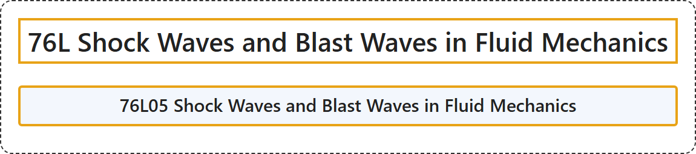

# 76L Shock Waves and Blast Waves in Fluid Mechanics

## Classification

## Glossary

| Term | Definition | 中文翻译 | Source |
|---|---|---|---|
| **76L Shock Waves and Blast Waves in Fluid Mechanics** 流体力学中的激波与爆炸波 | (No definition) | （无定义） | [Associate Editors of Mathematical Reviews and zbMATH, 2020](https://msc2020.org/) |
| **76L05 Shock Waves and Blast Waves in Fluid Mechanics** 流体力学中的激波与爆炸波 | (No definition) | （无定义） | [Associate Editors of Mathematical Reviews and zbMATH, 2020](https://msc2020.org/) |

## References

Associate Editors of Mathematical Reviews and zbMATH. (2020). *MSC2020: Mathematics Subject Classification system*. Retrieved October 27, 2026, from <https://msc2020.org/>
