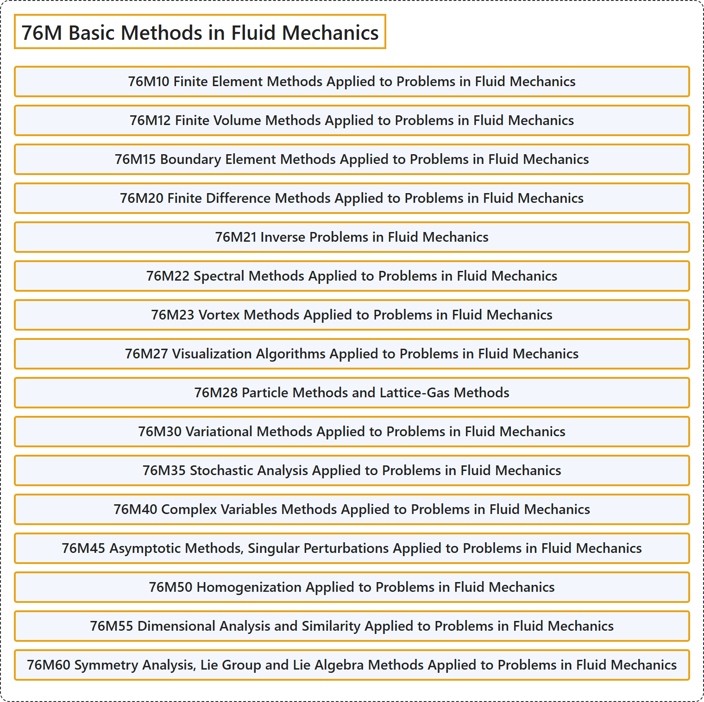

# 76M Basic Methods in Fluid Mechanics

## Classification

## Glossary

| Term | Definition | 中文翻译 | Source |
|---|---|---|---|
| **76M Basic Methods in Fluid Mechanics** 流体力学基本方法 | (No definition) | （无定义） | [Associate Editors of Mathematical Reviews and zbMATH, 2020](https://msc2020.org/) |
| **76M10 Finite Element Methods Applied to Problems in Fluid Mechanics** 应用于流体力学问题的有限元方法 | (No definition) | （无定义） | [Associate Editors of Mathematical Reviews and zbMATH, 2020](https://msc2020.org/) |
| **76M12 Finite Volume Methods Applied to Problems in Fluid Mechanics** 应用于流体力学问题的有限体积方法 | (No definition) | （无定义） | [Associate Editors of Mathematical Reviews and zbMATH, 2020](https://msc2020.org/) |
| **76M15 Boundary Element Methods Applied to Problems in Fluid Mechanics** 应用于流体力学问题的边界元方法 | (No definition) | （无定义） | [Associate Editors of Mathematical Reviews and zbMATH, 2020](https://msc2020.org/) |
| **76M20 Finite Difference Methods Applied to Problems in Fluid Mechanics** 应用于流体力学问题的有限差分方法 | (No definition) | （无定义） | [Associate Editors of Mathematical Reviews and zbMATH, 2020](https://msc2020.org/) |
| **76M21 Inverse Problems in Fluid Mechanics** 流体力学中的反问题 | (No definition) | （无定义） | [Associate Editors of Mathematical Reviews and zbMATH, 2020](https://msc2020.org/) |
| **76M22 Spectral Methods Applied to Problems in Fluid Mechanics** 应用于流体力学问题的谱方法 | (No definition) | （无定义） | [Associate Editors of Mathematical Reviews and zbMATH, 2020](https://msc2020.org/) |
| **76M23 Vortex Methods Applied to Problems in Fluid Mechanics** 应用于流体力学问题的涡方法 | (No definition) | （无定义） | [Associate Editors of Mathematical Reviews and zbMATH, 2020](https://msc2020.org/) |
| **76M27 Visualization Algorithms Applied to Problems in Fluid Mechanics** 应用于流体力学问题的可视化算法 | (No definition) | （无定义） | [Associate Editors of Mathematical Reviews and zbMATH, 2020](https://msc2020.org/) |
| **76M28 Particle Methods and Lattice-Gas Methods** 粒子方法与格子气方法 | (No definition) | （无定义） | [Associate Editors of Mathematical Reviews and zbMATH, 2020](https://msc2020.org/) |
| **76M30 Variational Methods Applied to Problems in Fluid Mechanics** 应用于流体力学问题的变分方法 | (No definition) | （无定义） | [Associate Editors of Mathematical Reviews and zbMATH, 2020](https://msc2020.org/) |
| **76M35 Stochastic Analysis Applied to Problems in Fluid Mechanics** 应用于流体力学问题的随机分析 | (No definition) | （无定义） | [Associate Editors of Mathematical Reviews and zbMATH, 2020](https://msc2020.org/) |
| **76M40 Complex Variables Methods Applied to Problems in Fluid Mechanics** 应用于流体力学问题的复变方法 | (No definition) | （无定义） | [Associate Editors of Mathematical Reviews and zbMATH, 2020](https://msc2020.org/) |
| **76M45 Asymptotic Methods, Singular Perturbations Applied to Problems in Fluid Mechanics** 应用于流体力学问题的渐近方法、奇异摄动 | (No definition) | （无定义） | [Associate Editors of Mathematical Reviews and zbMATH, 2020](https://msc2020.org/) |
| **76M50 Homogenization Applied to Problems in Fluid Mechanics** 应用于流体力学问题的均匀化 | (No definition) | （无定义） | [Associate Editors of Mathematical Reviews and zbMATH, 2020](https://msc2020.org/) |
| **76M55 Dimensional Analysis and Similarity Applied to Problems in Fluid Mechanics** 应用于流体力学问题的量纲分析与相似 | (No definition) | （无定义） | [Associate Editors of Mathematical Reviews and zbMATH, 2020](https://msc2020.org/) |
| **76M60 Symmetry Analysis, Lie Group and Lie Algebra Methods Applied to Problems in Fluid Mechanics** 应用于流体力学问题的对称性分析、李群与李代数方法 | (No definition) | （无定义） | [Associate Editors of Mathematical Reviews and zbMATH, 2020](https://msc2020.org/) |

## References

Associate Editors of Mathematical Reviews and zbMATH. (2020). *MSC2020: Mathematics Subject Classification system*. Retrieved October 27, 2026, from <https://msc2020.org/>
