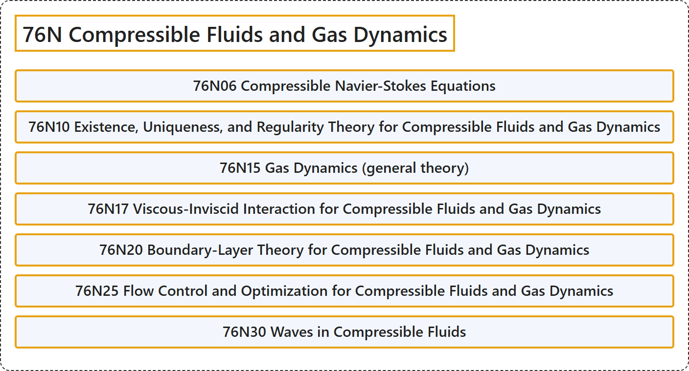

# 76N Compressible Fluids and Gas Dynamics

## Classification

## Glossary

| Term | Definition | 中文翻译 | Source |
|---|---|---|---|
| **76N Compressible Fluids and Gas Dynamics** 可压缩流体与气体动力学 | (No definition) | （无定义） | [Associate Editors of Mathematical Reviews and zbMATH, 2020](https://msc2020.org/) |
| **76N06 Compressible Navier-Stokes Equations** 可压缩纳维-斯托克斯方程 | (No definition) | （无定义） | [Associate Editors of Mathematical Reviews and zbMATH, 2020](https://msc2020.org/) |
| **76N10 Existence, Uniqueness, and Regularity Theory for Compressible Fluids and Gas Dynamics** 可压缩流体与气体动力学的存在性、唯一性与正则性理论 | (No definition) | （无定义） | [Associate Editors of Mathematical Reviews and zbMATH, 2020](https://msc2020.org/) |
| **76N15 Gas Dynamics (general theory)** 气体动力学（一般理论） | (No definition) | （无定义） | [Associate Editors of Mathematical Reviews and zbMATH, 2020](https://msc2020.org/) |
| **76N17 Viscous-Inviscid Interaction for Compressible Fluids and Gas Dynamics** 可压缩流体与气体动力学中的黏性-无黏相互作用 | (No definition) | （无定义） | [Associate Editors of Mathematical Reviews and zbMATH, 2020](https://msc2020.org/) |
| **76N20 Boundary-Layer Theory for Compressible Fluids and Gas Dynamics** 可压缩流体与气体动力学的边界层理论 | (No definition) | （无定义） | [Associate Editors of Mathematical Reviews and zbMATH, 2020](https://msc2020.org/) |
| **76N25 Flow Control and Optimization for Compressible Fluids and Gas Dynamics** 可压缩流体与气体动力学的流动控制与优化 | (No definition) | （无定义） | [Associate Editors of Mathematical Reviews and zbMATH, 2020](https://msc2020.org/) |
| **76N30 Waves in Compressible Fluids** 可压缩流体中的波 | (No definition) | （无定义） | [Associate Editors of Mathematical Reviews and zbMATH, 2020](https://msc2020.org/) |

## References

Associate Editors of Mathematical Reviews and zbMATH. (2020). *MSC2020: Mathematics Subject Classification system*. Retrieved October 27, 2026, from <https://msc2020.org/>
