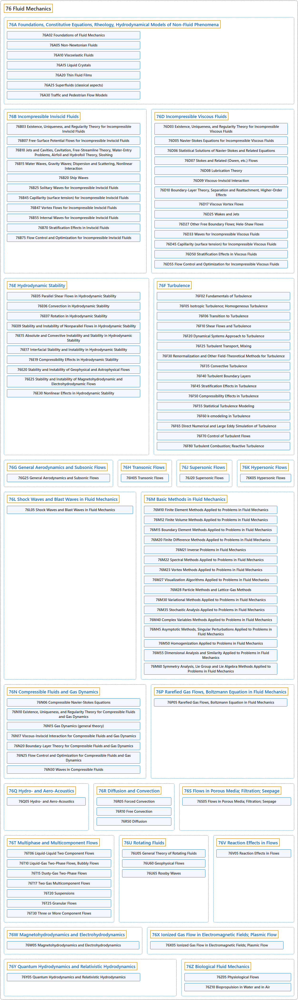

# 76 Fluid Mechanics

## Classification

## Glossary

| Term | Definition | 中文翻译 | Source |
|---|---|---|---|
| **76 Fluid Mechanics** 流体力学 | "Fluid mechanics is the study of **the flow of fluids**, and is sometimes known as hydrodynamics." | 流体力学研究**流体的流动**，有时也称为水动力学。 | [Weisstein, n.d., "Fluid mechanics" entry, para. 1](https://scienceworld.wolfram.com/physics/FluidMechanics.html#:~:text=Fluid%20mechanics%20is%20the%20study%20of%20the%20flow%20of) |
| **[76A Foundations, Constitutive Equations, Rheology, Hydrodynamical Models of Non-Fluid Phenomena](76a-foundations-constitutive-equations-rheology-hydrodynamical-m.md)** 基础、本构方程、流变学、非流体现象的流体动力学模型 | (No definition) | （无定义） | [Associate Editors of Mathematical Reviews and zbMATH, 2020](https://msc2020.org/) |
| **[76B Incompressible Inviscid Fluids](76b-incompressible-inviscid-fluids.md)** 不可压缩无粘流体 | (No definition) | （无定义） | [Associate Editors of Mathematical Reviews and zbMATH, 2020](https://msc2020.org/) |
| **[76D Incompressible Viscous Fluids](76d-incompressible-viscous-fluids.md)** 不可压缩粘性流体 | (No definition) | （无定义） | [Associate Editors of Mathematical Reviews and zbMATH, 2020](https://msc2020.org/) |
| **[76E Hydrodynamic Stability](76e-hydrodynamic-stability.md)** 流体动力稳定性 | (No definition) | （无定义） | [Associate Editors of Mathematical Reviews and zbMATH, 2020](https://msc2020.org/) |
| **[76F Turbulence](76f-turbulence.md)** 湍流 | (No definition) | （无定义） | [Associate Editors of Mathematical Reviews and zbMATH, 2020](https://msc2020.org/) |
| **[76G General Aerodynamics and Subsonic Flows](76g-general-aerodynamics-and-subsonic-flows.md)** 一般空气动力学与亚声速流 | (No definition) | （无定义） | [Associate Editors of Mathematical Reviews and zbMATH, 2020](https://msc2020.org/) |
| **[76H Transonic Flows](76h-transonic-flows.md)** 跨声速流 | (No definition) | （无定义） | [Associate Editors of Mathematical Reviews and zbMATH, 2020](https://msc2020.org/) |
| **[76J Supersonic Flows](76j-supersonic-flows.md)** 超声速流 | (No definition) | （无定义） | [Associate Editors of Mathematical Reviews and zbMATH, 2020](https://msc2020.org/) |
| **[76K Hypersonic Flows](76k-hypersonic-flows.md)** 高超声速流 | (No definition) | （无定义） | [Associate Editors of Mathematical Reviews and zbMATH, 2020](https://msc2020.org/) |
| **[76L Shock Waves and Blast Waves in Fluid Mechanics](76l-shock-waves-and-blast-waves-in-fluid-mechanics.md)** 流体力学中的激波与爆炸波 | (No definition) | （无定义） | [Associate Editors of Mathematical Reviews and zbMATH, 2020](https://msc2020.org/) |
| **[76M Basic Methods in Fluid Mechanics](76m-basic-methods-in-fluid-mechanics.md)** 流体力学基本方法 | (No definition) | （无定义） | [Associate Editors of Mathematical Reviews and zbMATH, 2020](https://msc2020.org/) |
| **[76N Compressible Fluids and Gas Dynamics](76n-compressible-fluids-and-gas-dynamics.md)** 可压缩流体与气体动力学 | (No definition) | （无定义） | [Associate Editors of Mathematical Reviews and zbMATH, 2020](https://msc2020.org/) |
| **[76P Rarefied Gas Flows, Boltzmann Equation in Fluid Mechanics](76p-rarefied-gas-flows-boltzmann-equation-in-fluid-mechanics.md)** 稀薄气体流动、流体力学中的玻尔兹曼方程 | (No definition) | （无定义） | [Associate Editors of Mathematical Reviews and zbMATH, 2020](https://msc2020.org/) |
| **[76Q Hydro- and Aero-Acoustics](76q-hydro-and-aero-acoustics.md)** 水声学与空气声学 | (No definition) | （无定义） | [Associate Editors of Mathematical Reviews and zbMATH, 2020](https://msc2020.org/) |
| **[76R Diffusion and Convection](76r-diffusion-and-convection.md)** 扩散与对流 | (No definition) | （无定义） | [Associate Editors of Mathematical Reviews and zbMATH, 2020](https://msc2020.org/) |
| **[76S Flows in Porous Media; Filtration; Seepage](76s-flows-in-porous-media-filtration-seepage.md)** 多孔介质中的流动；过滤；渗流 | (No definition) | （无定义） | [Associate Editors of Mathematical Reviews and zbMATH, 2020](https://msc2020.org/) |
| **[76T Multiphase and Multicomponent Flows](76t-multiphase-and-multicomponent-flows.md)** 多相与多组分流 | (No definition) | （无定义） | [Associate Editors of Mathematical Reviews and zbMATH, 2020](https://msc2020.org/) |
| **[76U Rotating Fluids](76u-rotating-fluids.md)** 旋转流体 | (No definition) | （无定义） | [Associate Editors of Mathematical Reviews and zbMATH, 2020](https://msc2020.org/) |
| **[76V Reaction Effects in Flows](76v-reaction-effects-in-flows.md)** 流动中的反应效应 | (No definition) | （无定义） | [Associate Editors of Mathematical Reviews and zbMATH, 2020](https://msc2020.org/) |
| **[76W Magnetohydrodynamics and Electrohydrodynamics](76w-magnetohydrodynamics-and-electrohydrodynamics.md)** 磁流体力学与电流体力学 | (No definition) | （无定义） | [Associate Editors of Mathematical Reviews and zbMATH, 2020](https://msc2020.org/) |
| **[76X Ionized Gas Flow in Electromagnetic Fields; Plasmic Flow](76x-ionized-gas-flow-in-electromagnetic-fields-plasmic-flow.md)** 电磁场中的电离气体流动；等离子体流 | (No definition) | （无定义） | [Associate Editors of Mathematical Reviews and zbMATH, 2020](https://msc2020.org/) |
| **[76Y Quantum Hydrodynamics and Relativistic Hydrodynamics](76y-quantum-hydrodynamics-and-relativistic-hydrodynamics.md)** 量子流体力学与相对论流体力学 | (No definition) | （无定义） | [Associate Editors of Mathematical Reviews and zbMATH, 2020](https://msc2020.org/) |
| **[76Z Biological Fluid Mechanics](76z-biological-fluid-mechanics.md)** 生物流体力学 | (No definition) | （无定义） | [Associate Editors of Mathematical Reviews and zbMATH, 2020](https://msc2020.org/) |

## References

Associate Editors of Mathematical Reviews and zbMATH. (2020). *MSC2020: Mathematics Subject Classification system*. Retrieved October 27, 2026, from <https://msc2020.org/>

Weisstein, E. W. (n.d.). *Fluid mechanics*. Eric Weisstein's World of Physics. Retrieved October 27, 2026, from <https://scienceworld.wolfram.com/physics/FluidMechanics.html>
