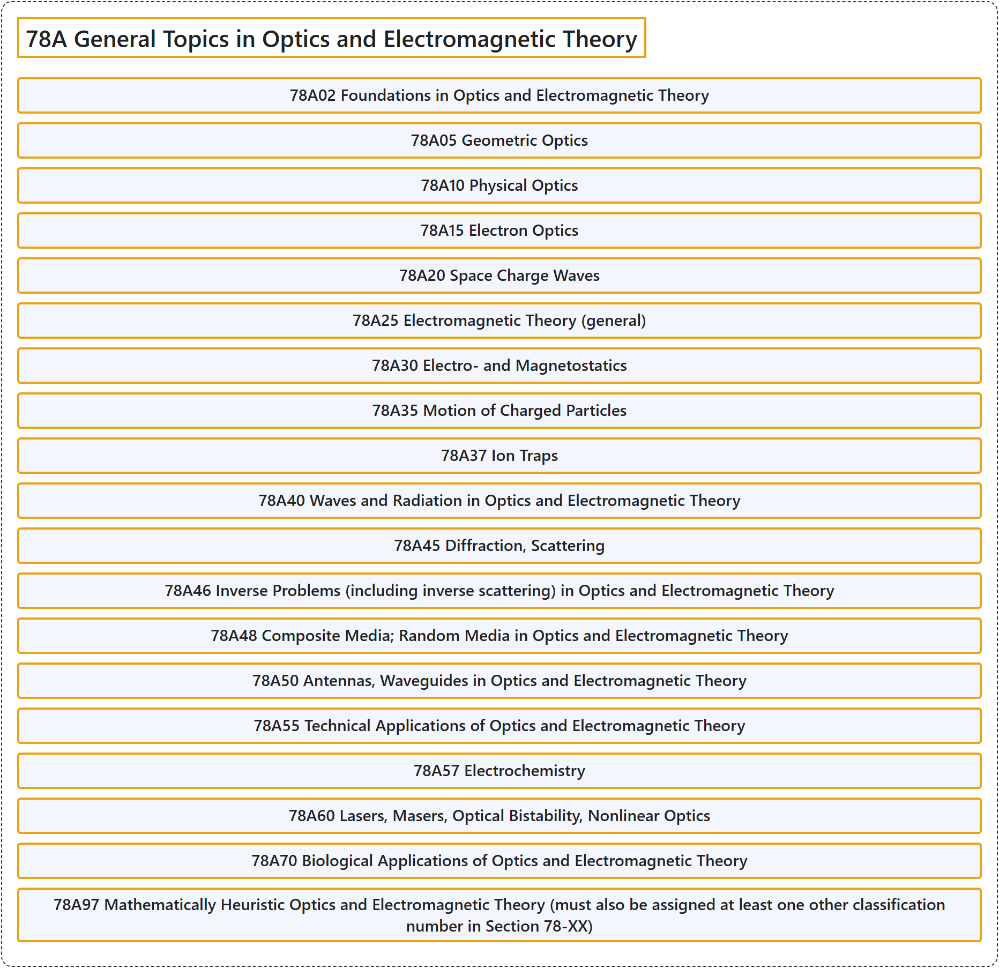

# 78A General Topics in Optics and Electromagnetic Theory

## Classification

## Glossary

| Term | Definition | 中文翻译 | Source |
|---|---|---|---|
| **78A General Topics in Optics and Electromagnetic Theory** 光学与电磁理论的一般专题 | (No definition) | （无定义） | [Associate Editors of Mathematical Reviews and zbMATH, 2020](https://msc2020.org/) |
| **78A02 Foundations in Optics and Electromagnetic Theory** 光学与电磁理论的基础 | (No definition) | （无定义） | [Associate Editors of Mathematical Reviews and zbMATH, 2020](https://msc2020.org/) |
| **78A05 Geometric Optics** 几何光学 | (No definition) | （无定义） | [Associate Editors of Mathematical Reviews and zbMATH, 2020](https://msc2020.org/) |
| **78A10 Physical Optics** 物理光学 | (No definition) | （无定义） | [Associate Editors of Mathematical Reviews and zbMATH, 2020](https://msc2020.org/) |
| **78A15 Electron Optics** 电子光学 | (No definition) | （无定义） | [Associate Editors of Mathematical Reviews and zbMATH, 2020](https://msc2020.org/) |
| **78A20 Space Charge Waves** 空间电荷波 | (No definition) | （无定义） | [Associate Editors of Mathematical Reviews and zbMATH, 2020](https://msc2020.org/) |
| **78A25 Electromagnetic Theory (general)** 电磁理论（一般） | (No definition) | （无定义） | [Associate Editors of Mathematical Reviews and zbMATH, 2020](https://msc2020.org/) |
| **78A30 Electro- and Magnetostatics** 静电学与静磁学 | (No definition) | （无定义） | [Associate Editors of Mathematical Reviews and zbMATH, 2020](https://msc2020.org/) |
| **78A35 Motion of Charged Particles** 带电粒子的运动 | (No definition) | （无定义） | [Associate Editors of Mathematical Reviews and zbMATH, 2020](https://msc2020.org/) |
| **78A37 Ion Traps** 离子阱 | (No definition) | （无定义） | [Associate Editors of Mathematical Reviews and zbMATH, 2020](https://msc2020.org/) |
| **78A40 Waves and Radiation in Optics and Electromagnetic Theory** 光学与电磁理论中的波与辐射 | (No definition) | （无定义） | [Associate Editors of Mathematical Reviews and zbMATH, 2020](https://msc2020.org/) |
| **78A45 Diffraction, Scattering** 衍射、散射 | (No definition) | （无定义） | [Associate Editors of Mathematical Reviews and zbMATH, 2020](https://msc2020.org/) |
| **78A46 Inverse Problems (including inverse scattering) in Optics and Electromagnetic Theory** 光学与电磁理论中的反问题（包括反散射） | (No definition) | （无定义） | [Associate Editors of Mathematical Reviews and zbMATH, 2020](https://msc2020.org/) |
| **78A48 Composite Media; Random Media in Optics and Electromagnetic Theory** 光学与电磁理论中的复合介质；随机介质 | (No definition) | （无定义） | [Associate Editors of Mathematical Reviews and zbMATH, 2020](https://msc2020.org/) |
| **78A50 Antennas, Waveguides in Optics and Electromagnetic Theory** 光学与电磁理论中的天线、波导 | (No definition) | （无定义） | [Associate Editors of Mathematical Reviews and zbMATH, 2020](https://msc2020.org/) |
| **78A55 Technical Applications of Optics and Electromagnetic Theory** 光学与电磁理论的技术应用 | (No definition) | （无定义） | [Associate Editors of Mathematical Reviews and zbMATH, 2020](https://msc2020.org/) |
| **78A57 Electrochemistry** 电化学 | (No definition) | （无定义） | [Associate Editors of Mathematical Reviews and zbMATH, 2020](https://msc2020.org/) |
| **78A60 Lasers, Masers, Optical Bistability, Nonlinear Optics** 激光、微波激射器、光学双稳性、非线性光学 | (No definition) | （无定义） | [Associate Editors of Mathematical Reviews and zbMATH, 2020](https://msc2020.org/) |
| **78A70 Biological Applications of Optics and Electromagnetic Theory** 光学与电磁理论的生物学应用 | (No definition) | （无定义） | [Associate Editors of Mathematical Reviews and zbMATH, 2020](https://msc2020.org/) |
| **78A97 Mathematically Heuristic Optics and Electromagnetic Theory (must also be assigned at least one other classification number in Section 78-XX)** 数学启发式光学与电磁理论（必须同时指派 78-XX 部分中至少一个其他分类号） | (No definition) | （无定义） | [Associate Editors of Mathematical Reviews and zbMATH, 2020](https://msc2020.org/) |

## References

Associate Editors of Mathematical Reviews and zbMATH. (2020). *MSC2020: Mathematics Subject Classification system*. Retrieved October 27, 2026, from <https://msc2020.org/>
