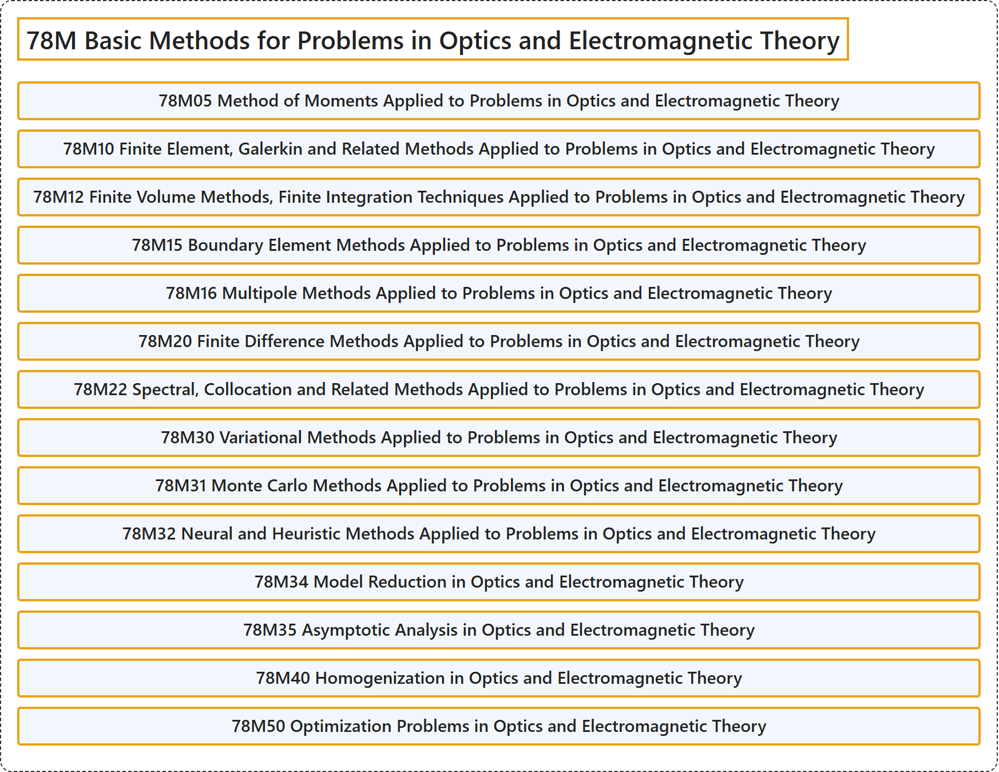

# 78M Basic Methods for Problems in Optics and Electromagnetic Theory

## Classification

## Glossary

| Term | Definition | 中文翻译 | Source |
|---|---|---|---|
| **78M Basic Methods for Problems in Optics and Electromagnetic Theory** 光学与电磁理论问题的基本方法 | (No definition) | （无定义） | [Associate Editors of Mathematical Reviews and zbMATH, 2020](https://msc2020.org/) |
| **78M05 Method of Moments Applied to Problems in Optics and Electromagnetic Theory** 应用于光学与电磁理论问题的矩量法 | (No definition) | （无定义） | [Associate Editors of Mathematical Reviews and zbMATH, 2020](https://msc2020.org/) |
| **78M10 Finite Element, Galerkin and Related Methods Applied to Problems in Optics and Electromagnetic Theory** 应用于光学与电磁理论问题的有限元、伽辽金及相关方法 | (No definition) | （无定义） | [Associate Editors of Mathematical Reviews and zbMATH, 2020](https://msc2020.org/) |
| **78M12 Finite Volume Methods, Finite Integration Techniques Applied to Problems in Optics and Electromagnetic Theory** 应用于光学与电磁理论问题的有限体积方法、有限积分技术 | (No definition) | （无定义） | [Associate Editors of Mathematical Reviews and zbMATH, 2020](https://msc2020.org/) |
| **78M15 Boundary Element Methods Applied to Problems in Optics and Electromagnetic Theory** 应用于光学与电磁理论问题的边界元方法 | (No definition) | （无定义） | [Associate Editors of Mathematical Reviews and zbMATH, 2020](https://msc2020.org/) |
| **78M16 Multipole Methods Applied to Problems in Optics and Electromagnetic Theory** 应用于光学与电磁理论问题的多极方法 | (No definition) | （无定义） | [Associate Editors of Mathematical Reviews and zbMATH, 2020](https://msc2020.org/) |
| **78M20 Finite Difference Methods Applied to Problems in Optics and Electromagnetic Theory** 应用于光学与电磁理论问题的有限差分方法 | (No definition) | （无定义） | [Associate Editors of Mathematical Reviews and zbMATH, 2020](https://msc2020.org/) |
| **78M22 Spectral, Collocation and Related Methods Applied to Problems in Optics and Electromagnetic Theory** 应用于光学与电磁理论问题的谱方法、配置法及相关方法 | (No definition) | （无定义） | [Associate Editors of Mathematical Reviews and zbMATH, 2020](https://msc2020.org/) |
| **78M30 Variational Methods Applied to Problems in Optics and Electromagnetic Theory** 应用于光学与电磁理论问题的变分方法 | (No definition) | （无定义） | [Associate Editors of Mathematical Reviews and zbMATH, 2020](https://msc2020.org/) |
| **78M31 Monte Carlo Methods Applied to Problems in Optics and Electromagnetic Theory** 应用于光学与电磁理论问题的蒙特卡罗方法 | (No definition) | （无定义） | [Associate Editors of Mathematical Reviews and zbMATH, 2020](https://msc2020.org/) |
| **78M32 Neural and Heuristic Methods Applied to Problems in Optics and Electromagnetic Theory** 应用于光学与电磁理论问题的神经方法与启发式方法 | (No definition) | （无定义） | [Associate Editors of Mathematical Reviews and zbMATH, 2020](https://msc2020.org/) |
| **78M34 Model Reduction in Optics and Electromagnetic Theory** 光学与电磁理论中的模型降阶 | (No definition) | （无定义） | [Associate Editors of Mathematical Reviews and zbMATH, 2020](https://msc2020.org/) |
| **78M35 Asymptotic Analysis in Optics and Electromagnetic Theory** 光学与电磁理论中的渐近分析 | (No definition) | （无定义） | [Associate Editors of Mathematical Reviews and zbMATH, 2020](https://msc2020.org/) |
| **78M40 Homogenization in Optics and Electromagnetic Theory** 光学与电磁理论中的均匀化 | (No definition) | （无定义） | [Associate Editors of Mathematical Reviews and zbMATH, 2020](https://msc2020.org/) |
| **78M50 Optimization Problems in Optics and Electromagnetic Theory** 光学与电磁理论中的优化问题 | (No definition) | （无定义） | [Associate Editors of Mathematical Reviews and zbMATH, 2020](https://msc2020.org/) |

## References

Associate Editors of Mathematical Reviews and zbMATH. (2020). *MSC2020: Mathematics Subject Classification system*. Retrieved October 27, 2026, from <https://msc2020.org/>
