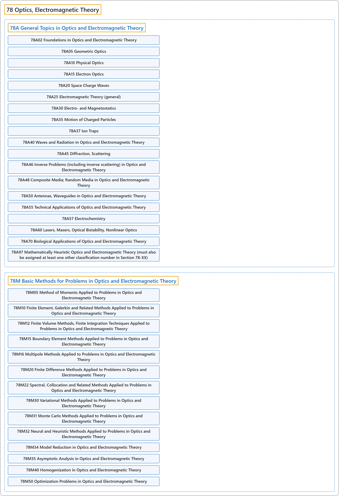

# 78 Optics, Electromagnetic Theory

## Classification

## Glossary

| Term | Definition | 中文翻译 | Source |
|---|---|---|---|
| **78 Optics, Electromagnetic Theory** 光学、电磁理论 | "Optics is the study of **the propagation of electromagnetic radiation** (most commonly, visible light)." | 光学研究**电磁辐射的传播**（最常见的是可见光）。 | [Weisstein, n.d., "Optics" entry, para. 1](https://scienceworld.wolfram.com/physics/Optics.html#:~:text=Optics%20is%20the%20study%20of%20the%20propagation%20of%20electromagnetic%20radiation) |
| **[78A General Topics in Optics and Electromagnetic Theory](78a-general-topics-in-optics-and-electromagnetic-theory.md)** 光学与电磁理论的一般专题 | (No definition) | （无定义） | [Associate Editors of Mathematical Reviews and zbMATH, 2020](https://msc2020.org/) |
| **[78M Basic Methods for Problems in Optics and Electromagnetic Theory](78m-basic-methods-for-problems-in-optics-and-electromagnetic-the.md)** 光学与电磁理论问题的基本方法 | (No definition) | （无定义） | [Associate Editors of Mathematical Reviews and zbMATH, 2020](https://msc2020.org/) |

## References

Associate Editors of Mathematical Reviews and zbMATH. (2020). *MSC2020: Mathematics Subject Classification system*. Retrieved October 27, 2026, from <https://msc2020.org/>

Weisstein, E. W. (n.d.). *Optics*. Eric Weisstein's World of Physics. Retrieved October 27, 2026, from <https://scienceworld.wolfram.com/physics/Optics.html>
