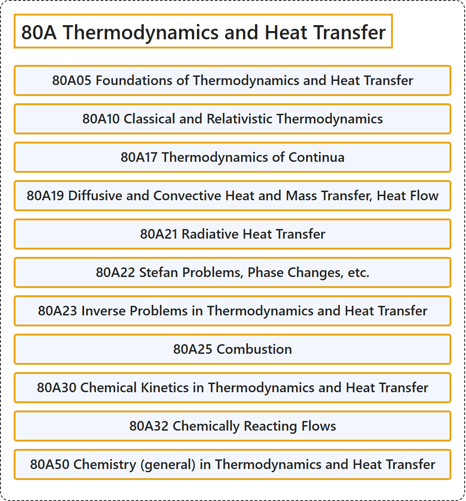

# 80A Thermodynamics and Heat Transfer

## Classification

## Glossary

| Term | Definition | 中文翻译 | Source |
|---|---|---|---|
| **80A Thermodynamics and Heat Transfer** 热力学与传热 | (No definition) | （无定义） | [Associate Editors of Mathematical Reviews and zbMATH, 2020](https://msc2020.org/) |
| **80A05 Foundations of Thermodynamics and Heat Transfer** 热力学与传热学基础 | (No definition) | （无定义） | [Associate Editors of Mathematical Reviews and zbMATH, 2020](https://msc2020.org/) |
| **80A10 Classical and Relativistic Thermodynamics** 经典热力学与相对论热力学 | (No definition) | （无定义） | [Associate Editors of Mathematical Reviews and zbMATH, 2020](https://msc2020.org/) |
| **80A17 Thermodynamics of Continua** 连续介质热力学 | (No definition) | （无定义） | [Associate Editors of Mathematical Reviews and zbMATH, 2020](https://msc2020.org/) |
| **80A19 Diffusive and Convective Heat and Mass Transfer, Heat Flow** 扩散与对流传热传质、热流 | (No definition) | （无定义） | [Associate Editors of Mathematical Reviews and zbMATH, 2020](https://msc2020.org/) |
| **80A21 Radiative Heat Transfer** 辐射传热 | (No definition) | （无定义） | [Associate Editors of Mathematical Reviews and zbMATH, 2020](https://msc2020.org/) |
| **80A22 Stefan Problems, Phase Changes, etc.** 斯特藩问题、相变等 | (No definition) | （无定义） | [Associate Editors of Mathematical Reviews and zbMATH, 2020](https://msc2020.org/) |
| **80A23 Inverse Problems in Thermodynamics and Heat Transfer** 热力学与传热学中的反问题 | (No definition) | （无定义） | [Associate Editors of Mathematical Reviews and zbMATH, 2020](https://msc2020.org/) |
| **80A25 Combustion** 燃烧 | (No definition) | （无定义） | [Associate Editors of Mathematical Reviews and zbMATH, 2020](https://msc2020.org/) |
| **80A30 Chemical Kinetics in Thermodynamics and Heat Transfer** 热力学与传热学中的化学动力学 | (No definition) | （无定义） | [Associate Editors of Mathematical Reviews and zbMATH, 2020](https://msc2020.org/) |
| **80A32 Chemically Reacting Flows** 化学反应流动 | (No definition) | （无定义） | [Associate Editors of Mathematical Reviews and zbMATH, 2020](https://msc2020.org/) |
| **80A50 Chemistry (general) in Thermodynamics and Heat Transfer** 热力学与传热学中的化学（一般） | (No definition) | （无定义） | [Associate Editors of Mathematical Reviews and zbMATH, 2020](https://msc2020.org/) |

## References

Associate Editors of Mathematical Reviews and zbMATH. (2020). *MSC2020: Mathematics Subject Classification system*. Retrieved October 27, 2026, from <https://msc2020.org/>
