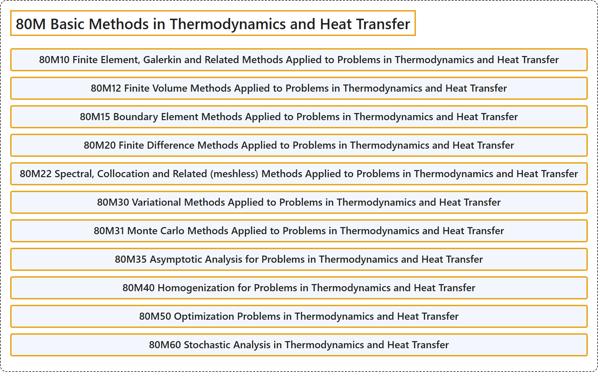

# 80M Basic Methods in Thermodynamics and Heat Transfer

## Classification

## Glossary

| Term | Definition | 中文翻译 | Source |
|---|---|---|---|
| **80M Basic Methods in Thermodynamics and Heat Transfer** 热力学与传热的基本方法 | (No definition) | （无定义） | [Associate Editors of Mathematical Reviews and zbMATH, 2020](https://msc2020.org/) |
| **80M10 Finite Element, Galerkin and Related Methods Applied to Problems in Thermodynamics and Heat Transfer** 应用于热力学与传热学问题的有限元、伽辽金及相关方法 | (No definition) | （无定义） | [Associate Editors of Mathematical Reviews and zbMATH, 2020](https://msc2020.org/) |
| **80M12 Finite Volume Methods Applied to Problems in Thermodynamics and Heat Transfer** 应用于热力学与传热学问题的有限体积方法 | (No definition) | （无定义） | [Associate Editors of Mathematical Reviews and zbMATH, 2020](https://msc2020.org/) |
| **80M15 Boundary Element Methods Applied to Problems in Thermodynamics and Heat Transfer** 应用于热力学与传热学问题的边界元方法 | (No definition) | （无定义） | [Associate Editors of Mathematical Reviews and zbMATH, 2020](https://msc2020.org/) |
| **80M20 Finite Difference Methods Applied to Problems in Thermodynamics and Heat Transfer** 应用于热力学与传热学问题的有限差分方法 | (No definition) | （无定义） | [Associate Editors of Mathematical Reviews and zbMATH, 2020](https://msc2020.org/) |
| **80M22 Spectral, Collocation and Related (meshless) Methods Applied to Problems in Thermodynamics and Heat Transfer** 应用于热力学与传热学问题的谱方法、配置法及相关（无网格）方法 | (No definition) | （无定义） | [Associate Editors of Mathematical Reviews and zbMATH, 2020](https://msc2020.org/) |
| **80M30 Variational Methods Applied to Problems in Thermodynamics and Heat Transfer** 应用于热力学与传热学问题的变分方法 | (No definition) | （无定义） | [Associate Editors of Mathematical Reviews and zbMATH, 2020](https://msc2020.org/) |
| **80M31 Monte Carlo Methods Applied to Problems in Thermodynamics and Heat Transfer** 应用于热力学与传热学问题的蒙特卡罗方法 | (No definition) | （无定义） | [Associate Editors of Mathematical Reviews and zbMATH, 2020](https://msc2020.org/) |
| **80M35 Asymptotic Analysis for Problems in Thermodynamics and Heat Transfer** 热力学与传热学问题的渐近分析 | (No definition) | （无定义） | [Associate Editors of Mathematical Reviews and zbMATH, 2020](https://msc2020.org/) |
| **80M40 Homogenization for Problems in Thermodynamics and Heat Transfer** 热力学与传热学问题的均匀化 | (No definition) | （无定义） | [Associate Editors of Mathematical Reviews and zbMATH, 2020](https://msc2020.org/) |
| **80M50 Optimization Problems in Thermodynamics and Heat Transfer** 热力学与传热学中的优化问题 | (No definition) | （无定义） | [Associate Editors of Mathematical Reviews and zbMATH, 2020](https://msc2020.org/) |
| **80M60 Stochastic Analysis in Thermodynamics and Heat Transfer** 热力学与传热学中的随机分析 | (No definition) | （无定义） | [Associate Editors of Mathematical Reviews and zbMATH, 2020](https://msc2020.org/) |

## References

Associate Editors of Mathematical Reviews and zbMATH. (2020). *MSC2020: Mathematics Subject Classification system*. Retrieved October 27, 2026, from <https://msc2020.org/>
