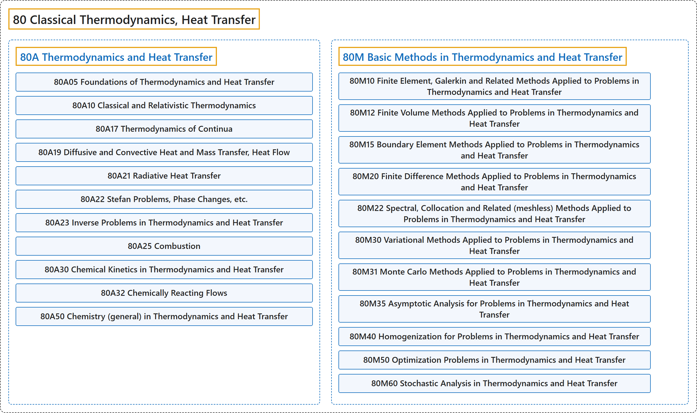

# 80 Classical Thermodynamics, Heat Transfer

## Classification

## Glossary

| Term | Definition | 中文翻译 | Source |
|---|---|---|---|
| **80 Classical Thermodynamics, Heat Transfer** 经典热力学、热传递 | (context) "The heat conduction equation is a **partial differential diffusion equation** ..." | （语境）热传导方程是一种**偏微分扩散方程**…… | [Weisstein, n.d., "Heat conduction equation" entry, para. 1](https://mathworld.wolfram.com/HeatConductionEquation.html#:~:text=The%20heat%20conduction%20equation%20is%20a%20partial%20differential%20diffusion%20equation) |
| **[80A Thermodynamics and Heat Transfer](80a-thermodynamics-and-heat-transfer.md)** 热力学与传热 | (No definition) | （无定义） | [Associate Editors of Mathematical Reviews and zbMATH, 2020](https://msc2020.org/) |
| **[80M Basic Methods in Thermodynamics and Heat Transfer](80m-basic-methods-in-thermodynamics-and-heat-transfer.md)** 热力学与传热的基本方法 | (No definition) | （无定义） | [Associate Editors of Mathematical Reviews and zbMATH, 2020](https://msc2020.org/) |

## References

Associate Editors of Mathematical Reviews and zbMATH. (2020). *MSC2020: Mathematics Subject Classification system*. Retrieved October 27, 2026, from <https://msc2020.org/>

Weisstein, E. W. (n.d.). *Heat conduction equation*. MathWorld: A Wolfram Resource. Retrieved October 27, 2026, from <https://mathworld.wolfram.com/HeatConductionEquation.html>
