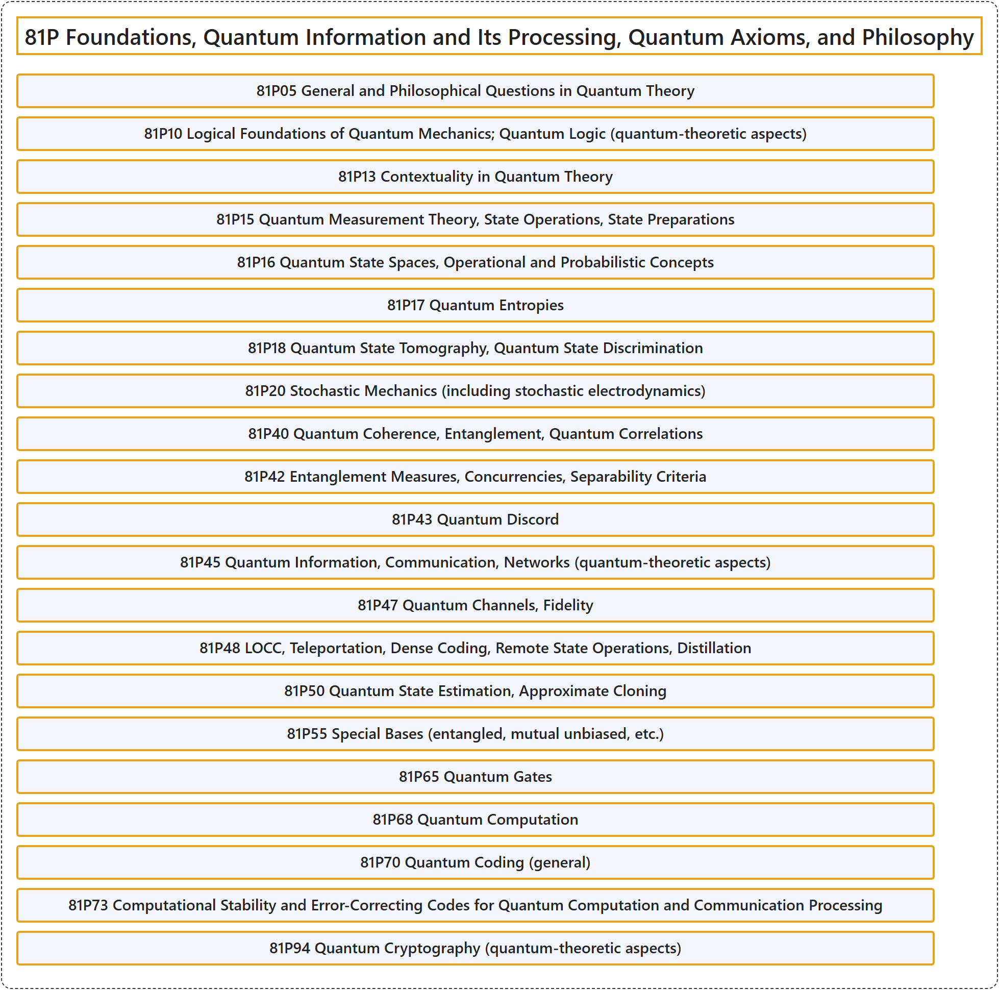

# 81P Foundations, Quantum Information and Its Processing, Quantum Axioms, and Philosophy

## Classification

## Glossary

| Term | Definition | 中文翻译 | Source |
|---|---|---|---|
| **81P Foundations, Quantum Information and Its Processing, Quantum Axioms, and Philosophy** 基础、量子信息及其处理、量子公理与哲学 | (No definition) | （无定义） | [Associate Editors of Mathematical Reviews and zbMATH, 2020](https://msc2020.org/) |
| **81P05 General and Philosophical Questions in Quantum Theory** 量子理论中的一般问题与哲学问题 | (No definition) | （无定义） | [Associate Editors of Mathematical Reviews and zbMATH, 2020](https://msc2020.org/) |
| **81P10 Logical Foundations of Quantum Mechanics; Quantum Logic (quantum-theoretic aspects)** 量子力学的逻辑基础；量子逻辑（量子理论方面） | (No definition) | （无定义） | [Associate Editors of Mathematical Reviews and zbMATH, 2020](https://msc2020.org/) |
| **81P13 Contextuality in Quantum Theory** 量子理论中的语境性 | (No definition) | （无定义） | [Associate Editors of Mathematical Reviews and zbMATH, 2020](https://msc2020.org/) |
| **81P15 Quantum Measurement Theory, State Operations, State Preparations** 量子测量理论、态操作、态制备 | (No definition) | （无定义） | [Associate Editors of Mathematical Reviews and zbMATH, 2020](https://msc2020.org/) |
| **81P16 Quantum State Spaces, Operational and Probabilistic Concepts** 量子态空间、操作概念与概率概念 | (No definition) | （无定义） | [Associate Editors of Mathematical Reviews and zbMATH, 2020](https://msc2020.org/) |
| **81P17 Quantum Entropies** 量子熵 | (No definition) | （无定义） | [Associate Editors of Mathematical Reviews and zbMATH, 2020](https://msc2020.org/) |
| **81P18 Quantum State Tomography, Quantum State Discrimination** 量子态层析、量子态判别 | (No definition) | （无定义） | [Associate Editors of Mathematical Reviews and zbMATH, 2020](https://msc2020.org/) |
| **81P20 Stochastic Mechanics (including stochastic electrodynamics)** 随机力学（包括随机电动力学） | (No definition) | （无定义） | [Associate Editors of Mathematical Reviews and zbMATH, 2020](https://msc2020.org/) |
| **81P40 Quantum Coherence, Entanglement, Quantum Correlations** 量子相干、纠缠、量子关联 | (No definition) | （无定义） | [Associate Editors of Mathematical Reviews and zbMATH, 2020](https://msc2020.org/) |
| **81P42 Entanglement Measures, Concurrencies, Separability Criteria** 纠缠度量、并发度、可分性判据 | (No definition) | （无定义） | [Associate Editors of Mathematical Reviews and zbMATH, 2020](https://msc2020.org/) |
| **81P43 Quantum Discord** 量子失协 | (No definition) | （无定义） | [Associate Editors of Mathematical Reviews and zbMATH, 2020](https://msc2020.org/) |
| **81P45 Quantum Information, Communication, Networks (quantum-theoretic aspects)** 量子信息、通信、网络（量子理论方面） | (No definition) | （无定义） | [Associate Editors of Mathematical Reviews and zbMATH, 2020](https://msc2020.org/) |
| **81P47 Quantum Channels, Fidelity** 量子信道、保真度 | (No definition) | （无定义） | [Associate Editors of Mathematical Reviews and zbMATH, 2020](https://msc2020.org/) |
| **81P48 LOCC, Teleportation, Dense Coding, Remote State Operations, Distillation** LOCC、隐形传态、密集编码、远程态操作、纯化 | (No definition) | （无定义） | [Associate Editors of Mathematical Reviews and zbMATH, 2020](https://msc2020.org/) |
| **81P50 Quantum State Estimation, Approximate Cloning** 量子态估计、近似克隆 | (No definition) | （无定义） | [Associate Editors of Mathematical Reviews and zbMATH, 2020](https://msc2020.org/) |
| **81P55 Special Bases (entangled, mutual unbiased, etc.)** 特殊基（纠缠基、互无偏基等） | (No definition) | （无定义） | [Associate Editors of Mathematical Reviews and zbMATH, 2020](https://msc2020.org/) |
| **81P65 Quantum Gates** 量子门 | (No definition) | （无定义） | [Associate Editors of Mathematical Reviews and zbMATH, 2020](https://msc2020.org/) |
| **81P68 Quantum Computation** 量子计算 | (No definition) | （无定义） | [Associate Editors of Mathematical Reviews and zbMATH, 2020](https://msc2020.org/) |
| **81P70 Quantum Coding (general)** 量子编码（一般） | (No definition) | （无定义） | [Associate Editors of Mathematical Reviews and zbMATH, 2020](https://msc2020.org/) |
| **81P73 Computational Stability and Error-Correcting Codes for Quantum Computation and Communication Processing** 量子计算与通信处理的计算稳定性与纠错码 | (No definition) | （无定义） | [Associate Editors of Mathematical Reviews and zbMATH, 2020](https://msc2020.org/) |
| **81P94 Quantum Cryptography (quantum-theoretic aspects)** 量子密码学（量子理论方面） | (No definition) | （无定义） | [Associate Editors of Mathematical Reviews and zbMATH, 2020](https://msc2020.org/) |

## References

Associate Editors of Mathematical Reviews and zbMATH. (2020). *MSC2020: Mathematics Subject Classification system*. Retrieved October 27, 2026, from <https://msc2020.org/>
