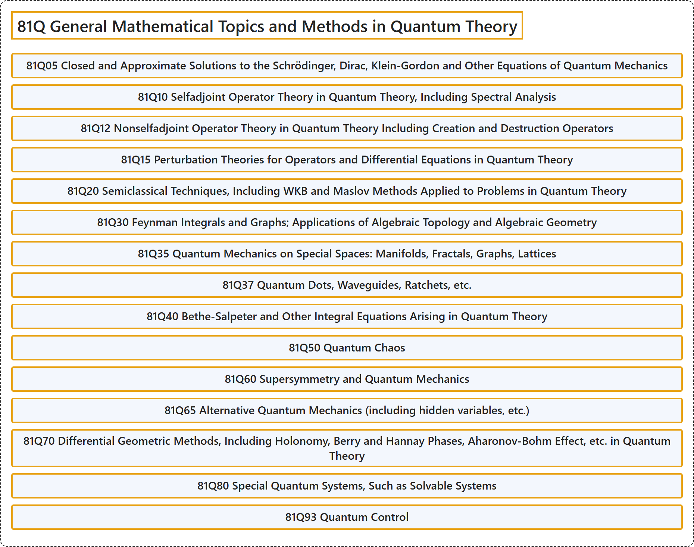

# 81Q General Mathematical Topics and Methods in Quantum Theory

## Classification

## Glossary

| Term | Definition | 中文翻译 | Source |
|---|---|---|---|
| **81Q General Mathematical Topics and Methods in Quantum Theory** 量子理论中的一般数学专题与方法 | (No definition) | （无定义） | [Associate Editors of Mathematical Reviews and zbMATH, 2020](https://msc2020.org/) |
| **81Q05 Closed and Approximate Solutions to the Schrödinger, Dirac, Klein-Gordon and Other Equations of Quantum Mechanics** 薛定谔方程、狄拉克方程、克莱因-戈尔登方程及量子力学其他方程的封闭解与近似解 | (No definition) | （无定义） | [Associate Editors of Mathematical Reviews and zbMATH, 2020](https://msc2020.org/) |
| **81Q10 Selfadjoint Operator Theory in Quantum Theory, Including Spectral Analysis** 量子理论中的自伴算子理论，包括谱分析 | (No definition) | （无定义） | [Associate Editors of Mathematical Reviews and zbMATH, 2020](https://msc2020.org/) |
| **81Q12 Nonselfadjoint Operator Theory in Quantum Theory Including Creation and Destruction Operators** 量子理论中的非自伴算子理论，包括产生算符与湮灭算符 | (No definition) | （无定义） | [Associate Editors of Mathematical Reviews and zbMATH, 2020](https://msc2020.org/) |
| **81Q15 Perturbation Theories for Operators and Differential Equations in Quantum Theory** 量子理论中算子与微分方程的摄动理论 | (No definition) | （无定义） | [Associate Editors of Mathematical Reviews and zbMATH, 2020](https://msc2020.org/) |
| **81Q20 Semiclassical Techniques, Including WKB and Maslov Methods Applied to Problems in Quantum Theory** 应用于量子理论问题的半经典技术，包括 WKB 方法与马斯洛夫方法 | (No definition) | （无定义） | [Associate Editors of Mathematical Reviews and zbMATH, 2020](https://msc2020.org/) |
| **81Q30 Feynman Integrals and Graphs; Applications of Algebraic Topology and Algebraic Geometry** 费曼积分与费曼图；代数拓扑与代数几何的应用 | (No definition) | （无定义） | [Associate Editors of Mathematical Reviews and zbMATH, 2020](https://msc2020.org/) |
| **81Q35 Quantum Mechanics on Special Spaces: Manifolds, Fractals, Graphs, Lattices** 特殊空间上的量子力学：流形、分形、图、格 | (No definition) | （无定义） | [Associate Editors of Mathematical Reviews and zbMATH, 2020](https://msc2020.org/) |
| **81Q37 Quantum Dots, Waveguides, Ratchets, etc.** 量子点、波导、棘轮等 | (No definition) | （无定义） | [Associate Editors of Mathematical Reviews and zbMATH, 2020](https://msc2020.org/) |
| **81Q40 Bethe-Salpeter and Other Integral Equations Arising in Quantum Theory** 量子理论中产生的贝特-萨尔皮特方程及其他积分方程 | (No definition) | （无定义） | [Associate Editors of Mathematical Reviews and zbMATH, 2020](https://msc2020.org/) |
| **81Q50 Quantum Chaos** 量子混沌 | (No definition) | （无定义） | [Associate Editors of Mathematical Reviews and zbMATH, 2020](https://msc2020.org/) |
| **81Q60 Supersymmetry and Quantum Mechanics** 超对称与量子力学 | (No definition) | （无定义） | [Associate Editors of Mathematical Reviews and zbMATH, 2020](https://msc2020.org/) |
| **81Q65 Alternative Quantum Mechanics (including hidden variables, etc.)** 另类量子力学（包括隐变量等） | (No definition) | （无定义） | [Associate Editors of Mathematical Reviews and zbMATH, 2020](https://msc2020.org/) |
| **81Q70 Differential Geometric Methods, Including Holonomy, Berry and Hannay Phases, Aharonov-Bohm Effect, etc. in Quantum Theory** 量子理论中的微分几何方法，包括完整性、贝里相位与汉奈相位、阿哈罗诺夫-玻姆效应等 | (No definition) | （无定义） | [Associate Editors of Mathematical Reviews and zbMATH, 2020](https://msc2020.org/) |
| **81Q80 Special Quantum Systems, Such as Solvable Systems** 特殊量子系统，如可解系统 | (No definition) | （无定义） | [Associate Editors of Mathematical Reviews and zbMATH, 2020](https://msc2020.org/) |
| **81Q93 Quantum Control** 量子控制 | (No definition) | （无定义） | [Associate Editors of Mathematical Reviews and zbMATH, 2020](https://msc2020.org/) |

## References

Associate Editors of Mathematical Reviews and zbMATH. (2020). *MSC2020: Mathematics Subject Classification system*. Retrieved October 27, 2026, from <https://msc2020.org/>
