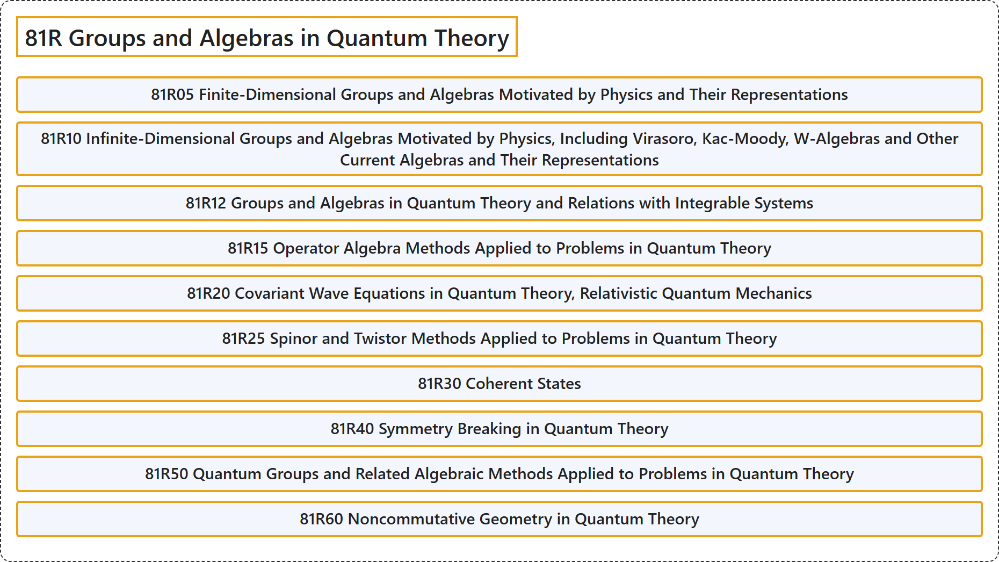

# 81R Groups and Algebras in Quantum Theory

## Classification

## Glossary

| Term | Definition | 中文翻译 | Source |
|---|---|---|---|
| **81R Groups and Algebras in Quantum Theory** 量子理论中的群与代数 | (No definition) | （无定义） | [Associate Editors of Mathematical Reviews and zbMATH, 2020](https://msc2020.org/) |
| **81R05 Finite-Dimensional Groups and Algebras Motivated by Physics and Their Representations** 物理学启发的有限维群与代数及其表示 | (No definition) | （无定义） | [Associate Editors of Mathematical Reviews and zbMATH, 2020](https://msc2020.org/) |
| **81R10 Infinite-Dimensional Groups and Algebras Motivated by Physics, Including Virasoro, Kac-Moody, W-Algebras and Other Current Algebras and Their Representations** 物理学启发的无限维群与代数，包括维拉索罗代数、卡茨-穆迪代数、W 代数及其他流代数及其表示 | (No definition) | （无定义） | [Associate Editors of Mathematical Reviews and zbMATH, 2020](https://msc2020.org/) |
| **81R12 Groups and Algebras in Quantum Theory and Relations with Integrable Systems** 量子理论中的群与代数及其与可积系统的关系 | (No definition) | （无定义） | [Associate Editors of Mathematical Reviews and zbMATH, 2020](https://msc2020.org/) |
| **81R15 Operator Algebra Methods Applied to Problems in Quantum Theory** 应用于量子理论问题的算子代数方法 | (No definition) | （无定义） | [Associate Editors of Mathematical Reviews and zbMATH, 2020](https://msc2020.org/) |
| **81R20 Covariant Wave Equations in Quantum Theory, Relativistic Quantum Mechanics** 量子理论中的协变波动方程、相对论量子力学 | (No definition) | （无定义） | [Associate Editors of Mathematical Reviews and zbMATH, 2020](https://msc2020.org/) |
| **81R25 Spinor and Twistor Methods Applied to Problems in Quantum Theory** 应用于量子理论问题的旋量与挠量方法 | (No definition) | （无定义） | [Associate Editors of Mathematical Reviews and zbMATH, 2020](https://msc2020.org/) |
| **81R30 Coherent States** 相干态 | (No definition) | （无定义） | [Associate Editors of Mathematical Reviews and zbMATH, 2020](https://msc2020.org/) |
| **81R40 Symmetry Breaking in Quantum Theory** 量子理论中的对称性破缺 | (No definition) | （无定义） | [Associate Editors of Mathematical Reviews and zbMATH, 2020](https://msc2020.org/) |
| **81R50 Quantum Groups and Related Algebraic Methods Applied to Problems in Quantum Theory** 应用于量子理论问题的量子群及相关代数方法 | (No definition) | （无定义） | [Associate Editors of Mathematical Reviews and zbMATH, 2020](https://msc2020.org/) |
| **81R60 Noncommutative Geometry in Quantum Theory** 量子理论中的非交换几何 | (No definition) | （无定义） | [Associate Editors of Mathematical Reviews and zbMATH, 2020](https://msc2020.org/) |

## References

Associate Editors of Mathematical Reviews and zbMATH. (2020). *MSC2020: Mathematics Subject Classification system*. Retrieved October 27, 2026, from <https://msc2020.org/>
