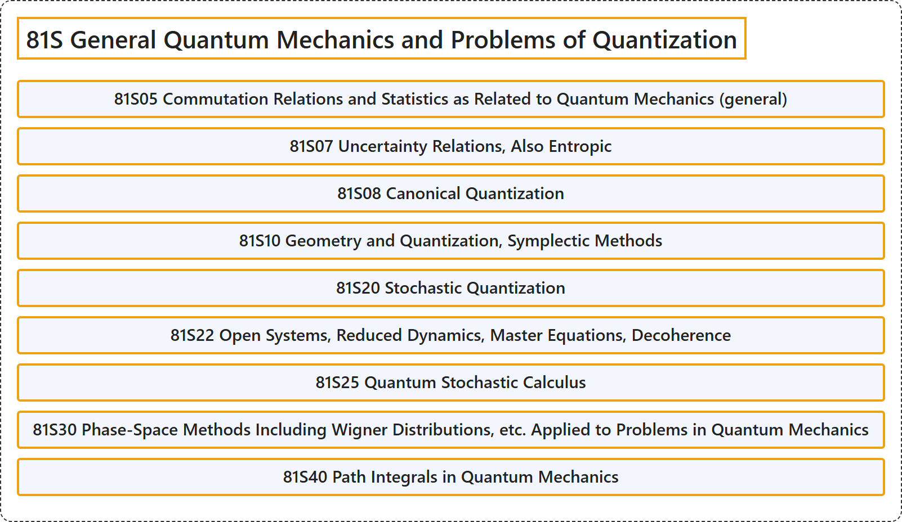

# 81S General Quantum Mechanics and Problems of Quantization

## Classification

## Glossary

| Term | Definition | 中文翻译 | Source |
|---|---|---|---|
| **81S General Quantum Mechanics and Problems of Quantization** 一般量子力学与量子化问题 | (No definition) | （无定义） | [Associate Editors of Mathematical Reviews and zbMATH, 2020](https://msc2020.org/) |
| **81S05 Commutation Relations and Statistics as Related to Quantum Mechanics (general)** 与量子力学相关的对易关系与统计（一般） | (No definition) | （无定义） | [Associate Editors of Mathematical Reviews and zbMATH, 2020](https://msc2020.org/) |
| **81S07 Uncertainty Relations, Also Entropic** 不确定性关系，也包括熵不确定性关系 | (No definition) | （无定义） | [Associate Editors of Mathematical Reviews and zbMATH, 2020](https://msc2020.org/) |
| **81S08 Canonical Quantization** 正则量子化 | (No definition) | （无定义） | [Associate Editors of Mathematical Reviews and zbMATH, 2020](https://msc2020.org/) |
| **81S10 Geometry and Quantization, Symplectic Methods** 几何与量子化、辛方法 | (No definition) | （无定义） | [Associate Editors of Mathematical Reviews and zbMATH, 2020](https://msc2020.org/) |
| **81S20 Stochastic Quantization** 随机量子化 | (No definition) | （无定义） | [Associate Editors of Mathematical Reviews and zbMATH, 2020](https://msc2020.org/) |
| **81S22 Open Systems, Reduced Dynamics, Master Equations, Decoherence** 开放系统、约化动力学、主方程、退相干 | (No definition) | （无定义） | [Associate Editors of Mathematical Reviews and zbMATH, 2020](https://msc2020.org/) |
| **81S25 Quantum Stochastic Calculus** 量子随机演算 | (No definition) | （无定义） | [Associate Editors of Mathematical Reviews and zbMATH, 2020](https://msc2020.org/) |
| **81S30 Phase-Space Methods Including Wigner Distributions, etc. Applied to Problems in Quantum Mechanics** 应用于量子力学问题的相空间方法，包括维格纳分布等 | (No definition) | （无定义） | [Associate Editors of Mathematical Reviews and zbMATH, 2020](https://msc2020.org/) |
| **81S40 Path Integrals in Quantum Mechanics** 量子力学中的路径积分 | (No definition) | （无定义） | [Associate Editors of Mathematical Reviews and zbMATH, 2020](https://msc2020.org/) |

## References

Associate Editors of Mathematical Reviews and zbMATH. (2020). *MSC2020: Mathematics Subject Classification system*. Retrieved October 27, 2026, from <https://msc2020.org/>
