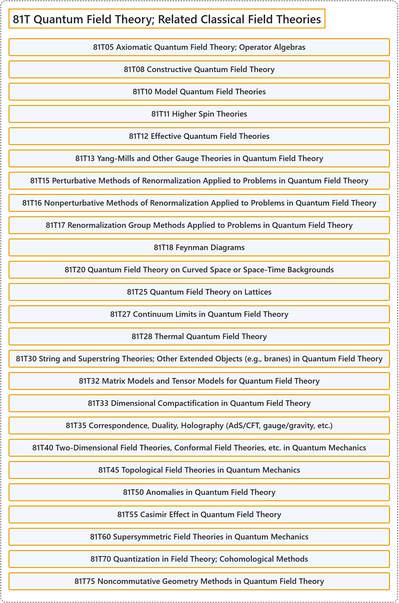

# 81T Quantum Field Theory; Related Classical Field Theories

## Classification

## Glossary

| Term | Definition | 中文翻译 | Source |
|---|---|---|---|
| **81T Quantum Field Theory; Related Classical Field Theories** 量子场论；相关的经典场论 | (No definition) | （无定义） | [Associate Editors of Mathematical Reviews and zbMATH, 2020](https://msc2020.org/) |
| **81T05 Axiomatic Quantum Field Theory; Operator Algebras** 公理化量子场论；算子代数 | (No definition) | （无定义） | [Associate Editors of Mathematical Reviews and zbMATH, 2020](https://msc2020.org/) |
| **81T08 Constructive Quantum Field Theory** 构造性量子场论 | (No definition) | （无定义） | [Associate Editors of Mathematical Reviews and zbMATH, 2020](https://msc2020.org/) |
| **81T10 Model Quantum Field Theories** 模型量子场论 | (No definition) | （无定义） | [Associate Editors of Mathematical Reviews and zbMATH, 2020](https://msc2020.org/) |
| **81T11 Higher Spin Theories** 高自旋理论 | (No definition) | （无定义） | [Associate Editors of Mathematical Reviews and zbMATH, 2020](https://msc2020.org/) |
| **81T12 Effective Quantum Field Theories** 有效量子场论 | (No definition) | （无定义） | [Associate Editors of Mathematical Reviews and zbMATH, 2020](https://msc2020.org/) |
| **81T13 Yang-Mills and Other Gauge Theories in Quantum Field Theory** 量子场论中的杨-米尔斯理论及其他规范理论 | (No definition) | （无定义） | [Associate Editors of Mathematical Reviews and zbMATH, 2020](https://msc2020.org/) |
| **81T15 Perturbative Methods of Renormalization Applied to Problems in Quantum Field Theory** 应用于量子场论问题的重整化微扰方法 | (No definition) | （无定义） | [Associate Editors of Mathematical Reviews and zbMATH, 2020](https://msc2020.org/) |
| **81T16 Nonperturbative Methods of Renormalization Applied to Problems in Quantum Field Theory** 应用于量子场论问题的重整化非微扰方法 | (No definition) | （无定义） | [Associate Editors of Mathematical Reviews and zbMATH, 2020](https://msc2020.org/) |
| **81T17 Renormalization Group Methods Applied to Problems in Quantum Field Theory** 应用于量子场论问题的重整化群方法 | (No definition) | （无定义） | [Associate Editors of Mathematical Reviews and zbMATH, 2020](https://msc2020.org/) |
| **81T18 Feynman Diagrams** 费曼图 | (No definition) | （无定义） | [Associate Editors of Mathematical Reviews and zbMATH, 2020](https://msc2020.org/) |
| **81T20 Quantum Field Theory on Curved Space or Space-Time Backgrounds** 弯曲空间或时空背景上的量子场论 | (No definition) | （无定义） | [Associate Editors of Mathematical Reviews and zbMATH, 2020](https://msc2020.org/) |
| **81T25 Quantum Field Theory on Lattices** 格上的量子场论 | (No definition) | （无定义） | [Associate Editors of Mathematical Reviews and zbMATH, 2020](https://msc2020.org/) |
| **81T27 Continuum Limits in Quantum Field Theory** 量子场论中的连续极限 | (No definition) | （无定义） | [Associate Editors of Mathematical Reviews and zbMATH, 2020](https://msc2020.org/) |
| **81T28 Thermal Quantum Field Theory** 热量子场论 | (No definition) | （无定义） | [Associate Editors of Mathematical Reviews and zbMATH, 2020](https://msc2020.org/) |
| **81T30 String and Superstring Theories; Other Extended Objects (e.g., branes) in Quantum Field Theory** 量子场论中的弦与超弦理论；其他扩展对象（如膜） | (No definition) | （无定义） | [Associate Editors of Mathematical Reviews and zbMATH, 2020](https://msc2020.org/) |
| **81T32 Matrix Models and Tensor Models for Quantum Field Theory** 量子场论的矩阵模型与张量模型 | (No definition) | （无定义） | [Associate Editors of Mathematical Reviews and zbMATH, 2020](https://msc2020.org/) |
| **81T33 Dimensional Compactification in Quantum Field Theory** 量子场论中的维度紧化 | (No definition) | （无定义） | [Associate Editors of Mathematical Reviews and zbMATH, 2020](https://msc2020.org/) |
| **81T35 Correspondence, Duality, Holography (AdS/CFT, gauge/gravity, etc.)** 对应、对偶、全息（AdS/CFT、规范/引力等） | (No definition) | （无定义） | [Associate Editors of Mathematical Reviews and zbMATH, 2020](https://msc2020.org/) |
| **81T40 Two-Dimensional Field Theories, Conformal Field Theories, etc. in Quantum Mechanics** 量子力学中的二维场论、共形场论等 | (No definition) | （无定义） | [Associate Editors of Mathematical Reviews and zbMATH, 2020](https://msc2020.org/) |
| **81T45 Topological Field Theories in Quantum Mechanics** 量子力学中的拓扑场论 | (No definition) | （无定义） | [Associate Editors of Mathematical Reviews and zbMATH, 2020](https://msc2020.org/) |
| **81T50 Anomalies in Quantum Field Theory** 量子场论中的反常 | (No definition) | （无定义） | [Associate Editors of Mathematical Reviews and zbMATH, 2020](https://msc2020.org/) |
| **81T55 Casimir Effect in Quantum Field Theory** 量子场论中的卡西米尔效应 | (No definition) | （无定义） | [Associate Editors of Mathematical Reviews and zbMATH, 2020](https://msc2020.org/) |
| **81T60 Supersymmetric Field Theories in Quantum Mechanics** 量子力学中的超对称场论 | (No definition) | （无定义） | [Associate Editors of Mathematical Reviews and zbMATH, 2020](https://msc2020.org/) |
| **81T70 Quantization in Field Theory; Cohomological Methods** 场论中的量子化；上同调方法 | (No definition) | （无定义） | [Associate Editors of Mathematical Reviews and zbMATH, 2020](https://msc2020.org/) |
| **81T75 Noncommutative Geometry Methods in Quantum Field Theory** 量子场论中的非交换几何方法 | (No definition) | （无定义） | [Associate Editors of Mathematical Reviews and zbMATH, 2020](https://msc2020.org/) |

## References

Associate Editors of Mathematical Reviews and zbMATH. (2020). *MSC2020: Mathematics Subject Classification system*. Retrieved October 27, 2026, from <https://msc2020.org/>
