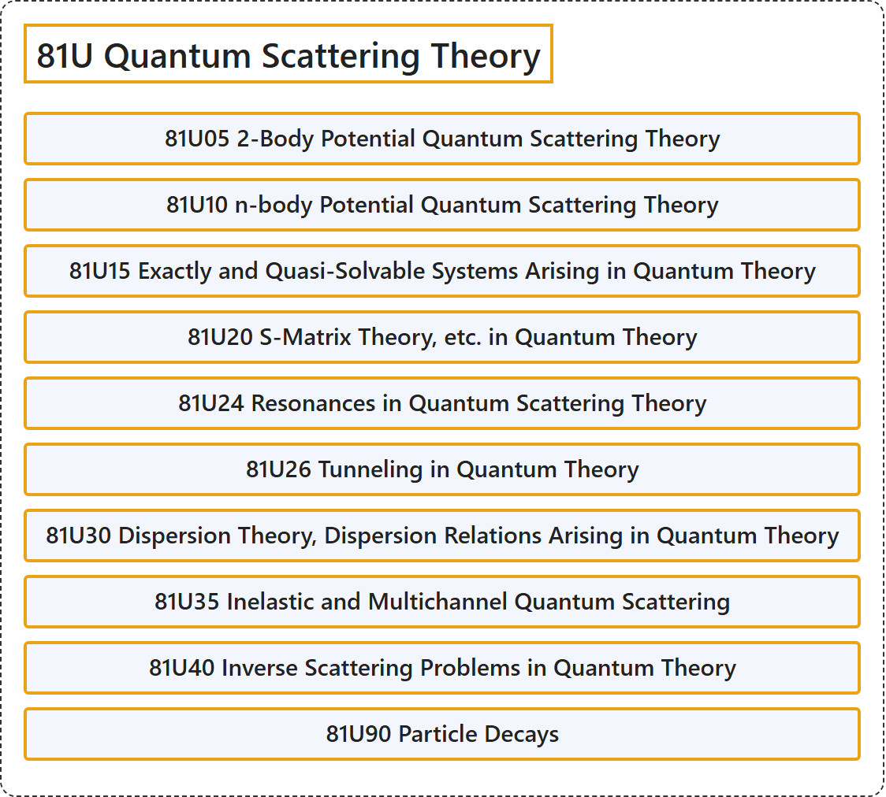

# 81U Quantum Scattering Theory

## Classification

## Glossary

| Term | Definition | 中文翻译 | Source |
|---|---|---|---|
| **81U Quantum Scattering Theory** 量子散射理论 | (No definition) | （无定义） | [Associate Editors of Mathematical Reviews and zbMATH, 2020](https://msc2020.org/) |
| **81U05 2-Body Potential Quantum Scattering Theory** 二体势量子散射理论 | (No definition) | （无定义） | [Associate Editors of Mathematical Reviews and zbMATH, 2020](https://msc2020.org/) |
| **81U10 n-body Potential Quantum Scattering Theory** n 体势量子散射理论 | (No definition) | （无定义） | [Associate Editors of Mathematical Reviews and zbMATH, 2020](https://msc2020.org/) |
| **81U15 Exactly and Quasi-Solvable Systems Arising in Quantum Theory** 量子理论中产生的精确可解与拟可解系统 | (No definition) | （无定义） | [Associate Editors of Mathematical Reviews and zbMATH, 2020](https://msc2020.org/) |
| **81U20 S-Matrix Theory, etc. in Quantum Theory** 量子理论中的 S 矩阵理论等 | (No definition) | （无定义） | [Associate Editors of Mathematical Reviews and zbMATH, 2020](https://msc2020.org/) |
| **81U24 Resonances in Quantum Scattering Theory** 量子散射理论中的共振 | (No definition) | （无定义） | [Associate Editors of Mathematical Reviews and zbMATH, 2020](https://msc2020.org/) |
| **81U26 Tunneling in Quantum Theory** 量子理论中的隧穿 | (No definition) | （无定义） | [Associate Editors of Mathematical Reviews and zbMATH, 2020](https://msc2020.org/) |
| **81U30 Dispersion Theory, Dispersion Relations Arising in Quantum Theory** 量子理论中产生的色散理论、色散关系 | (No definition) | （无定义） | [Associate Editors of Mathematical Reviews and zbMATH, 2020](https://msc2020.org/) |
| **81U35 Inelastic and Multichannel Quantum Scattering** 非弹性与多通道量子散射 | (No definition) | （无定义） | [Associate Editors of Mathematical Reviews and zbMATH, 2020](https://msc2020.org/) |
| **81U40 Inverse Scattering Problems in Quantum Theory** 量子理论中的反散射问题 | (No definition) | （无定义） | [Associate Editors of Mathematical Reviews and zbMATH, 2020](https://msc2020.org/) |
| **81U90 Particle Decays** 粒子衰变 | (No definition) | （无定义） | [Associate Editors of Mathematical Reviews and zbMATH, 2020](https://msc2020.org/) |

## References

Associate Editors of Mathematical Reviews and zbMATH. (2020). *MSC2020: Mathematics Subject Classification system*. Retrieved October 27, 2026, from <https://msc2020.org/>
