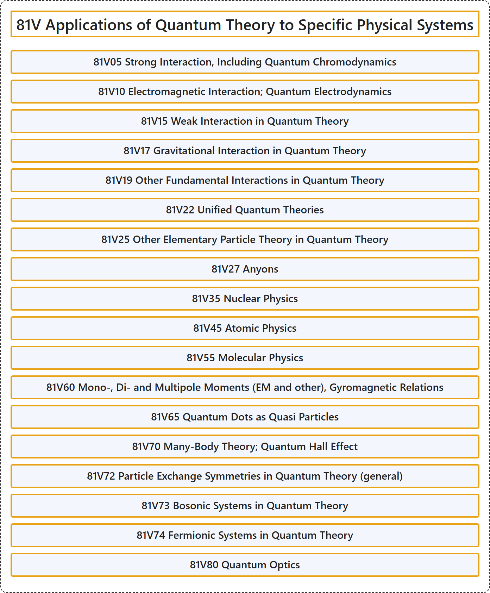

# 81V Applications of Quantum Theory to Specific Physical Systems

## Classification

## Glossary

| Term | Definition | 中文翻译 | Source |
|---|---|---|---|
| **81V Applications of Quantum Theory to Specific Physical Systems** 量子理论在特定物理系统中的应用 | (No definition) | （无定义） | [Associate Editors of Mathematical Reviews and zbMATH, 2020](https://msc2020.org/) |
| **81V05 Strong Interaction, Including Quantum Chromodynamics** 强相互作用，包括量子色动力学 | (No definition) | （无定义） | [Associate Editors of Mathematical Reviews and zbMATH, 2020](https://msc2020.org/) |
| **81V10 Electromagnetic Interaction; Quantum Electrodynamics** 电磁相互作用；量子电动力学 | (No definition) | （无定义） | [Associate Editors of Mathematical Reviews and zbMATH, 2020](https://msc2020.org/) |
| **81V15 Weak Interaction in Quantum Theory** 量子理论中的弱相互作用 | (No definition) | （无定义） | [Associate Editors of Mathematical Reviews and zbMATH, 2020](https://msc2020.org/) |
| **81V17 Gravitational Interaction in Quantum Theory** 量子理论中的引力相互作用 | (No definition) | （无定义） | [Associate Editors of Mathematical Reviews and zbMATH, 2020](https://msc2020.org/) |
| **81V19 Other Fundamental Interactions in Quantum Theory** 量子理论中的其他基本相互作用 | (No definition) | （无定义） | [Associate Editors of Mathematical Reviews and zbMATH, 2020](https://msc2020.org/) |
| **81V22 Unified Quantum Theories** 统一量子理论 | (No definition) | （无定义） | [Associate Editors of Mathematical Reviews and zbMATH, 2020](https://msc2020.org/) |
| **81V25 Other Elementary Particle Theory in Quantum Theory** 量子理论中的其他基本粒子理论 | (No definition) | （无定义） | [Associate Editors of Mathematical Reviews and zbMATH, 2020](https://msc2020.org/) |
| **81V27 Anyons** 任意子 | (No definition) | （无定义） | [Associate Editors of Mathematical Reviews and zbMATH, 2020](https://msc2020.org/) |
| **81V35 Nuclear Physics** 核物理 | (No definition) | （无定义） | [Associate Editors of Mathematical Reviews and zbMATH, 2020](https://msc2020.org/) |
| **81V45 Atomic Physics** 原子物理 | (No definition) | （无定义） | [Associate Editors of Mathematical Reviews and zbMATH, 2020](https://msc2020.org/) |
| **81V55 Molecular Physics** 分子物理 | (No definition) | （无定义） | [Associate Editors of Mathematical Reviews and zbMATH, 2020](https://msc2020.org/) |
| **81V60 Mono-, Di- and Multipole Moments (EM and other), Gyromagnetic Relations** 单极矩、偶极矩与多极矩（电磁及其他）、旋磁关系 | (No definition) | （无定义） | [Associate Editors of Mathematical Reviews and zbMATH, 2020](https://msc2020.org/) |
| **81V65 Quantum Dots as Quasi Particles** 作为准粒子的量子点 | (No definition) | （无定义） | [Associate Editors of Mathematical Reviews and zbMATH, 2020](https://msc2020.org/) |
| **81V70 Many-Body Theory; Quantum Hall Effect** 多体理论；量子霍尔效应 | (No definition) | （无定义） | [Associate Editors of Mathematical Reviews and zbMATH, 2020](https://msc2020.org/) |
| **81V72 Particle Exchange Symmetries in Quantum Theory (general)** 量子理论中的粒子交换对称性（一般） | (No definition) | （无定义） | [Associate Editors of Mathematical Reviews and zbMATH, 2020](https://msc2020.org/) |
| **81V73 Bosonic Systems in Quantum Theory** 量子理论中的玻色系统 | (No definition) | （无定义） | [Associate Editors of Mathematical Reviews and zbMATH, 2020](https://msc2020.org/) |
| **81V74 Fermionic Systems in Quantum Theory** 量子理论中的费米系统 | (No definition) | （无定义） | [Associate Editors of Mathematical Reviews and zbMATH, 2020](https://msc2020.org/) |
| **81V80 Quantum Optics** 量子光学 | (No definition) | （无定义） | [Associate Editors of Mathematical Reviews and zbMATH, 2020](https://msc2020.org/) |

## References

Associate Editors of Mathematical Reviews and zbMATH. (2020). *MSC2020: Mathematics Subject Classification system*. Retrieved October 27, 2026, from <https://msc2020.org/>
