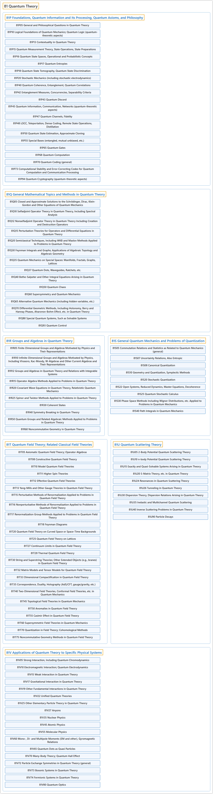

# 81 Quantum Theory

## Classification

## Glossary

| Term | Definition | 中文翻译 | Source |
|---|---|---|---|
| **81 Quantum Theory** 量子理论 | "Quantum mechanics is the description of **motion and interaction of particles at the small scales** where the discrete nature of the physical world becomes important." | 量子力学描述**在微小尺度上粒子的运动和相互作用**，在这些尺度上物理世界的离散性变得重要。 | [Weisstein, n.d., "Quantum mechanics" entry, para. 1](https://scienceworld.wolfram.com/physics/QuantumMechanics.html#:~:text=Quantum%20mechanics%20is%20the%20description%20of%20motion%20and%20interaction) |
| **[81P Foundations, Quantum Information and Its Processing, Quantum Axioms, and Philosophy](81p-foundations-quantum-information-and-its-processing-quantum-a.md)** 基础、量子信息及其处理、量子公理与哲学 | (No definition) | （无定义） | [Associate Editors of Mathematical Reviews and zbMATH, 2020](https://msc2020.org/) |
| **[81Q General Mathematical Topics and Methods in Quantum Theory](81q-general-mathematical-topics-and-methods-in-quantum-theory.md)** 量子理论中的一般数学专题与方法 | (No definition) | （无定义） | [Associate Editors of Mathematical Reviews and zbMATH, 2020](https://msc2020.org/) |
| **[81R Groups and Algebras in Quantum Theory](81r-groups-and-algebras-in-quantum-theory.md)** 量子理论中的群与代数 | (No definition) | （无定义） | [Associate Editors of Mathematical Reviews and zbMATH, 2020](https://msc2020.org/) |
| **[81S General Quantum Mechanics and Problems of Quantization](81s-general-quantum-mechanics-and-problems-of-quantization.md)** 一般量子力学与量子化问题 | (No definition) | （无定义） | [Associate Editors of Mathematical Reviews and zbMATH, 2020](https://msc2020.org/) |
| **[81T Quantum Field Theory; Related Classical Field Theories](81t-quantum-field-theory-related-classical-field-theories.md)** 量子场论；相关的经典场论 | (No definition) | （无定义） | [Associate Editors of Mathematical Reviews and zbMATH, 2020](https://msc2020.org/) |
| **[81U Quantum Scattering Theory](81u-quantum-scattering-theory.md)** 量子散射理论 | (No definition) | （无定义） | [Associate Editors of Mathematical Reviews and zbMATH, 2020](https://msc2020.org/) |
| **[81V Applications of Quantum Theory to Specific Physical Systems](81v-applications-of-quantum-theory-to-specific-physical-systems.md)** 量子理论在特定物理系统中的应用 | (No definition) | （无定义） | [Associate Editors of Mathematical Reviews and zbMATH, 2020](https://msc2020.org/) |

## References

Associate Editors of Mathematical Reviews and zbMATH. (2020). *MSC2020: Mathematics Subject Classification system*. Retrieved October 27, 2026, from <https://msc2020.org/>

Weisstein, E. W. (n.d.). *Quantum mechanics*. Eric Weisstein's World of Physics. Retrieved October 27, 2026, from <https://scienceworld.wolfram.com/physics/QuantumMechanics.html>
