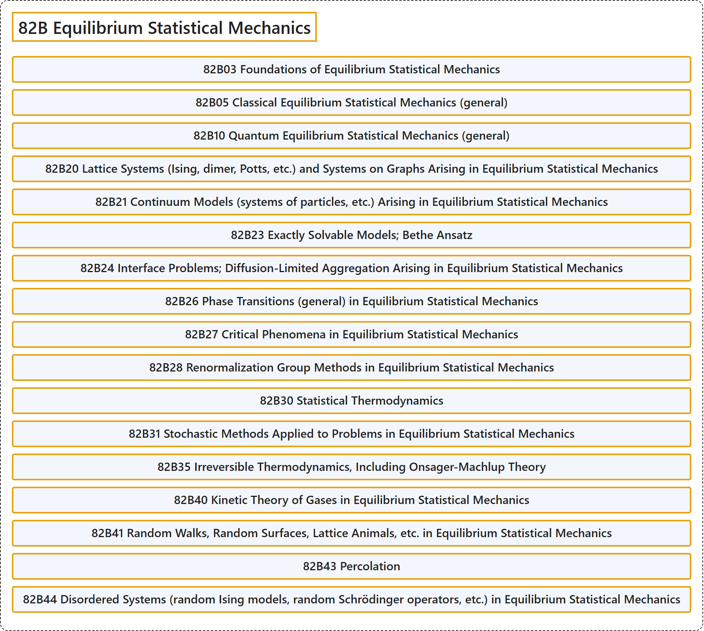

# 82B Equilibrium Statistical Mechanics

## Classification

## Glossary

| Term | Definition | 中文翻译 | Source |
|---|---|---|---|
| **82B Equilibrium Statistical Mechanics** 平衡统计力学 | (No definition) | （无定义） | [Associate Editors of Mathematical Reviews and zbMATH, 2020](https://msc2020.org/) |
| **82B03 Foundations of Equilibrium Statistical Mechanics** 平衡统计力学基础 | (No definition) | （无定义） | [Associate Editors of Mathematical Reviews and zbMATH, 2020](https://msc2020.org/) |
| **82B05 Classical Equilibrium Statistical Mechanics (general)** 经典平衡统计力学（一般） | (No definition) | （无定义） | [Associate Editors of Mathematical Reviews and zbMATH, 2020](https://msc2020.org/) |
| **82B10 Quantum Equilibrium Statistical Mechanics (general)** 量子平衡统计力学（一般） | (No definition) | （无定义） | [Associate Editors of Mathematical Reviews and zbMATH, 2020](https://msc2020.org/) |
| **82B20 Lattice Systems (Ising, dimer, Potts, etc.) and Systems on Graphs Arising in Equilibrium Statistical Mechanics** 平衡统计力学中产生的格系统（伊辛、二聚体、波茨等）与图上的系统 | (No definition) | （无定义） | [Associate Editors of Mathematical Reviews and zbMATH, 2020](https://msc2020.org/) |
| **82B21 Continuum Models (systems of particles, etc.) Arising in Equilibrium Statistical Mechanics** 平衡统计力学中产生的连续模型（粒子系统等） | (No definition) | （无定义） | [Associate Editors of Mathematical Reviews and zbMATH, 2020](https://msc2020.org/) |
| **82B23 Exactly Solvable Models; Bethe Ansatz** 精确可解模型；贝特假设 | (No definition) | （无定义） | [Associate Editors of Mathematical Reviews and zbMATH, 2020](https://msc2020.org/) |
| **82B24 Interface Problems; Diffusion-Limited Aggregation Arising in Equilibrium Statistical Mechanics** 平衡统计力学中产生的界面问题；扩散限制凝聚 | (No definition) | （无定义） | [Associate Editors of Mathematical Reviews and zbMATH, 2020](https://msc2020.org/) |
| **82B26 Phase Transitions (general) in Equilibrium Statistical Mechanics** 平衡统计力学中的相变（一般） | (No definition) | （无定义） | [Associate Editors of Mathematical Reviews and zbMATH, 2020](https://msc2020.org/) |
| **82B27 Critical Phenomena in Equilibrium Statistical Mechanics** 平衡统计力学中的临界现象 | (No definition) | （无定义） | [Associate Editors of Mathematical Reviews and zbMATH, 2020](https://msc2020.org/) |
| **82B28 Renormalization Group Methods in Equilibrium Statistical Mechanics** 平衡统计力学中的重整化群方法 | (No definition) | （无定义） | [Associate Editors of Mathematical Reviews and zbMATH, 2020](https://msc2020.org/) |
| **82B30 Statistical Thermodynamics** 统计热力学 | (No definition) | （无定义） | [Associate Editors of Mathematical Reviews and zbMATH, 2020](https://msc2020.org/) |
| **82B31 Stochastic Methods Applied to Problems in Equilibrium Statistical Mechanics** 应用于平衡统计力学问题的随机方法 | (No definition) | （无定义） | [Associate Editors of Mathematical Reviews and zbMATH, 2020](https://msc2020.org/) |
| **82B35 Irreversible Thermodynamics, Including Onsager-Machlup Theory** 不可逆热力学，包括昂萨格-马赫鲁普理论 | (No definition) | （无定义） | [Associate Editors of Mathematical Reviews and zbMATH, 2020](https://msc2020.org/) |
| **82B40 Kinetic Theory of Gases in Equilibrium Statistical Mechanics** 平衡统计力学中的气体动理论 | (No definition) | （无定义） | [Associate Editors of Mathematical Reviews and zbMATH, 2020](https://msc2020.org/) |
| **82B41 Random Walks, Random Surfaces, Lattice Animals, etc. in Equilibrium Statistical Mechanics** 平衡统计力学中的随机游动、随机曲面、格点动物等 | (No definition) | （无定义） | [Associate Editors of Mathematical Reviews and zbMATH, 2020](https://msc2020.org/) |
| **82B43 Percolation** 渗流 | (No definition) | （无定义） | [Associate Editors of Mathematical Reviews and zbMATH, 2020](https://msc2020.org/) |
| **82B44 Disordered Systems (random Ising models, random Schrödinger operators, etc.) in Equilibrium Statistical Mechanics** 平衡统计力学中的无序系统（随机伊辛模型、随机薛定谔算子等） | (No definition) | （无定义） | [Associate Editors of Mathematical Reviews and zbMATH, 2020](https://msc2020.org/) |

## References

Associate Editors of Mathematical Reviews and zbMATH. (2020). *MSC2020: Mathematics Subject Classification system*. Retrieved October 27, 2026, from <https://msc2020.org/>
