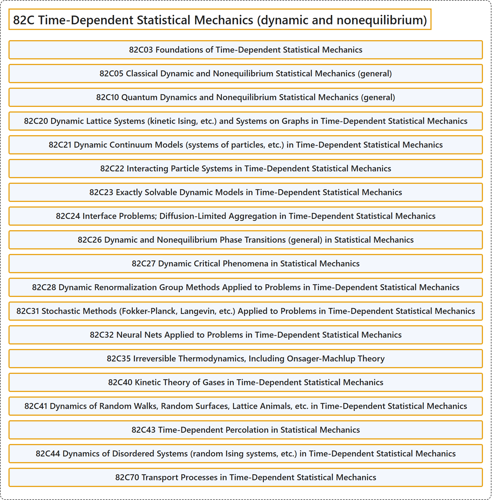

# 82C Time-Dependent Statistical Mechanics (dynamic and nonequilibrium)

## Classification

## Glossary

| Term | Definition | 中文翻译 | Source |
|---|---|---|---|
| **82C Time-Dependent Statistical Mechanics (dynamic and nonequilibrium)** 含时统计力学（动态与非平衡） | (No definition) | （无定义） | [Associate Editors of Mathematical Reviews and zbMATH, 2020](https://msc2020.org/) |
| **82C03 Foundations of Time-Dependent Statistical Mechanics** 含时统计力学基础 | (No definition) | （无定义） | [Associate Editors of Mathematical Reviews and zbMATH, 2020](https://msc2020.org/) |
| **82C05 Classical Dynamic and Nonequilibrium Statistical Mechanics (general)** 经典动力学与非平衡统计力学（一般） | (No definition) | （无定义） | [Associate Editors of Mathematical Reviews and zbMATH, 2020](https://msc2020.org/) |
| **82C10 Quantum Dynamics and Nonequilibrium Statistical Mechanics (general)** 量子动力学与非平衡统计力学（一般） | (No definition) | （无定义） | [Associate Editors of Mathematical Reviews and zbMATH, 2020](https://msc2020.org/) |
| **82C20 Dynamic Lattice Systems (kinetic Ising, etc.) and Systems on Graphs in Time-Dependent Statistical Mechanics** 含时统计力学中的动态格系统（动理学伊辛等）与图上的系统 | (No definition) | （无定义） | [Associate Editors of Mathematical Reviews and zbMATH, 2020](https://msc2020.org/) |
| **82C21 Dynamic Continuum Models (systems of particles, etc.) in Time-Dependent Statistical Mechanics** 含时统计力学中的动态连续模型（粒子系统等） | (No definition) | （无定义） | [Associate Editors of Mathematical Reviews and zbMATH, 2020](https://msc2020.org/) |
| **82C22 Interacting Particle Systems in Time-Dependent Statistical Mechanics** 含时统计力学中的相互作用粒子系统 | (No definition) | （无定义） | [Associate Editors of Mathematical Reviews and zbMATH, 2020](https://msc2020.org/) |
| **82C23 Exactly Solvable Dynamic Models in Time-Dependent Statistical Mechanics** 含时统计力学中的精确可解动态模型 | (No definition) | （无定义） | [Associate Editors of Mathematical Reviews and zbMATH, 2020](https://msc2020.org/) |
| **82C24 Interface Problems; Diffusion-Limited Aggregation in Time-Dependent Statistical Mechanics** 含时统计力学中的界面问题；扩散限制凝聚 | (No definition) | （无定义） | [Associate Editors of Mathematical Reviews and zbMATH, 2020](https://msc2020.org/) |
| **82C26 Dynamic and Nonequilibrium Phase Transitions (general) in Statistical Mechanics** 统计力学中的动态与非平衡相变（一般） | (No definition) | （无定义） | [Associate Editors of Mathematical Reviews and zbMATH, 2020](https://msc2020.org/) |
| **82C27 Dynamic Critical Phenomena in Statistical Mechanics** 统计力学中的动态临界现象 | (No definition) | （无定义） | [Associate Editors of Mathematical Reviews and zbMATH, 2020](https://msc2020.org/) |
| **82C28 Dynamic Renormalization Group Methods Applied to Problems in Time-Dependent Statistical Mechanics** 应用于含时统计力学问题的动态重整化群方法 | (No definition) | （无定义） | [Associate Editors of Mathematical Reviews and zbMATH, 2020](https://msc2020.org/) |
| **82C31 Stochastic Methods (Fokker-Planck, Langevin, etc.) Applied to Problems in Time-Dependent Statistical Mechanics** 应用于含时统计力学问题的随机方法（福克-普朗克、朗之万等） | (No definition) | （无定义） | [Associate Editors of Mathematical Reviews and zbMATH, 2020](https://msc2020.org/) |
| **82C32 Neural Nets Applied to Problems in Time-Dependent Statistical Mechanics** 应用于含时统计力学问题的神经网络 | (No definition) | （无定义） | [Associate Editors of Mathematical Reviews and zbMATH, 2020](https://msc2020.org/) |
| **82C35 Irreversible Thermodynamics, Including Onsager-Machlup Theory** 不可逆热力学，包括昂萨格-马赫鲁普理论 | (No definition) | （无定义） | [Associate Editors of Mathematical Reviews and zbMATH, 2020](https://msc2020.org/) |
| **82C40 Kinetic Theory of Gases in Time-Dependent Statistical Mechanics** 含时统计力学中的气体动理论 | (No definition) | （无定义） | [Associate Editors of Mathematical Reviews and zbMATH, 2020](https://msc2020.org/) |
| **82C41 Dynamics of Random Walks, Random Surfaces, Lattice Animals, etc. in Time-Dependent Statistical Mechanics** 含时统计力学中随机游动、随机曲面、格点动物等的动力学 | (No definition) | （无定义） | [Associate Editors of Mathematical Reviews and zbMATH, 2020](https://msc2020.org/) |
| **82C43 Time-Dependent Percolation in Statistical Mechanics** 统计力学中的含时渗流 | (No definition) | （无定义） | [Associate Editors of Mathematical Reviews and zbMATH, 2020](https://msc2020.org/) |
| **82C44 Dynamics of Disordered Systems (random Ising systems, etc.) in Time-Dependent Statistical Mechanics** 含时统计力学中无序系统（随机伊辛系统等）的动力学 | (No definition) | （无定义） | [Associate Editors of Mathematical Reviews and zbMATH, 2020](https://msc2020.org/) |
| **82C70 Transport Processes in Time-Dependent Statistical Mechanics** 含时统计力学中的输运过程 | (No definition) | （无定义） | [Associate Editors of Mathematical Reviews and zbMATH, 2020](https://msc2020.org/) |

## References

Associate Editors of Mathematical Reviews and zbMATH. (2020). *MSC2020: Mathematics Subject Classification system*. Retrieved October 27, 2026, from <https://msc2020.org/>
