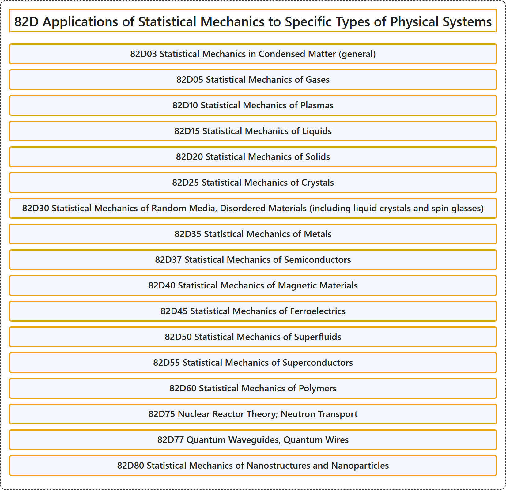

# 82D Applications of Statistical Mechanics to Specific Types of Physical Systems

## Classification

## Glossary

| Term | Definition | 中文翻译 | Source |
|---|---|---|---|
| **82D Applications of Statistical Mechanics to Specific Types of Physical Systems** 统计力学在特定类型物理系统中的应用 | (No definition) | （无定义） | [Associate Editors of Mathematical Reviews and zbMATH, 2020](https://msc2020.org/) |
| **82D03 Statistical Mechanics in Condensed Matter (general)** 凝聚态中的统计力学（一般） | (No definition) | （无定义） | [Associate Editors of Mathematical Reviews and zbMATH, 2020](https://msc2020.org/) |
| **82D05 Statistical Mechanics of Gases** 气体的统计力学 | (No definition) | （无定义） | [Associate Editors of Mathematical Reviews and zbMATH, 2020](https://msc2020.org/) |
| **82D10 Statistical Mechanics of Plasmas** 等离子体的统计力学 | (No definition) | （无定义） | [Associate Editors of Mathematical Reviews and zbMATH, 2020](https://msc2020.org/) |
| **82D15 Statistical Mechanics of Liquids** 液体的统计力学 | (No definition) | （无定义） | [Associate Editors of Mathematical Reviews and zbMATH, 2020](https://msc2020.org/) |
| **82D20 Statistical Mechanics of Solids** 固体的统计力学 | (No definition) | （无定义） | [Associate Editors of Mathematical Reviews and zbMATH, 2020](https://msc2020.org/) |
| **82D25 Statistical Mechanics of Crystals** 晶体的统计力学 | (No definition) | （无定义） | [Associate Editors of Mathematical Reviews and zbMATH, 2020](https://msc2020.org/) |
| **82D30 Statistical Mechanics of Random Media, Disordered Materials (including liquid crystals and spin glasses)** 随机介质、无序材料（包括液晶与自旋玻璃）的统计力学 | (No definition) | （无定义） | [Associate Editors of Mathematical Reviews and zbMATH, 2020](https://msc2020.org/) |
| **82D35 Statistical Mechanics of Metals** 金属的统计力学 | (No definition) | （无定义） | [Associate Editors of Mathematical Reviews and zbMATH, 2020](https://msc2020.org/) |
| **82D37 Statistical Mechanics of Semiconductors** 半导体的统计力学 | (No definition) | （无定义） | [Associate Editors of Mathematical Reviews and zbMATH, 2020](https://msc2020.org/) |
| **82D40 Statistical Mechanics of Magnetic Materials** 磁性材料的统计力学 | (No definition) | （无定义） | [Associate Editors of Mathematical Reviews and zbMATH, 2020](https://msc2020.org/) |
| **82D45 Statistical Mechanics of Ferroelectrics** 铁电体的统计力学 | (No definition) | （无定义） | [Associate Editors of Mathematical Reviews and zbMATH, 2020](https://msc2020.org/) |
| **82D50 Statistical Mechanics of Superfluids** 超流体的统计力学 | (No definition) | （无定义） | [Associate Editors of Mathematical Reviews and zbMATH, 2020](https://msc2020.org/) |
| **82D55 Statistical Mechanics of Superconductors** 超导体的统计力学 | (No definition) | （无定义） | [Associate Editors of Mathematical Reviews and zbMATH, 2020](https://msc2020.org/) |
| **82D60 Statistical Mechanics of Polymers** 聚合物的统计力学 | (No definition) | （无定义） | [Associate Editors of Mathematical Reviews and zbMATH, 2020](https://msc2020.org/) |
| **82D75 Nuclear Reactor Theory; Neutron Transport** 核反应堆理论；中子输运 | (No definition) | （无定义） | [Associate Editors of Mathematical Reviews and zbMATH, 2020](https://msc2020.org/) |
| **82D77 Quantum Waveguides, Quantum Wires** 量子波导、量子线 | (No definition) | （无定义） | [Associate Editors of Mathematical Reviews and zbMATH, 2020](https://msc2020.org/) |
| **82D80 Statistical Mechanics of Nanostructures and Nanoparticles** 纳米结构与纳米粒子的统计力学 | (No definition) | （无定义） | [Associate Editors of Mathematical Reviews and zbMATH, 2020](https://msc2020.org/) |

## References

Associate Editors of Mathematical Reviews and zbMATH. (2020). *MSC2020: Mathematics Subject Classification system*. Retrieved October 27, 2026, from <https://msc2020.org/>
