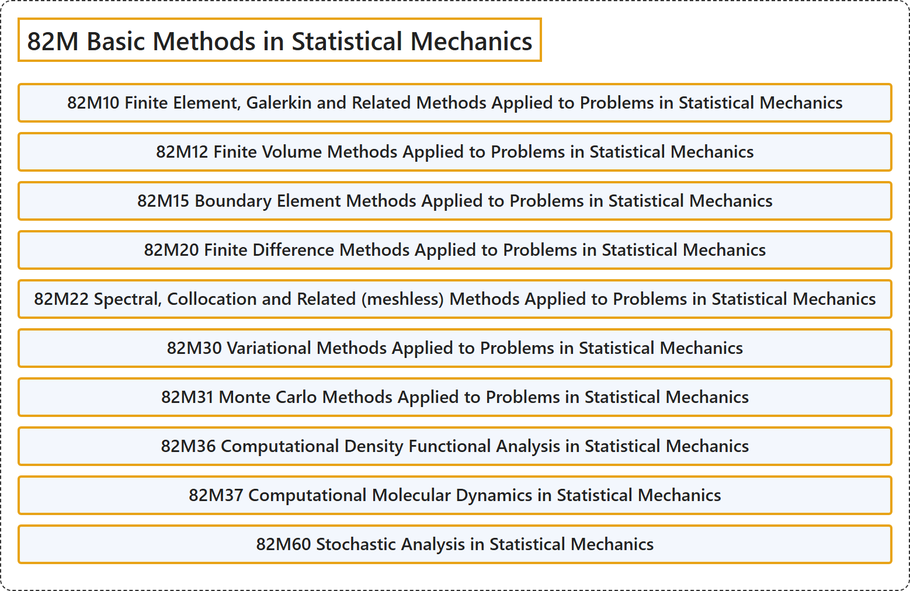

# 82M Basic Methods in Statistical Mechanics

## Classification

## Glossary

| Term | Definition | 中文翻译 | Source |
|---|---|---|---|
| **82M Basic Methods in Statistical Mechanics** 统计力学基本方法 | (No definition) | （无定义） | [Associate Editors of Mathematical Reviews and zbMATH, 2020](https://msc2020.org/) |
| **82M10 Finite Element, Galerkin and Related Methods Applied to Problems in Statistical Mechanics** 应用于统计力学问题的有限元、伽辽金及相关方法 | (No definition) | （无定义） | [Associate Editors of Mathematical Reviews and zbMATH, 2020](https://msc2020.org/) |
| **82M12 Finite Volume Methods Applied to Problems in Statistical Mechanics** 应用于统计力学问题的有限体积方法 | (No definition) | （无定义） | [Associate Editors of Mathematical Reviews and zbMATH, 2020](https://msc2020.org/) |
| **82M15 Boundary Element Methods Applied to Problems in Statistical Mechanics** 应用于统计力学问题的边界元方法 | (No definition) | （无定义） | [Associate Editors of Mathematical Reviews and zbMATH, 2020](https://msc2020.org/) |
| **82M20 Finite Difference Methods Applied to Problems in Statistical Mechanics** 应用于统计力学问题的有限差分方法 | (No definition) | （无定义） | [Associate Editors of Mathematical Reviews and zbMATH, 2020](https://msc2020.org/) |
| **82M22 Spectral, Collocation and Related (meshless) Methods Applied to Problems in Statistical Mechanics** 应用于统计力学问题的谱方法、配置法及相关（无网格）方法 | (No definition) | （无定义） | [Associate Editors of Mathematical Reviews and zbMATH, 2020](https://msc2020.org/) |
| **82M30 Variational Methods Applied to Problems in Statistical Mechanics** 应用于统计力学问题的变分方法 | (No definition) | （无定义） | [Associate Editors of Mathematical Reviews and zbMATH, 2020](https://msc2020.org/) |
| **82M31 Monte Carlo Methods Applied to Problems in Statistical Mechanics** 应用于统计力学问题的蒙特卡罗方法 | (No definition) | （无定义） | [Associate Editors of Mathematical Reviews and zbMATH, 2020](https://msc2020.org/) |
| **82M36 Computational Density Functional Analysis in Statistical Mechanics** 统计力学中的计算密度泛函分析 | (No definition) | （无定义） | [Associate Editors of Mathematical Reviews and zbMATH, 2020](https://msc2020.org/) |
| **82M37 Computational Molecular Dynamics in Statistical Mechanics** 统计力学中的计算分子动力学 | (No definition) | （无定义） | [Associate Editors of Mathematical Reviews and zbMATH, 2020](https://msc2020.org/) |
| **82M60 Stochastic Analysis in Statistical Mechanics** 统计力学中的随机分析 | (No definition) | （无定义） | [Associate Editors of Mathematical Reviews and zbMATH, 2020](https://msc2020.org/) |

## References

Associate Editors of Mathematical Reviews and zbMATH. (2020). *MSC2020: Mathematics Subject Classification system*. Retrieved October 27, 2026, from <https://msc2020.org/>
