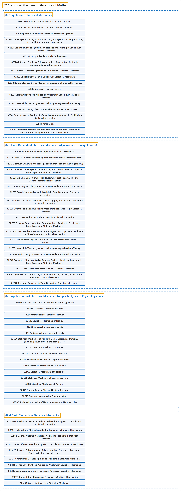

# 82 Statistical Mechanics, Structure of Matter

## Classification

## Glossary

| Term | Definition | 中文翻译 | Source |
|---|---|---|---|
| **82 Statistical Mechanics, Structure of Matter** 统计力学、物质结构 | (Definition pending: no web source yet.) | （定义待补：暂无网页来源。） | Pending |
| **[82B Equilibrium Statistical Mechanics](82b-equilibrium-statistical-mechanics.md)** 平衡统计力学 | (No definition) | （无定义） | [Associate Editors of Mathematical Reviews and zbMATH, 2020](https://msc2020.org/) |
| **[82C Time-Dependent Statistical Mechanics (dynamic and nonequilibrium)](82c-time-dependent-statistical-mechanics-dynamic-and-nonequilibr.md)** 含时统计力学（动态与非平衡） | (No definition) | （无定义） | [Associate Editors of Mathematical Reviews and zbMATH, 2020](https://msc2020.org/) |
| **[82D Applications of Statistical Mechanics to Specific Types of Physical Systems](82d-applications-of-statistical-mechanics-to-specific-types-of-p.md)** 统计力学在特定类型物理系统中的应用 | (No definition) | （无定义） | [Associate Editors of Mathematical Reviews and zbMATH, 2020](https://msc2020.org/) |
| **[82M Basic Methods in Statistical Mechanics](82m-basic-methods-in-statistical-mechanics.md)** 统计力学基本方法 | (No definition) | （无定义） | [Associate Editors of Mathematical Reviews and zbMATH, 2020](https://msc2020.org/) |

## References

Associate Editors of Mathematical Reviews and zbMATH. (2020). *MSC2020: Mathematics Subject Classification system*. Retrieved October 27, 2026, from <https://msc2020.org/>
