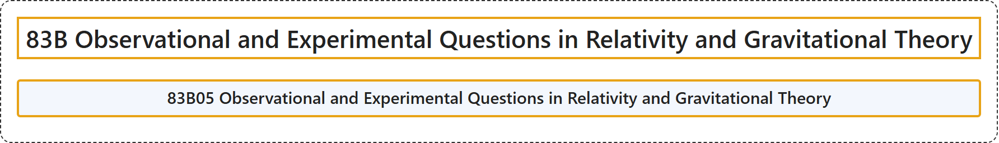

# 83B Observational and Experimental Questions in Relativity and Gravitational Theory

## Classification

## Glossary

| Term | Definition | 中文翻译 | Source |
|---|---|---|---|
| **83B Observational and Experimental Questions in Relativity and Gravitational Theory** 相对论与引力理论中的观测与实验问题 | (No definition) | （无定义） | [Associate Editors of Mathematical Reviews and zbMATH, 2020](https://msc2020.org/) |
| **83B05 Observational and Experimental Questions in Relativity and Gravitational Theory** 相对论与引力理论中的观测与实验问题 | (No definition) | （无定义） | [Associate Editors of Mathematical Reviews and zbMATH, 2020](https://msc2020.org/) |

## References

Associate Editors of Mathematical Reviews and zbMATH. (2020). *MSC2020: Mathematics Subject Classification system*. Retrieved October 27, 2026, from <https://msc2020.org/>
