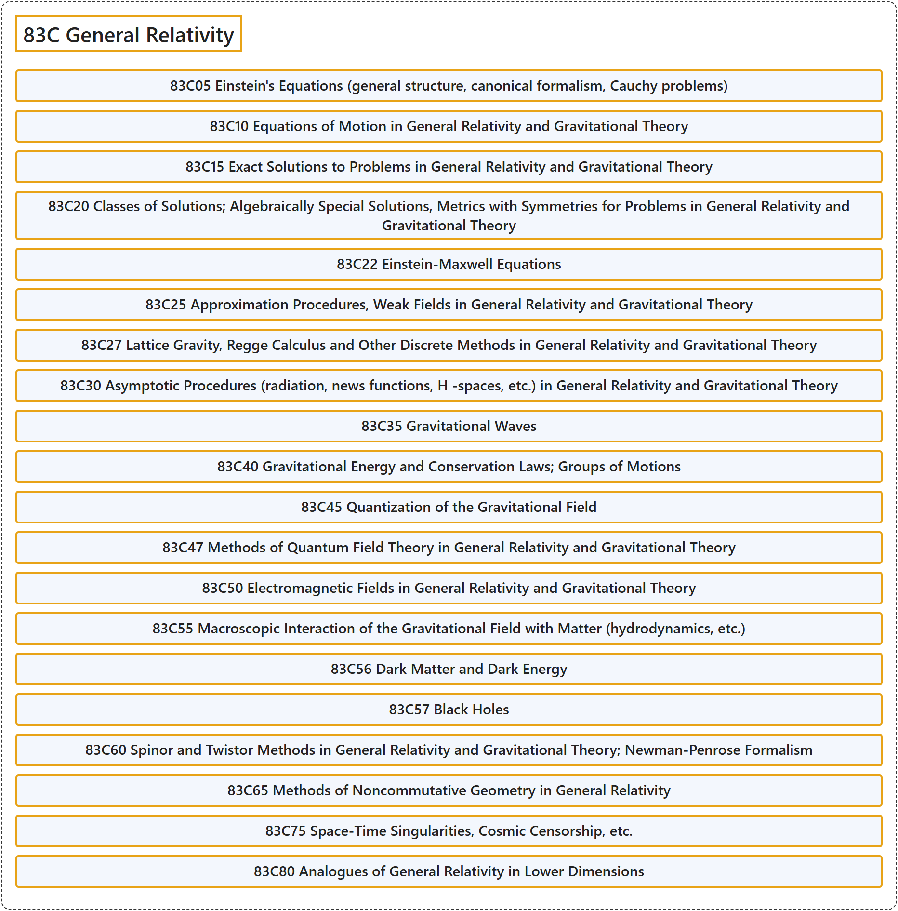

# 83C General Relativity

## Classification

## Glossary

| Term | Definition | 中文翻译 | Source |
|---|---|---|---|
| **83C General Relativity** 广义相对论 | (No definition) | （无定义） | [Associate Editors of Mathematical Reviews and zbMATH, 2020](https://msc2020.org/) |
| **83C05 Einstein's Equations (general structure, canonical formalism, Cauchy problems)** 爱因斯坦方程（一般结构、正则形式、柯西问题） | (No definition) | （无定义） | [Associate Editors of Mathematical Reviews and zbMATH, 2020](https://msc2020.org/) |
| **83C10 Equations of Motion in General Relativity and Gravitational Theory** 广义相对论与引力理论中的运动方程 | (No definition) | （无定义） | [Associate Editors of Mathematical Reviews and zbMATH, 2020](https://msc2020.org/) |
| **83C15 Exact Solutions to Problems in General Relativity and Gravitational Theory** 广义相对论与引力理论问题的精确解 | (No definition) | （无定义） | [Associate Editors of Mathematical Reviews and zbMATH, 2020](https://msc2020.org/) |
| **83C20 Classes of Solutions; Algebraically Special Solutions, Metrics with Symmetries for Problems in General Relativity and Gravitational Theory** 广义相对论与引力理论问题的解类；代数特殊解、具有对称性的度量 | (No definition) | （无定义） | [Associate Editors of Mathematical Reviews and zbMATH, 2020](https://msc2020.org/) |
| **83C22 Einstein-Maxwell Equations** 爱因斯坦-麦克斯韦方程 | (No definition) | （无定义） | [Associate Editors of Mathematical Reviews and zbMATH, 2020](https://msc2020.org/) |
| **83C25 Approximation Procedures, Weak Fields in General Relativity and Gravitational Theory** 广义相对论与引力理论中的近似方法、弱场 | (No definition) | （无定义） | [Associate Editors of Mathematical Reviews and zbMATH, 2020](https://msc2020.org/) |
| **83C27 Lattice Gravity, Regge Calculus and Other Discrete Methods in General Relativity and Gravitational Theory** 广义相对论与引力理论中的格点引力、雷吉演算及其他离散方法 | (No definition) | （无定义） | [Associate Editors of Mathematical Reviews and zbMATH, 2020](https://msc2020.org/) |
| **83C30 Asymptotic Procedures (radiation, news functions, H -spaces, etc.) in General Relativity and Gravitational Theory** 广义相对论与引力理论中的渐近方法（辐射、新闻函数、H 空间等） | (No definition) | （无定义） | [Associate Editors of Mathematical Reviews and zbMATH, 2020](https://msc2020.org/) |
| **83C35 Gravitational Waves** 引力波 | (No definition) | （无定义） | [Associate Editors of Mathematical Reviews and zbMATH, 2020](https://msc2020.org/) |
| **83C40 Gravitational Energy and Conservation Laws; Groups of Motions** 引力能与守恒律；运动群 | (No definition) | （无定义） | [Associate Editors of Mathematical Reviews and zbMATH, 2020](https://msc2020.org/) |
| **83C45 Quantization of the Gravitational Field** 引力场的量子化 | (No definition) | （无定义） | [Associate Editors of Mathematical Reviews and zbMATH, 2020](https://msc2020.org/) |
| **83C47 Methods of Quantum Field Theory in General Relativity and Gravitational Theory** 广义相对论与引力理论中的量子场论方法 | (No definition) | （无定义） | [Associate Editors of Mathematical Reviews and zbMATH, 2020](https://msc2020.org/) |
| **83C50 Electromagnetic Fields in General Relativity and Gravitational Theory** 广义相对论与引力理论中的电磁场 | (No definition) | （无定义） | [Associate Editors of Mathematical Reviews and zbMATH, 2020](https://msc2020.org/) |
| **83C55 Macroscopic Interaction of the Gravitational Field with Matter (hydrodynamics, etc.)** 引力场与物质的宏观相互作用（流体动力学等） | (No definition) | （无定义） | [Associate Editors of Mathematical Reviews and zbMATH, 2020](https://msc2020.org/) |
| **83C56 Dark Matter and Dark Energy** 暗物质与暗能量 | (No definition) | （无定义） | [Associate Editors of Mathematical Reviews and zbMATH, 2020](https://msc2020.org/) |
| **83C57 Black Holes** 黑洞 | (No definition) | （无定义） | [Associate Editors of Mathematical Reviews and zbMATH, 2020](https://msc2020.org/) |
| **83C60 Spinor and Twistor Methods in General Relativity and Gravitational Theory; Newman-Penrose Formalism** 广义相对论与引力理论中的旋量与挠量方法；纽曼-彭罗斯形式 | (No definition) | （无定义） | [Associate Editors of Mathematical Reviews and zbMATH, 2020](https://msc2020.org/) |
| **83C65 Methods of Noncommutative Geometry in General Relativity** 广义相对论中的非交换几何方法 | (No definition) | （无定义） | [Associate Editors of Mathematical Reviews and zbMATH, 2020](https://msc2020.org/) |
| **83C75 Space-Time Singularities, Cosmic Censorship, etc.** 时空奇点、宇宙监督等 | (No definition) | （无定义） | [Associate Editors of Mathematical Reviews and zbMATH, 2020](https://msc2020.org/) |
| **83C80 Analogues of General Relativity in Lower Dimensions** 广义相对论在低维情形的类比 | (No definition) | （无定义） | [Associate Editors of Mathematical Reviews and zbMATH, 2020](https://msc2020.org/) |

## References

Associate Editors of Mathematical Reviews and zbMATH. (2020). *MSC2020: Mathematics Subject Classification system*. Retrieved October 27, 2026, from <https://msc2020.org/>
