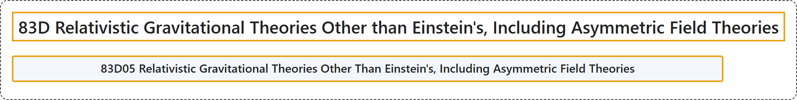

# 83D Relativistic Gravitational Theories Other than Einstein's, Including Asymmetric Field Theories

## Classification

## Glossary

| Term | Definition | 中文翻译 | Source |
|---|---|---|---|
| **83D Relativistic Gravitational Theories Other than Einstein's, Including Asymmetric Field Theories** 爱因斯坦理论以外的相对论性引力理论，包括非对称场论 | (No definition) | （无定义） | [Associate Editors of Mathematical Reviews and zbMATH, 2020](https://msc2020.org/) |
| **83D05 Relativistic Gravitational Theories Other Than Einstein's, Including Asymmetric Field Theories** 爱因斯坦理论之外的相对论引力理论，包括非对称场论 | (No definition) | （无定义） | [Associate Editors of Mathematical Reviews and zbMATH, 2020](https://msc2020.org/) |

## References

Associate Editors of Mathematical Reviews and zbMATH. (2020). *MSC2020: Mathematics Subject Classification system*. Retrieved October 27, 2026, from <https://msc2020.org/>
