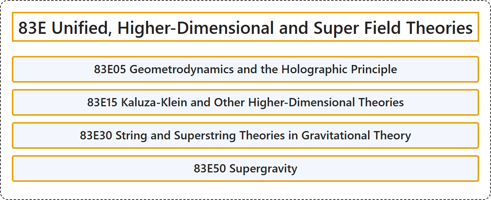

# 83E Unified, Higher-Dimensional and Super Field Theories

## Classification

## Glossary

| Term | Definition | 中文翻译 | Source |
|---|---|---|---|
| **83E Unified, Higher-Dimensional and Super Field Theories** 统一场论、高维场论与超场论 | (No definition) | （无定义） | [Associate Editors of Mathematical Reviews and zbMATH, 2020](https://msc2020.org/) |
| **83E05 Geometrodynamics and the Holographic Principle** 几何动力学与全息原理 | (No definition) | （无定义） | [Associate Editors of Mathematical Reviews and zbMATH, 2020](https://msc2020.org/) |
| **83E15 Kaluza-Klein and Other Higher-Dimensional Theories** 卡鲁扎-克莱因及其他高维理论 | (No definition) | （无定义） | [Associate Editors of Mathematical Reviews and zbMATH, 2020](https://msc2020.org/) |
| **83E30 String and Superstring Theories in Gravitational Theory** 引力理论中的弦与超弦理论 | (No definition) | （无定义） | [Associate Editors of Mathematical Reviews and zbMATH, 2020](https://msc2020.org/) |
| **83E50 Supergravity** 超引力 | (No definition) | （无定义） | [Associate Editors of Mathematical Reviews and zbMATH, 2020](https://msc2020.org/) |

## References

Associate Editors of Mathematical Reviews and zbMATH. (2020). *MSC2020: Mathematics Subject Classification system*. Retrieved October 27, 2026, from <https://msc2020.org/>
