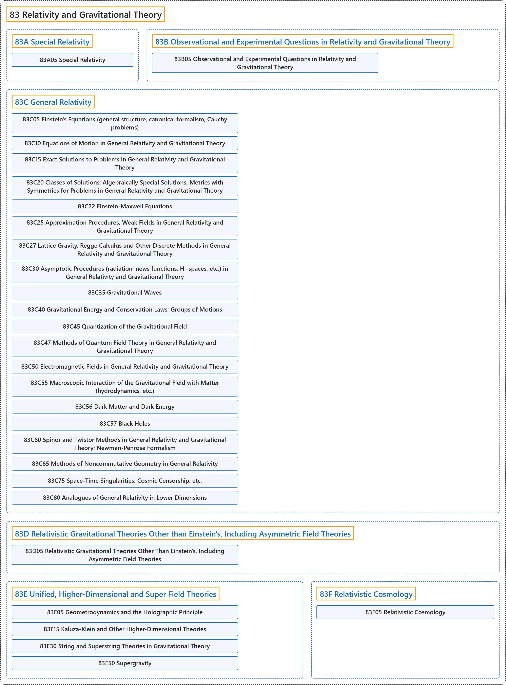

# 83 Relativity and Gravitational Theory

## Classification

## Glossary

| Term | Definition | 中文翻译 | Source |
|---|---|---|---|
| **83 Relativity and Gravitational Theory** 相对论与引力理论 | "A theory invented by Albert Einstein which **describes gravitational forces in terms of the curvature in space caused by the presence of mass**." | 由爱因斯坦（Albert Einstein）提出的理论，它**用质量的存在所引起的空间弯曲来描述引力**。 | [Weisstein, n.d., "General relativity" entry, para. 1](https://scienceworld.wolfram.com/physics/GeneralRelativity.html#:~:text=A%20theory%20invented%20by%20Albert%20Einstein) |
| **[83A Special Relativity](83a-special-relativity.md)** 狭义相对论 | (No definition) | （无定义） | [Associate Editors of Mathematical Reviews and zbMATH, 2020](https://msc2020.org/) |
| **[83B Observational and Experimental Questions in Relativity and Gravitational Theory](83b-observational-and-experimental-questions-in-relativity-and-g.md)** 相对论与引力理论中的观测与实验问题 | (No definition) | （无定义） | [Associate Editors of Mathematical Reviews and zbMATH, 2020](https://msc2020.org/) |
| **[83C General Relativity](83c-general-relativity.md)** 广义相对论 | (No definition) | （无定义） | [Associate Editors of Mathematical Reviews and zbMATH, 2020](https://msc2020.org/) |
| **[83D Relativistic Gravitational Theories Other than Einstein's, Including Asymmetric Field Theories](83d-relativistic-gravitational-theories-other-than-einstein-s-in.md)** 爱因斯坦理论以外的相对论性引力理论，包括非对称场论 | (No definition) | （无定义） | [Associate Editors of Mathematical Reviews and zbMATH, 2020](https://msc2020.org/) |
| **[83E Unified, Higher-Dimensional and Super Field Theories](83e-unified-higher-dimensional-and-super-field-theories.md)** 统一场论、高维场论与超场论 | (No definition) | （无定义） | [Associate Editors of Mathematical Reviews and zbMATH, 2020](https://msc2020.org/) |
| **[83F Relativistic Cosmology](83f-relativistic-cosmology.md)** 相对论宇宙学 | (No definition) | （无定义） | [Associate Editors of Mathematical Reviews and zbMATH, 2020](https://msc2020.org/) |

## References

Associate Editors of Mathematical Reviews and zbMATH. (2020). *MSC2020: Mathematics Subject Classification system*. Retrieved October 27, 2026, from <https://msc2020.org/>

Weisstein, E. W. (n.d.). *General relativity*. Eric Weisstein's World of Physics. Retrieved October 27, 2026, from <https://scienceworld.wolfram.com/physics/GeneralRelativity.html>
