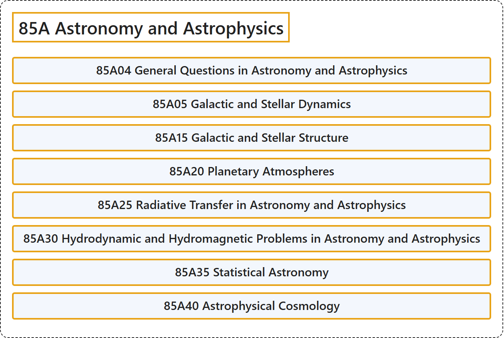

# 85A Astronomy and Astrophysics

## Classification

## Glossary

| Term | Definition | 中文翻译 | Source |
|---|---|---|---|
| **85A Astronomy and Astrophysics** 天文学与天体物理学 | (No definition) | （无定义） | [Associate Editors of Mathematical Reviews and zbMATH, 2020](https://msc2020.org/) |
| **85A04 General Questions in Astronomy and Astrophysics** 天文学与天体物理学中的一般问题 | (No definition) | （无定义） | [Associate Editors of Mathematical Reviews and zbMATH, 2020](https://msc2020.org/) |
| **85A05 Galactic and Stellar Dynamics** 星系与恒星动力学 | (No definition) | （无定义） | [Associate Editors of Mathematical Reviews and zbMATH, 2020](https://msc2020.org/) |
| **85A15 Galactic and Stellar Structure** 星系与恒星结构 | (No definition) | （无定义） | [Associate Editors of Mathematical Reviews and zbMATH, 2020](https://msc2020.org/) |
| **85A20 Planetary Atmospheres** 行星大气 | (No definition) | （无定义） | [Associate Editors of Mathematical Reviews and zbMATH, 2020](https://msc2020.org/) |
| **85A25 Radiative Transfer in Astronomy and Astrophysics** 天文学与天体物理学中的辐射转移 | (No definition) | （无定义） | [Associate Editors of Mathematical Reviews and zbMATH, 2020](https://msc2020.org/) |
| **85A30 Hydrodynamic and Hydromagnetic Problems in Astronomy and Astrophysics** 天文学与天体物理学中的流体动力学与磁流体动力学问题 | (No definition) | （无定义） | [Associate Editors of Mathematical Reviews and zbMATH, 2020](https://msc2020.org/) |
| **85A35 Statistical Astronomy** 统计天文学 | (No definition) | （无定义） | [Associate Editors of Mathematical Reviews and zbMATH, 2020](https://msc2020.org/) |
| **85A40 Astrophysical Cosmology** 天体物理宇宙学 | (No definition) | （无定义） | [Associate Editors of Mathematical Reviews and zbMATH, 2020](https://msc2020.org/) |

## References

Associate Editors of Mathematical Reviews and zbMATH. (2020). *MSC2020: Mathematics Subject Classification system*. Retrieved October 27, 2026, from <https://msc2020.org/>
