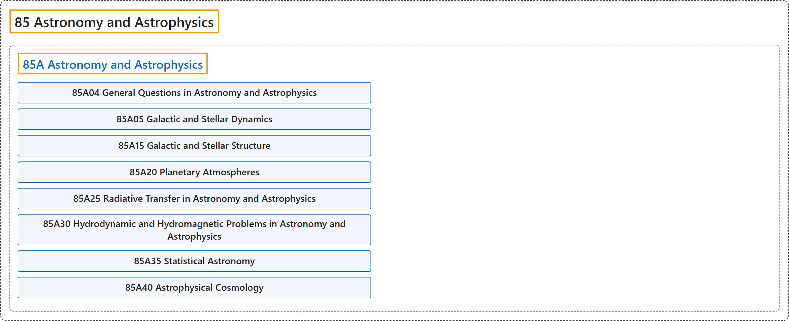

# 85 Astronomy and Astrophysics

## Classification

## Glossary

| Term | Definition | 中文翻译 | Source |
|---|---|---|---|
| **85 Astronomy and Astrophysics** 天文学与天体物理学 | "The study of **the physical properties of astronomical objects**, including stars, planets, black holes, neutron stars, accretion disks, etc." | 对**天体物理性质**的研究，天体包括恒星、行星、黑洞、中子星、吸积盘等。 | [Weisstein, n.d., "Astrophysics" entry, para. 1](https://scienceworld.wolfram.com/physics/Astrophysics.html#:~:text=The%20study%20of%20the%20physical%20properties%20of%20astronomical%20objects) |
| **[85A Astronomy and Astrophysics](85a-astronomy-and-astrophysics.md)** 天文学与天体物理学 | (No definition) | （无定义） | [Associate Editors of Mathematical Reviews and zbMATH, 2020](https://msc2020.org/) |

## References

Associate Editors of Mathematical Reviews and zbMATH. (2020). *MSC2020: Mathematics Subject Classification system*. Retrieved October 27, 2026, from <https://msc2020.org/>

Weisstein, E. W. (n.d.). *Astrophysics*. Eric Weisstein's World of Physics. Retrieved October 27, 2026, from <https://scienceworld.wolfram.com/physics/Astrophysics.html>
