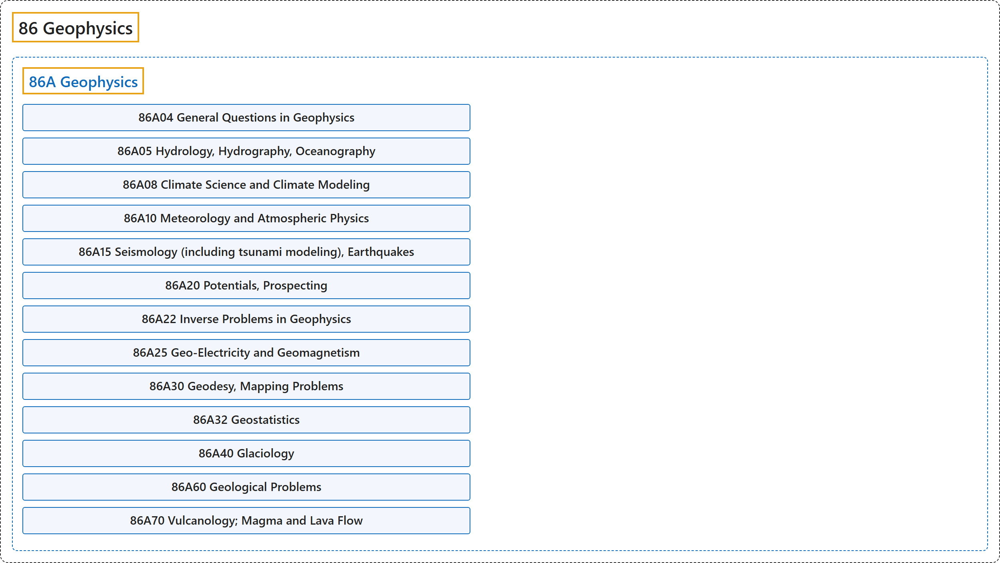

# 86 Geophysics

## Classification

## Glossary

| Term | Definition | 中文翻译 | Source |
|---|---|---|---|
| **86 Geophysics** 地球物理 | (Definition pending: no web source yet.) | （定义待补：暂无网页来源。） | Pending |
| **[86A Geophysics](86a-geophysics.md)** 地球物理学 | (No definition) | （无定义） | [Associate Editors of Mathematical Reviews and zbMATH, 2020](https://msc2020.org/) |

## References

Associate Editors of Mathematical Reviews and zbMATH. (2020). *MSC2020: Mathematics Subject Classification system*. Retrieved October 27, 2026, from <https://msc2020.org/>
