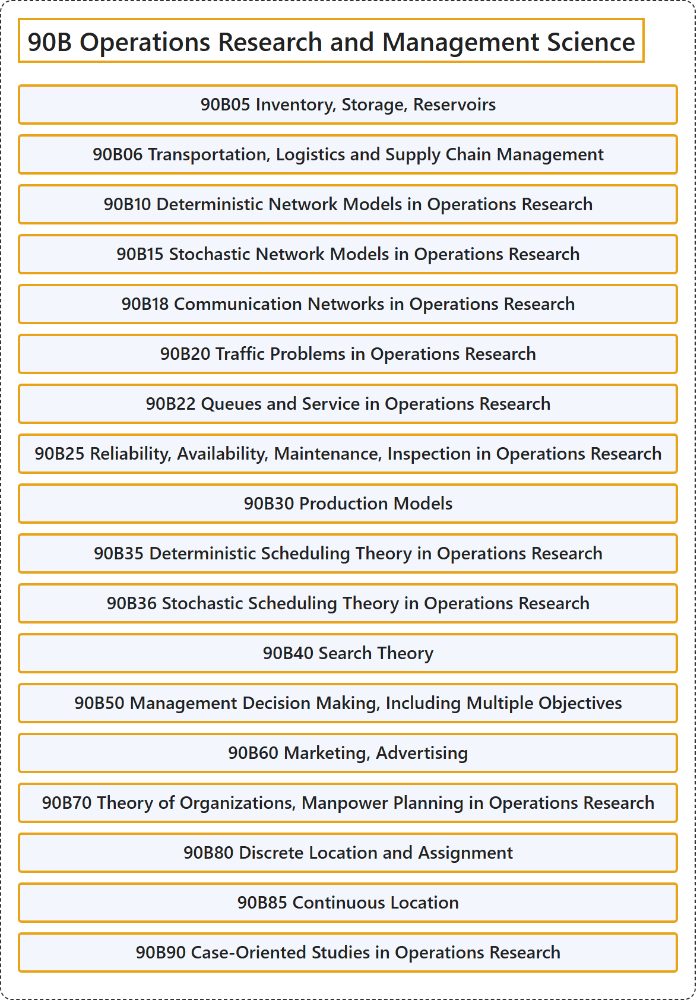

# 90B Operations Research and Management Science

## Classification

## Glossary

| Term | Definition | 中文翻译 | Source |
|---|---|---|---|
| **90B Operations Research and Management Science** 运筹学与管理科学 | (No definition) | （无定义） | [Associate Editors of Mathematical Reviews and zbMATH, 2020](https://msc2020.org/) |
| **90B05 Inventory, Storage, Reservoirs** 库存、储存、水库 | (No definition) | （无定义） | [Associate Editors of Mathematical Reviews and zbMATH, 2020](https://msc2020.org/) |
| **90B06 Transportation, Logistics and Supply Chain Management** 运输、物流与供应链管理 | (No definition) | （无定义） | [Associate Editors of Mathematical Reviews and zbMATH, 2020](https://msc2020.org/) |
| **90B10 Deterministic Network Models in Operations Research** 运筹学中的确定性网络模型 | (No definition) | （无定义） | [Associate Editors of Mathematical Reviews and zbMATH, 2020](https://msc2020.org/) |
| **90B15 Stochastic Network Models in Operations Research** 运筹学中的随机网络模型 | (No definition) | （无定义） | [Associate Editors of Mathematical Reviews and zbMATH, 2020](https://msc2020.org/) |
| **90B18 Communication Networks in Operations Research** 运筹学中的通信网络 | (No definition) | （无定义） | [Associate Editors of Mathematical Reviews and zbMATH, 2020](https://msc2020.org/) |
| **90B20 Traffic Problems in Operations Research** 运筹学中的交通问题 | (No definition) | （无定义） | [Associate Editors of Mathematical Reviews and zbMATH, 2020](https://msc2020.org/) |
| **90B22 Queues and Service in Operations Research** 运筹学中的排队与服务 | (No definition) | （无定义） | [Associate Editors of Mathematical Reviews and zbMATH, 2020](https://msc2020.org/) |
| **90B25 Reliability, Availability, Maintenance, Inspection in Operations Research** 运筹学中的可靠性、可用性、维护、检查 | (No definition) | （无定义） | [Associate Editors of Mathematical Reviews and zbMATH, 2020](https://msc2020.org/) |
| **90B30 Production Models** 生产模型 | (No definition) | （无定义） | [Associate Editors of Mathematical Reviews and zbMATH, 2020](https://msc2020.org/) |
| **90B35 Deterministic Scheduling Theory in Operations Research** 运筹学中的确定性调度理论 | (No definition) | （无定义） | [Associate Editors of Mathematical Reviews and zbMATH, 2020](https://msc2020.org/) |
| **90B36 Stochastic Scheduling Theory in Operations Research** 运筹学中的随机调度理论 | (No definition) | （无定义） | [Associate Editors of Mathematical Reviews and zbMATH, 2020](https://msc2020.org/) |
| **90B40 Search Theory** 搜索理论 | (No definition) | （无定义） | [Associate Editors of Mathematical Reviews and zbMATH, 2020](https://msc2020.org/) |
| **90B50 Management Decision Making, Including Multiple Objectives** 管理决策，包括多目标决策 | (No definition) | （无定义） | [Associate Editors of Mathematical Reviews and zbMATH, 2020](https://msc2020.org/) |
| **90B60 Marketing, Advertising** 市场营销、广告 | (No definition) | （无定义） | [Associate Editors of Mathematical Reviews and zbMATH, 2020](https://msc2020.org/) |
| **90B70 Theory of Organizations, Manpower Planning in Operations Research** 运筹学中的组织理论、人力规划 | (No definition) | （无定义） | [Associate Editors of Mathematical Reviews and zbMATH, 2020](https://msc2020.org/) |
| **90B80 Discrete Location and Assignment** 离散选址与指派 | (No definition) | （无定义） | [Associate Editors of Mathematical Reviews and zbMATH, 2020](https://msc2020.org/) |
| **90B85 Continuous Location** 连续选址 | (No definition) | （无定义） | [Associate Editors of Mathematical Reviews and zbMATH, 2020](https://msc2020.org/) |
| **90B90 Case-Oriented Studies in Operations Research** 运筹学中的案例研究 | (No definition) | （无定义） | [Associate Editors of Mathematical Reviews and zbMATH, 2020](https://msc2020.org/) |

## References

Associate Editors of Mathematical Reviews and zbMATH. (2020). *MSC2020: Mathematics Subject Classification system*. Retrieved October 27, 2026, from <https://msc2020.org/>
