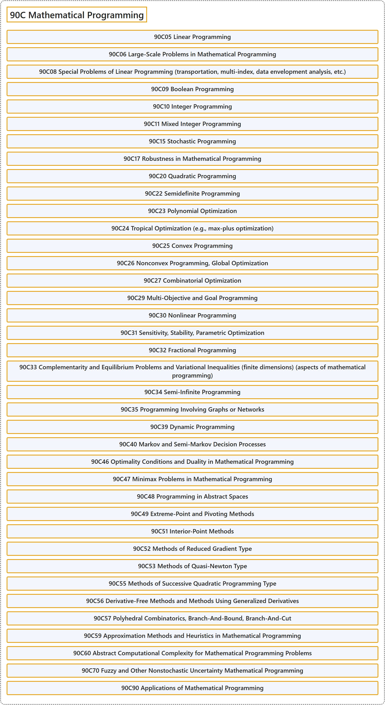

# 90C Mathematical Programming

## Classification

## Glossary

| Term | Definition | 中文翻译 | Source |
|---|---|---|---|
| **90C Mathematical Programming** 数学规划 | (No definition) | （无定义） | [Associate Editors of Mathematical Reviews and zbMATH, 2020](https://msc2020.org/) |
| **90C05 Linear Programming** 线性规划 | (No definition) | （无定义） | [Associate Editors of Mathematical Reviews and zbMATH, 2020](https://msc2020.org/) |
| **90C06 Large-Scale Problems in Mathematical Programming** 数学规划中的大规模问题 | (No definition) | （无定义） | [Associate Editors of Mathematical Reviews and zbMATH, 2020](https://msc2020.org/) |
| **90C08 Special Problems of Linear Programming (transportation, multi-index, data envelopment analysis, etc.)** 线性规划的特殊问题（运输、多指标、数据包络分析等） | (No definition) | （无定义） | [Associate Editors of Mathematical Reviews and zbMATH, 2020](https://msc2020.org/) |
| **90C09 Boolean Programming** 布尔规划 | (No definition) | （无定义） | [Associate Editors of Mathematical Reviews and zbMATH, 2020](https://msc2020.org/) |
| **90C10 Integer Programming** 整数规划 | (No definition) | （无定义） | [Associate Editors of Mathematical Reviews and zbMATH, 2020](https://msc2020.org/) |
| **90C11 Mixed Integer Programming** 混合整数规划 | (No definition) | （无定义） | [Associate Editors of Mathematical Reviews and zbMATH, 2020](https://msc2020.org/) |
| **90C15 Stochastic Programming** 随机规划 | (No definition) | （无定义） | [Associate Editors of Mathematical Reviews and zbMATH, 2020](https://msc2020.org/) |
| **90C17 Robustness in Mathematical Programming** 数学规划中的鲁棒性 | (No definition) | （无定义） | [Associate Editors of Mathematical Reviews and zbMATH, 2020](https://msc2020.org/) |
| **90C20 Quadratic Programming** 二次规划 | (No definition) | （无定义） | [Associate Editors of Mathematical Reviews and zbMATH, 2020](https://msc2020.org/) |
| **90C22 Semidefinite Programming** 半定规划 | (No definition) | （无定义） | [Associate Editors of Mathematical Reviews and zbMATH, 2020](https://msc2020.org/) |
| **90C23 Polynomial Optimization** 多项式优化 | (No definition) | （无定义） | [Associate Editors of Mathematical Reviews and zbMATH, 2020](https://msc2020.org/) |
| **90C24 Tropical Optimization (e.g., max-plus optimization)** 热带优化（如极大加优化） | (No definition) | （无定义） | [Associate Editors of Mathematical Reviews and zbMATH, 2020](https://msc2020.org/) |
| **90C25 Convex Programming** 凸规划 | (No definition) | （无定义） | [Associate Editors of Mathematical Reviews and zbMATH, 2020](https://msc2020.org/) |
| **90C26 Nonconvex Programming, Global Optimization** 非凸规划、全局优化 | (No definition) | （无定义） | [Associate Editors of Mathematical Reviews and zbMATH, 2020](https://msc2020.org/) |
| **90C27 Combinatorial Optimization** 组合优化 | (No definition) | （无定义） | [Associate Editors of Mathematical Reviews and zbMATH, 2020](https://msc2020.org/) |
| **90C29 Multi-Objective and Goal Programming** 多目标规划与目标规划 | (No definition) | （无定义） | [Associate Editors of Mathematical Reviews and zbMATH, 2020](https://msc2020.org/) |
| **90C30 Nonlinear Programming** 非线性规划 | (No definition) | （无定义） | [Associate Editors of Mathematical Reviews and zbMATH, 2020](https://msc2020.org/) |
| **90C31 Sensitivity, Stability, Parametric Optimization** 灵敏度、稳定性、参数优化 | (No definition) | （无定义） | [Associate Editors of Mathematical Reviews and zbMATH, 2020](https://msc2020.org/) |
| **90C32 Fractional Programming** 分式规划 | (No definition) | （无定义） | [Associate Editors of Mathematical Reviews and zbMATH, 2020](https://msc2020.org/) |
| **90C33 Complementarity and Equilibrium Problems and Variational Inequalities (finite dimensions) (aspects of mathematical programming)** 互补与均衡问题及变分不等式（有限维）（数学规划方面） | (No definition) | （无定义） | [Associate Editors of Mathematical Reviews and zbMATH, 2020](https://msc2020.org/) |
| **90C34 Semi-Infinite Programming** 半无限规划 | (No definition) | （无定义） | [Associate Editors of Mathematical Reviews and zbMATH, 2020](https://msc2020.org/) |
| **90C35 Programming Involving Graphs or Networks** 涉及图或网络的规划 | (No definition) | （无定义） | [Associate Editors of Mathematical Reviews and zbMATH, 2020](https://msc2020.org/) |
| **90C39 Dynamic Programming** 动态规划 | (No definition) | （无定义） | [Associate Editors of Mathematical Reviews and zbMATH, 2020](https://msc2020.org/) |
| **90C40 Markov and Semi-Markov Decision Processes** 马尔可夫与半马尔可夫决策过程 | (No definition) | （无定义） | [Associate Editors of Mathematical Reviews and zbMATH, 2020](https://msc2020.org/) |
| **90C46 Optimality Conditions and Duality in Mathematical Programming** 数学规划中的最优性条件与对偶 | (No definition) | （无定义） | [Associate Editors of Mathematical Reviews and zbMATH, 2020](https://msc2020.org/) |
| **90C47 Minimax Problems in Mathematical Programming** 数学规划中的极小极大问题 | (No definition) | （无定义） | [Associate Editors of Mathematical Reviews and zbMATH, 2020](https://msc2020.org/) |
| **90C48 Programming in Abstract Spaces** 抽象空间中的规划 | (No definition) | （无定义） | [Associate Editors of Mathematical Reviews and zbMATH, 2020](https://msc2020.org/) |
| **90C49 Extreme-Point and Pivoting Methods** 极点方法与枢轴方法 | (No definition) | （无定义） | [Associate Editors of Mathematical Reviews and zbMATH, 2020](https://msc2020.org/) |
| **90C51 Interior-Point Methods** 内点法 | (No definition) | （无定义） | [Associate Editors of Mathematical Reviews and zbMATH, 2020](https://msc2020.org/) |
| **90C52 Methods of Reduced Gradient Type** 约化梯度型方法 | (No definition) | （无定义） | [Associate Editors of Mathematical Reviews and zbMATH, 2020](https://msc2020.org/) |
| **90C53 Methods of Quasi-Newton Type** 拟牛顿型方法 | (No definition) | （无定义） | [Associate Editors of Mathematical Reviews and zbMATH, 2020](https://msc2020.org/) |
| **90C55 Methods of Successive Quadratic Programming Type** 逐次二次规划型方法 | (No definition) | （无定义） | [Associate Editors of Mathematical Reviews and zbMATH, 2020](https://msc2020.org/) |
| **90C56 Derivative-Free Methods and Methods Using Generalized Derivatives** 无导数方法与使用广义导数的方法 | (No definition) | （无定义） | [Associate Editors of Mathematical Reviews and zbMATH, 2020](https://msc2020.org/) |
| **90C57 Polyhedral Combinatorics, Branch-And-Bound, Branch-And-Cut** 多面体组合学、分支定界、分支切割 | (No definition) | （无定义） | [Associate Editors of Mathematical Reviews and zbMATH, 2020](https://msc2020.org/) |
| **90C59 Approximation Methods and Heuristics in Mathematical Programming** 数学规划中的逼近方法与启发式方法 | (No definition) | （无定义） | [Associate Editors of Mathematical Reviews and zbMATH, 2020](https://msc2020.org/) |
| **90C60 Abstract Computational Complexity for Mathematical Programming Problems** 数学规划问题的抽象计算复杂度 | (No definition) | （无定义） | [Associate Editors of Mathematical Reviews and zbMATH, 2020](https://msc2020.org/) |
| **90C70 Fuzzy and Other Nonstochastic Uncertainty Mathematical Programming** 模糊及其他非随机不确定性数学规划 | (No definition) | （无定义） | [Associate Editors of Mathematical Reviews and zbMATH, 2020](https://msc2020.org/) |
| **90C90 Applications of Mathematical Programming** 数学规划的应用 | (No definition) | （无定义） | [Associate Editors of Mathematical Reviews and zbMATH, 2020](https://msc2020.org/) |

## References

Associate Editors of Mathematical Reviews and zbMATH. (2020). *MSC2020: Mathematics Subject Classification system*. Retrieved October 27, 2026, from <https://msc2020.org/>
