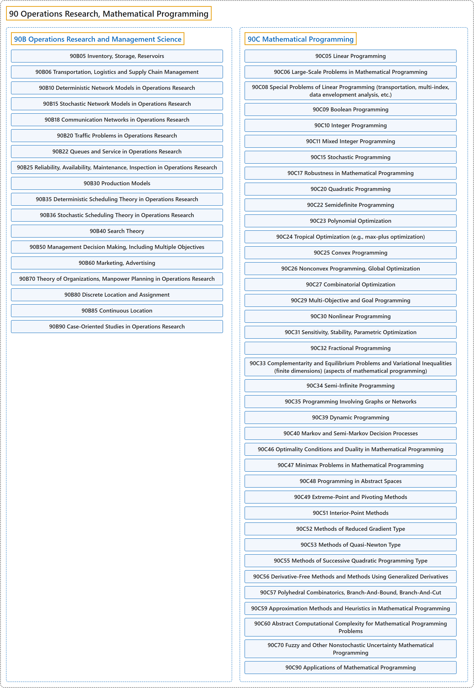

# 90 Operations Research, Mathematical Programming

## Classification

## Glossary

| Term | Definition | 中文翻译 | Source |
|---|---|---|---|
| **90 Operations Research, Mathematical Programming** 运筹学、数学规划 | "Operations research is a vast branch of mathematics which encompasses **many diverse areas of minimization and optimization**." | 运筹学是一个广阔的数学分支，涵盖**极小化与最优化的许多不同领域**。 | [Weisstein, n.d., "Operations research" entry, para. 1](https://mathworld.wolfram.com/OperationsResearch.html#:~:text=Operations%20research%20is%20a%20vast%20branch%20of%20mathematics) |
| **[90B Operations Research and Management Science](90b-operations-research-and-management-science.md)** 运筹学与管理科学 | (No definition) | （无定义） | [Associate Editors of Mathematical Reviews and zbMATH, 2020](https://msc2020.org/) |
| **[90C Mathematical Programming](90c-mathematical-programming.md)** 数学规划 | (No definition) | （无定义） | [Associate Editors of Mathematical Reviews and zbMATH, 2020](https://msc2020.org/) |

## References

Associate Editors of Mathematical Reviews and zbMATH. (2020). *MSC2020: Mathematics Subject Classification system*. Retrieved October 27, 2026, from <https://msc2020.org/>

Weisstein, E. W. (n.d.). *Operations research*. MathWorld: A Wolfram Resource. Retrieved October 27, 2026, from <https://mathworld.wolfram.com/OperationsResearch.html>
