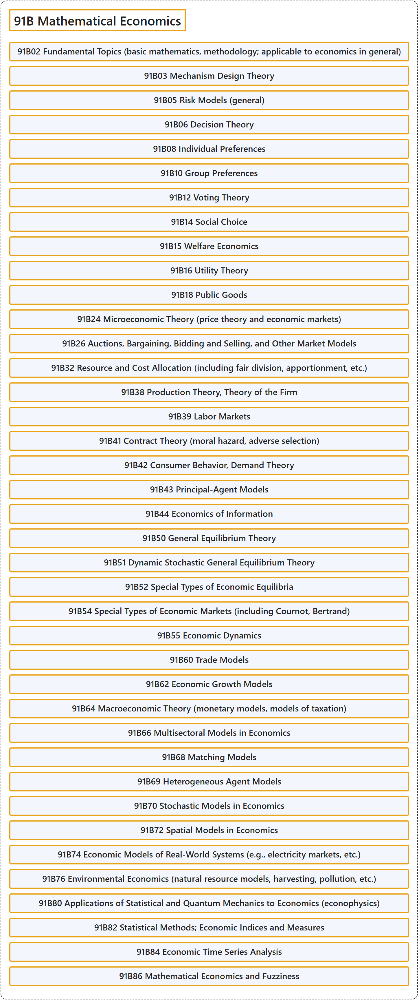

# 91B Mathematical Economics

## Classification

## Glossary

| Term | Definition | 中文翻译 | Source |
|---|---|---|---|
| **91B Mathematical Economics** 数理经济学 | (No definition) | （无定义） | [Associate Editors of Mathematical Reviews and zbMATH, 2020](https://msc2020.org/) |
| **91B02 Fundamental Topics (basic mathematics, methodology; applicable to economics in general)** 基础专题（基础数学、方法论；适用于一般经济学） | (No definition) | （无定义） | [Associate Editors of Mathematical Reviews and zbMATH, 2020](https://msc2020.org/) |
| **91B03 Mechanism Design Theory** 机制设计理论 | (No definition) | （无定义） | [Associate Editors of Mathematical Reviews and zbMATH, 2020](https://msc2020.org/) |
| **91B05 Risk Models (general)** 风险模型（一般） | (No definition) | （无定义） | [Associate Editors of Mathematical Reviews and zbMATH, 2020](https://msc2020.org/) |
| **91B06 Decision Theory** 决策理论 | (No definition) | （无定义） | [Associate Editors of Mathematical Reviews and zbMATH, 2020](https://msc2020.org/) |
| **91B08 Individual Preferences** 个体偏好 | (No definition) | （无定义） | [Associate Editors of Mathematical Reviews and zbMATH, 2020](https://msc2020.org/) |
| **91B10 Group Preferences** 群体偏好 | (No definition) | （无定义） | [Associate Editors of Mathematical Reviews and zbMATH, 2020](https://msc2020.org/) |
| **91B12 Voting Theory** 投票理论 | (No definition) | （无定义） | [Associate Editors of Mathematical Reviews and zbMATH, 2020](https://msc2020.org/) |
| **91B14 Social Choice** 社会选择 | (No definition) | （无定义） | [Associate Editors of Mathematical Reviews and zbMATH, 2020](https://msc2020.org/) |
| **91B15 Welfare Economics** 福利经济学 | (No definition) | （无定义） | [Associate Editors of Mathematical Reviews and zbMATH, 2020](https://msc2020.org/) |
| **91B16 Utility Theory** 效用理论 | (No definition) | （无定义） | [Associate Editors of Mathematical Reviews and zbMATH, 2020](https://msc2020.org/) |
| **91B18 Public Goods** 公共品 | (No definition) | （无定义） | [Associate Editors of Mathematical Reviews and zbMATH, 2020](https://msc2020.org/) |
| **91B24 Microeconomic Theory (price theory and economic markets)** 微观经济理论（价格理论与经济市场） | (No definition) | （无定义） | [Associate Editors of Mathematical Reviews and zbMATH, 2020](https://msc2020.org/) |
| **91B26 Auctions, Bargaining, Bidding and Selling, and Other Market Models** 拍卖、议价、竞标与出售及其他市场模型 | (No definition) | （无定义） | [Associate Editors of Mathematical Reviews and zbMATH, 2020](https://msc2020.org/) |
| **91B32 Resource and Cost Allocation (including fair division, apportionment, etc.)** 资源与成本分配（包括公平分割、按比例分配等） | (No definition) | （无定义） | [Associate Editors of Mathematical Reviews and zbMATH, 2020](https://msc2020.org/) |
| **91B38 Production Theory, Theory of the Firm** 生产理论、企业理论 | (No definition) | （无定义） | [Associate Editors of Mathematical Reviews and zbMATH, 2020](https://msc2020.org/) |
| **91B39 Labor Markets** 劳动力市场 | (No definition) | （无定义） | [Associate Editors of Mathematical Reviews and zbMATH, 2020](https://msc2020.org/) |
| **91B41 Contract Theory (moral hazard, adverse selection)** 契约理论（道德风险、逆向选择） | (No definition) | （无定义） | [Associate Editors of Mathematical Reviews and zbMATH, 2020](https://msc2020.org/) |
| **91B42 Consumer Behavior, Demand Theory** 消费者行为、需求理论 | (No definition) | （无定义） | [Associate Editors of Mathematical Reviews and zbMATH, 2020](https://msc2020.org/) |
| **91B43 Principal-Agent Models** 委托-代理模型 | (No definition) | （无定义） | [Associate Editors of Mathematical Reviews and zbMATH, 2020](https://msc2020.org/) |
| **91B44 Economics of Information** 信息经济学 | (No definition) | （无定义） | [Associate Editors of Mathematical Reviews and zbMATH, 2020](https://msc2020.org/) |
| **91B50 General Equilibrium Theory** 一般均衡理论 | (No definition) | （无定义） | [Associate Editors of Mathematical Reviews and zbMATH, 2020](https://msc2020.org/) |
| **91B51 Dynamic Stochastic General Equilibrium Theory** 动态随机一般均衡理论 | (No definition) | （无定义） | [Associate Editors of Mathematical Reviews and zbMATH, 2020](https://msc2020.org/) |
| **91B52 Special Types of Economic Equilibria** 特殊类型的经济均衡 | (No definition) | （无定义） | [Associate Editors of Mathematical Reviews and zbMATH, 2020](https://msc2020.org/) |
| **91B54 Special Types of Economic Markets (including Cournot, Bertrand)** 特殊类型的经济市场（包括古诺、伯特兰） | (No definition) | （无定义） | [Associate Editors of Mathematical Reviews and zbMATH, 2020](https://msc2020.org/) |
| **91B55 Economic Dynamics** 经济动力学 | (No definition) | （无定义） | [Associate Editors of Mathematical Reviews and zbMATH, 2020](https://msc2020.org/) |
| **91B60 Trade Models** 贸易模型 | (No definition) | （无定义） | [Associate Editors of Mathematical Reviews and zbMATH, 2020](https://msc2020.org/) |
| **91B62 Economic Growth Models** 经济增长模型 | (No definition) | （无定义） | [Associate Editors of Mathematical Reviews and zbMATH, 2020](https://msc2020.org/) |
| **91B64 Macroeconomic Theory (monetary models, models of taxation)** 宏观经济理论（货币模型、税收模型） | (No definition) | （无定义） | [Associate Editors of Mathematical Reviews and zbMATH, 2020](https://msc2020.org/) |
| **91B66 Multisectoral Models in Economics** 经济学中的多部门模型 | (No definition) | （无定义） | [Associate Editors of Mathematical Reviews and zbMATH, 2020](https://msc2020.org/) |
| **91B68 Matching Models** 匹配模型 | (No definition) | （无定义） | [Associate Editors of Mathematical Reviews and zbMATH, 2020](https://msc2020.org/) |
| **91B69 Heterogeneous Agent Models** 异质性主体模型 | (No definition) | （无定义） | [Associate Editors of Mathematical Reviews and zbMATH, 2020](https://msc2020.org/) |
| **91B70 Stochastic Models in Economics** 经济学中的随机模型 | (No definition) | （无定义） | [Associate Editors of Mathematical Reviews and zbMATH, 2020](https://msc2020.org/) |
| **91B72 Spatial Models in Economics** 经济学中的空间模型 | (No definition) | （无定义） | [Associate Editors of Mathematical Reviews and zbMATH, 2020](https://msc2020.org/) |
| **91B74 Economic Models of Real-World Systems (e.g., electricity markets, etc.)** 现实系统的经济模型（如电力市场等） | (No definition) | （无定义） | [Associate Editors of Mathematical Reviews and zbMATH, 2020](https://msc2020.org/) |
| **91B76 Environmental Economics (natural resource models, harvesting, pollution, etc.)** 环境经济学（自然资源模型、捕捞、污染等） | (No definition) | （无定义） | [Associate Editors of Mathematical Reviews and zbMATH, 2020](https://msc2020.org/) |
| **91B80 Applications of Statistical and Quantum Mechanics to Economics (econophysics)** 统计力学与量子力学在经济学中的应用（经济物理学） | (No definition) | （无定义） | [Associate Editors of Mathematical Reviews and zbMATH, 2020](https://msc2020.org/) |
| **91B82 Statistical Methods; Economic Indices and Measures** 统计方法；经济指数与度量 | (No definition) | （无定义） | [Associate Editors of Mathematical Reviews and zbMATH, 2020](https://msc2020.org/) |
| **91B84 Economic Time Series Analysis** 经济时间序列分析 | (No definition) | （无定义） | [Associate Editors of Mathematical Reviews and zbMATH, 2020](https://msc2020.org/) |
| **91B86 Mathematical Economics and Fuzziness** 数理经济学与模糊性 | (No definition) | （无定义） | [Associate Editors of Mathematical Reviews and zbMATH, 2020](https://msc2020.org/) |

## References

Associate Editors of Mathematical Reviews and zbMATH. (2020). *MSC2020: Mathematics Subject Classification system*. Retrieved October 27, 2026, from <https://msc2020.org/>
