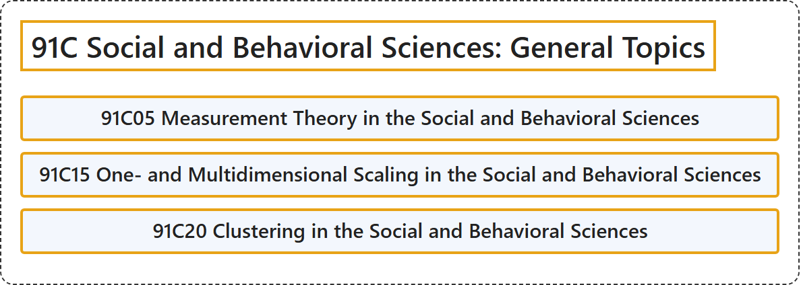

# 91C Social and Behavioral Sciences: General Topics

## Classification

## Glossary

| Term | Definition | 中文翻译 | Source |
|---|---|---|---|
| **91C Social and Behavioral Sciences: General Topics** 社会与行为科学：一般专题 | (No definition) | （无定义） | [Associate Editors of Mathematical Reviews and zbMATH, 2020](https://msc2020.org/) |
| **91C05 Measurement Theory in the Social and Behavioral Sciences** 社会与行为科学中的测量理论 | (No definition) | （无定义） | [Associate Editors of Mathematical Reviews and zbMATH, 2020](https://msc2020.org/) |
| **91C15 One- and Multidimensional Scaling in the Social and Behavioral Sciences** 社会与行为科学中的一维与多维标度 | (No definition) | （无定义） | [Associate Editors of Mathematical Reviews and zbMATH, 2020](https://msc2020.org/) |
| **91C20 Clustering in the Social and Behavioral Sciences** 社会与行为科学中的聚类 | (No definition) | （无定义） | [Associate Editors of Mathematical Reviews and zbMATH, 2020](https://msc2020.org/) |

## References

Associate Editors of Mathematical Reviews and zbMATH. (2020). *MSC2020: Mathematics Subject Classification system*. Retrieved October 27, 2026, from <https://msc2020.org/>
