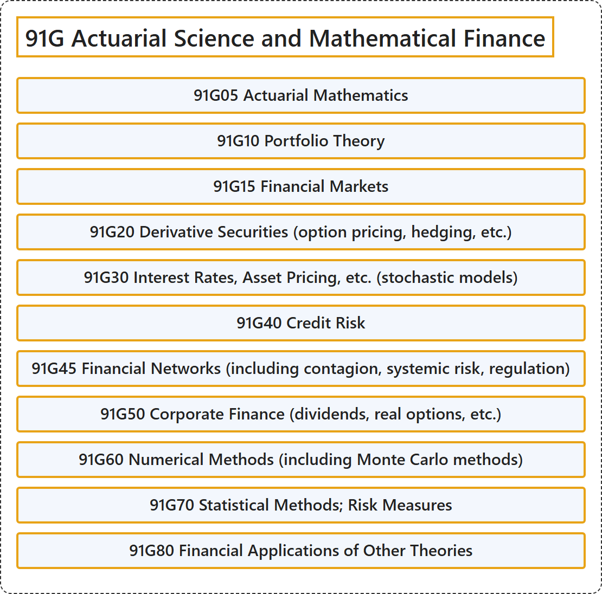

# 91G Actuarial Science and Mathematical Finance

## Classification

## Glossary

| Term | Definition | 中文翻译 | Source |
|---|---|---|---|
| **91G Actuarial Science and Mathematical Finance** 精算科学与数理金融 | (No definition) | （无定义） | [Associate Editors of Mathematical Reviews and zbMATH, 2020](https://msc2020.org/) |
| **91G05 Actuarial Mathematics** 精算数学 | (No definition) | （无定义） | [Associate Editors of Mathematical Reviews and zbMATH, 2020](https://msc2020.org/) |
| **91G10 Portfolio Theory** 投资组合理论 | (No definition) | （无定义） | [Associate Editors of Mathematical Reviews and zbMATH, 2020](https://msc2020.org/) |
| **91G15 Financial Markets** 金融市场 | (No definition) | （无定义） | [Associate Editors of Mathematical Reviews and zbMATH, 2020](https://msc2020.org/) |
| **91G20 Derivative Securities (option pricing, hedging, etc.)** 衍生证券（期权定价、对冲等） | (No definition) | （无定义） | [Associate Editors of Mathematical Reviews and zbMATH, 2020](https://msc2020.org/) |
| **91G30 Interest Rates, Asset Pricing, etc. (stochastic models)** 利率、资产定价等（随机模型） | (No definition) | （无定义） | [Associate Editors of Mathematical Reviews and zbMATH, 2020](https://msc2020.org/) |
| **91G40 Credit Risk** 信用风险 | (No definition) | （无定义） | [Associate Editors of Mathematical Reviews and zbMATH, 2020](https://msc2020.org/) |
| **91G45 Financial Networks (including contagion, systemic risk, regulation)** 金融网络（包括传染、系统性风险、监管） | (No definition) | （无定义） | [Associate Editors of Mathematical Reviews and zbMATH, 2020](https://msc2020.org/) |
| **91G50 Corporate Finance (dividends, real options, etc.)** 公司金融（股息、实物期权等） | (No definition) | （无定义） | [Associate Editors of Mathematical Reviews and zbMATH, 2020](https://msc2020.org/) |
| **91G60 Numerical Methods (including Monte Carlo methods)** 数值方法（包括蒙特卡罗方法） | (No definition) | （无定义） | [Associate Editors of Mathematical Reviews and zbMATH, 2020](https://msc2020.org/) |
| **91G70 Statistical Methods; Risk Measures** 统计方法；风险度量 | (No definition) | （无定义） | [Associate Editors of Mathematical Reviews and zbMATH, 2020](https://msc2020.org/) |
| **91G80 Financial Applications of Other Theories** 其他理论的金融应用 | (No definition) | （无定义） | [Associate Editors of Mathematical Reviews and zbMATH, 2020](https://msc2020.org/) |

## References

Associate Editors of Mathematical Reviews and zbMATH. (2020). *MSC2020: Mathematics Subject Classification system*. Retrieved October 27, 2026, from <https://msc2020.org/>
