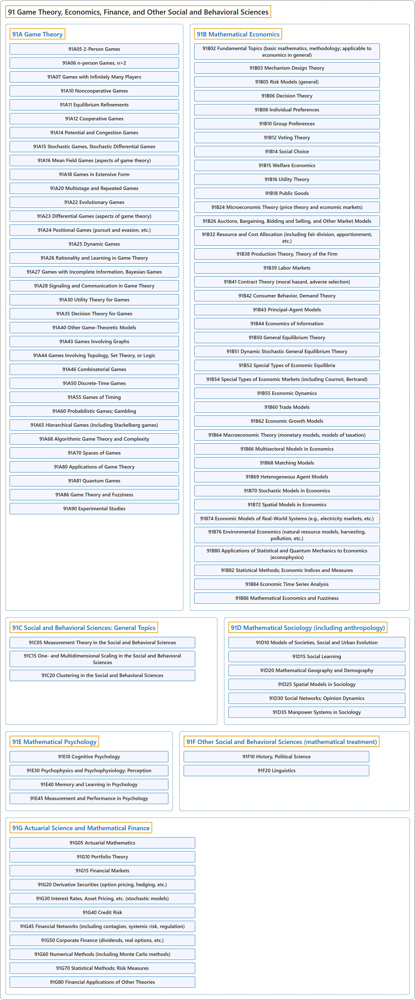

# 91 Game Theory, Economics, Finance, and Other Social and Behavioral Sciences

## Classification

## Glossary

| Term | Definition | 中文翻译 | Source |
|---|---|---|---|
| **91 Game Theory, Economics, Finance, and Other Social and Behavioral Sciences** 博弈论、经济学、金融及其他社会与行为科学 | "Game theory is a branch of mathematics that deals with **the analysis of games** (i.e., situations involving parties with conflicting interests)." | 博弈论是一个数学分支，处理**对博弈的分析**（即涉及利益冲突各方的情形）。 | [Weisstein, n.d., "Game theory" entry, para. 1](https://mathworld.wolfram.com/GameTheory.html#:~:text=Game%20theory%20is%20a%20branch%20of%20mathematics%20that%20deals%20with%20the%20analysis%20of%20games) |
| **[91A Game Theory](91a-game-theory.md)** 博弈论 | (No definition) | （无定义） | [Associate Editors of Mathematical Reviews and zbMATH, 2020](https://msc2020.org/) |
| **[91B Mathematical Economics](91b-mathematical-economics.md)** 数理经济学 | (No definition) | （无定义） | [Associate Editors of Mathematical Reviews and zbMATH, 2020](https://msc2020.org/) |
| **[91C Social and Behavioral Sciences: General Topics](91c-social-and-behavioral-sciences-general-topics.md)** 社会与行为科学：一般专题 | (No definition) | （无定义） | [Associate Editors of Mathematical Reviews and zbMATH, 2020](https://msc2020.org/) |
| **[91D Mathematical Sociology (including anthropology)](91d-mathematical-sociology-including-anthropology.md)** 数理社会学（包括人类学） | (No definition) | （无定义） | [Associate Editors of Mathematical Reviews and zbMATH, 2020](https://msc2020.org/) |
| **[91E Mathematical Psychology](91e-mathematical-psychology.md)** 数理心理学 | (No definition) | （无定义） | [Associate Editors of Mathematical Reviews and zbMATH, 2020](https://msc2020.org/) |
| **[91F Other Social and Behavioral Sciences (mathematical treatment)](91f-other-social-and-behavioral-sciences-mathematical-treatment.md)** 其他社会与行为科学（数学处理） | (No definition) | （无定义） | [Associate Editors of Mathematical Reviews and zbMATH, 2020](https://msc2020.org/) |
| **[91G Actuarial Science and Mathematical Finance](91g-actuarial-science-and-mathematical-finance.md)** 精算科学与数理金融 | (No definition) | （无定义） | [Associate Editors of Mathematical Reviews and zbMATH, 2020](https://msc2020.org/) |

## References

Associate Editors of Mathematical Reviews and zbMATH. (2020). *MSC2020: Mathematics Subject Classification system*. Retrieved October 27, 2026, from <https://msc2020.org/>

Weisstein, E. W. (n.d.). *Game theory*. MathWorld: A Wolfram Resource. Retrieved October 27, 2026, from <https://mathworld.wolfram.com/GameTheory.html>
