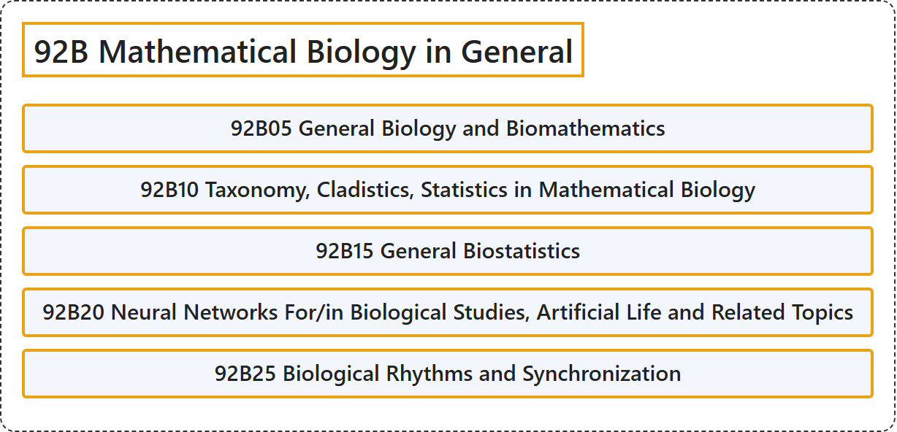

# 92B Mathematical Biology in General

## Classification

## Glossary

| Term | Definition | 中文翻译 | Source |
|---|---|---|---|
| **92B Mathematical Biology in General** 一般数学生物学 | (No definition) | （无定义） | [Associate Editors of Mathematical Reviews and zbMATH, 2020](https://msc2020.org/) |
| **92B05 General Biology and Biomathematics** 一般生物学与生物数学 | (No definition) | （无定义） | [Associate Editors of Mathematical Reviews and zbMATH, 2020](https://msc2020.org/) |
| **92B10 Taxonomy, Cladistics, Statistics in Mathematical Biology** 数学生物学中的分类学、支序分类学、统计 | (No definition) | （无定义） | [Associate Editors of Mathematical Reviews and zbMATH, 2020](https://msc2020.org/) |
| **92B15 General Biostatistics** 一般生物统计学 | (No definition) | （无定义） | [Associate Editors of Mathematical Reviews and zbMATH, 2020](https://msc2020.org/) |
| **92B20 Neural Networks For/in Biological Studies, Artificial Life and Related Topics** 生物学研究中的神经网络、人工生命及相关专题 | (No definition) | （无定义） | [Associate Editors of Mathematical Reviews and zbMATH, 2020](https://msc2020.org/) |
| **92B25 Biological Rhythms and Synchronization** 生物节律与同步 | (No definition) | （无定义） | [Associate Editors of Mathematical Reviews and zbMATH, 2020](https://msc2020.org/) |

## References

Associate Editors of Mathematical Reviews and zbMATH. (2020). *MSC2020: Mathematics Subject Classification system*. Retrieved October 27, 2026, from <https://msc2020.org/>
