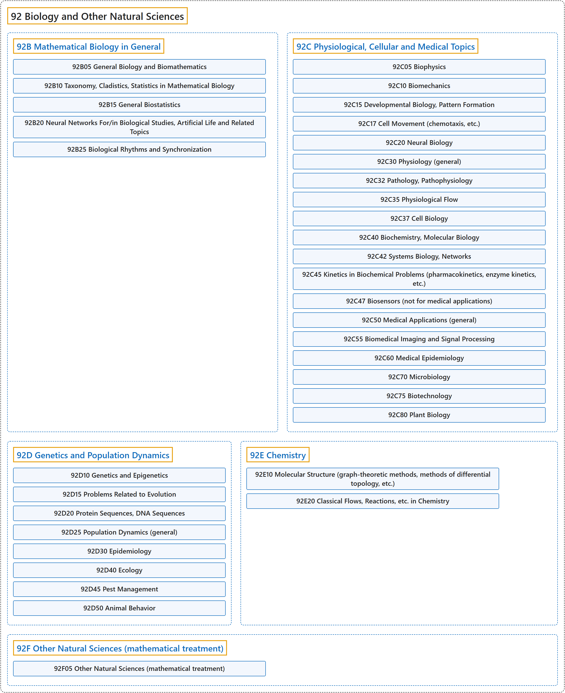

# 92 Biology and Other Natural Sciences

## Classification

## Glossary

| Term | Definition | 中文翻译 | Source |
|---|---|---|---|
| **92 Biology and Other Natural Sciences** 生物学及其他自然科学 | "Mathematical biology is the use of **mathematical methods to formulate and analyze models of biological systems**." | 数学生物学是运用**数学方法来建立和分析生物系统的模型**。 | [Weisstein, n.d., "Mathematical biology" entry, para. 1](https://mathworld.wolfram.com/MathematicalBiology.html#:~:text=Mathematical%20biology%20is%20the%20use%20of%20mathematical%20methods) |
| **[92B Mathematical Biology in General](92b-mathematical-biology-in-general.md)** 一般数学生物学 | (No definition) | （无定义） | [Associate Editors of Mathematical Reviews and zbMATH, 2020](https://msc2020.org/) |
| **[92C Physiological, Cellular and Medical Topics](92c-physiological-cellular-and-medical-topics.md)** 生理、细胞与医学专题 | (No definition) | （无定义） | [Associate Editors of Mathematical Reviews and zbMATH, 2020](https://msc2020.org/) |
| **[92D Genetics and Population Dynamics](92d-genetics-and-population-dynamics.md)** 遗传学与种群动力学 | (No definition) | （无定义） | [Associate Editors of Mathematical Reviews and zbMATH, 2020](https://msc2020.org/) |
| **[92E Chemistry](92e-chemistry.md)** 化学 | (No definition) | （无定义） | [Associate Editors of Mathematical Reviews and zbMATH, 2020](https://msc2020.org/) |
| **[92F Other Natural Sciences (mathematical treatment)](92f-other-natural-sciences-mathematical-treatment.md)** 其他自然科学（数学处理） | (No definition) | （无定义） | [Associate Editors of Mathematical Reviews and zbMATH, 2020](https://msc2020.org/) |

## References

Associate Editors of Mathematical Reviews and zbMATH. (2020). *MSC2020: Mathematics Subject Classification system*. Retrieved October 27, 2026, from <https://msc2020.org/>

Weisstein, E. W. (n.d.). *Mathematical biology*. MathWorld: A Wolfram Resource. Retrieved October 27, 2026, from <https://mathworld.wolfram.com/MathematicalBiology.html>
