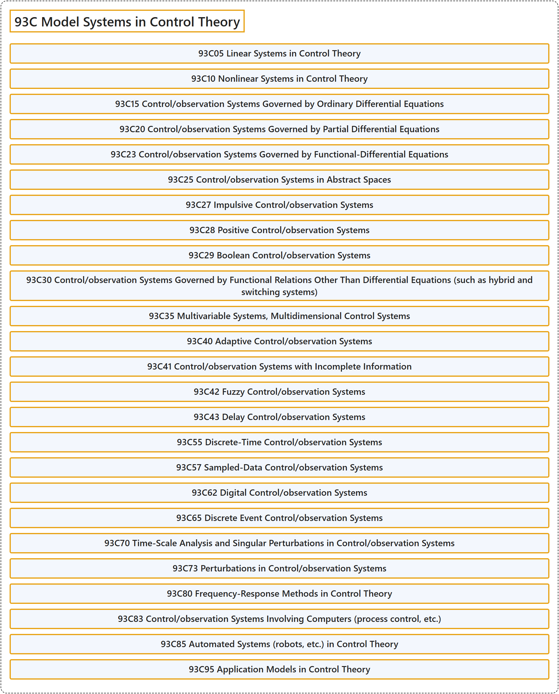

# 93C Model Systems in Control Theory

## Classification

## Glossary

| Term | Definition | 中文翻译 | Source |
|---|---|---|---|
| **93C Model Systems in Control Theory** 控制理论中的模型系统 | (No definition) | （无定义） | [Associate Editors of Mathematical Reviews and zbMATH, 2020](https://msc2020.org/) |
| **93C05 Linear Systems in Control Theory** 控制理论中的线性系统 | (No definition) | （无定义） | [Associate Editors of Mathematical Reviews and zbMATH, 2020](https://msc2020.org/) |
| **93C10 Nonlinear Systems in Control Theory** 控制理论中的非线性系统 | (No definition) | （无定义） | [Associate Editors of Mathematical Reviews and zbMATH, 2020](https://msc2020.org/) |
| **93C15 Control/observation Systems Governed by Ordinary Differential Equations** 由常微分方程支配的控制/观测系统 | (No definition) | （无定义） | [Associate Editors of Mathematical Reviews and zbMATH, 2020](https://msc2020.org/) |
| **93C20 Control/observation Systems Governed by Partial Differential Equations** 由偏微分方程支配的控制/观测系统 | (No definition) | （无定义） | [Associate Editors of Mathematical Reviews and zbMATH, 2020](https://msc2020.org/) |
| **93C23 Control/observation Systems Governed by Functional-Differential Equations** 由泛函微分方程支配的控制/观测系统 | (No definition) | （无定义） | [Associate Editors of Mathematical Reviews and zbMATH, 2020](https://msc2020.org/) |
| **93C25 Control/observation Systems in Abstract Spaces** 抽象空间中的控制/观测系统 | (No definition) | （无定义） | [Associate Editors of Mathematical Reviews and zbMATH, 2020](https://msc2020.org/) |
| **93C27 Impulsive Control/observation Systems** 脉冲控制/观测系统 | (No definition) | （无定义） | [Associate Editors of Mathematical Reviews and zbMATH, 2020](https://msc2020.org/) |
| **93C28 Positive Control/observation Systems** 正控制/观测系统 | (No definition) | （无定义） | [Associate Editors of Mathematical Reviews and zbMATH, 2020](https://msc2020.org/) |
| **93C29 Boolean Control/observation Systems** 布尔控制/观测系统 | (No definition) | （无定义） | [Associate Editors of Mathematical Reviews and zbMATH, 2020](https://msc2020.org/) |
| **93C30 Control/observation Systems Governed by Functional Relations Other Than Differential Equations (such as hybrid and switching systems)** 由微分方程以外的泛函关系支配的控制/观测系统（如混杂系统与切换系统） | (No definition) | （无定义） | [Associate Editors of Mathematical Reviews and zbMATH, 2020](https://msc2020.org/) |
| **93C35 Multivariable Systems, Multidimensional Control Systems** 多变量系统、多维控制系统 | (No definition) | （无定义） | [Associate Editors of Mathematical Reviews and zbMATH, 2020](https://msc2020.org/) |
| **93C40 Adaptive Control/observation Systems** 自适应控制/观测系统 | (No definition) | （无定义） | [Associate Editors of Mathematical Reviews and zbMATH, 2020](https://msc2020.org/) |
| **93C41 Control/observation Systems with Incomplete Information** 不完全信息的控制/观测系统 | (No definition) | （无定义） | [Associate Editors of Mathematical Reviews and zbMATH, 2020](https://msc2020.org/) |
| **93C42 Fuzzy Control/observation Systems** 模糊控制/观测系统 | (No definition) | （无定义） | [Associate Editors of Mathematical Reviews and zbMATH, 2020](https://msc2020.org/) |
| **93C43 Delay Control/observation Systems** 时滞控制/观测系统 | (No definition) | （无定义） | [Associate Editors of Mathematical Reviews and zbMATH, 2020](https://msc2020.org/) |
| **93C55 Discrete-Time Control/observation Systems** 离散时间控制/观测系统 | (No definition) | （无定义） | [Associate Editors of Mathematical Reviews and zbMATH, 2020](https://msc2020.org/) |
| **93C57 Sampled-Data Control/observation Systems** 采样数据控制/观测系统 | (No definition) | （无定义） | [Associate Editors of Mathematical Reviews and zbMATH, 2020](https://msc2020.org/) |
| **93C62 Digital Control/observation Systems** 数字控制/观测系统 | (No definition) | （无定义） | [Associate Editors of Mathematical Reviews and zbMATH, 2020](https://msc2020.org/) |
| **93C65 Discrete Event Control/observation Systems** 离散事件控制/观测系统 | (No definition) | （无定义） | [Associate Editors of Mathematical Reviews and zbMATH, 2020](https://msc2020.org/) |
| **93C70 Time-Scale Analysis and Singular Perturbations in Control/observation Systems** 控制/观测系统中的时间尺度分析与奇异摄动 | (No definition) | （无定义） | [Associate Editors of Mathematical Reviews and zbMATH, 2020](https://msc2020.org/) |
| **93C73 Perturbations in Control/observation Systems** 控制/观测系统中的摄动 | (No definition) | （无定义） | [Associate Editors of Mathematical Reviews and zbMATH, 2020](https://msc2020.org/) |
| **93C80 Frequency-Response Methods in Control Theory** 控制理论中的频率响应方法 | (No definition) | （无定义） | [Associate Editors of Mathematical Reviews and zbMATH, 2020](https://msc2020.org/) |
| **93C83 Control/observation Systems Involving Computers (process control, etc.)** 涉及计算机的控制/观测系统（过程控制等） | (No definition) | （无定义） | [Associate Editors of Mathematical Reviews and zbMATH, 2020](https://msc2020.org/) |
| **93C85 Automated Systems (robots, etc.) in Control Theory** 控制理论中的自动化系统（机器人等） | (No definition) | （无定义） | [Associate Editors of Mathematical Reviews and zbMATH, 2020](https://msc2020.org/) |
| **93C95 Application Models in Control Theory** 控制理论中的应用模型 | (No definition) | （无定义） | [Associate Editors of Mathematical Reviews and zbMATH, 2020](https://msc2020.org/) |

## References

Associate Editors of Mathematical Reviews and zbMATH. (2020). *MSC2020: Mathematics Subject Classification system*. Retrieved October 27, 2026, from <https://msc2020.org/>
