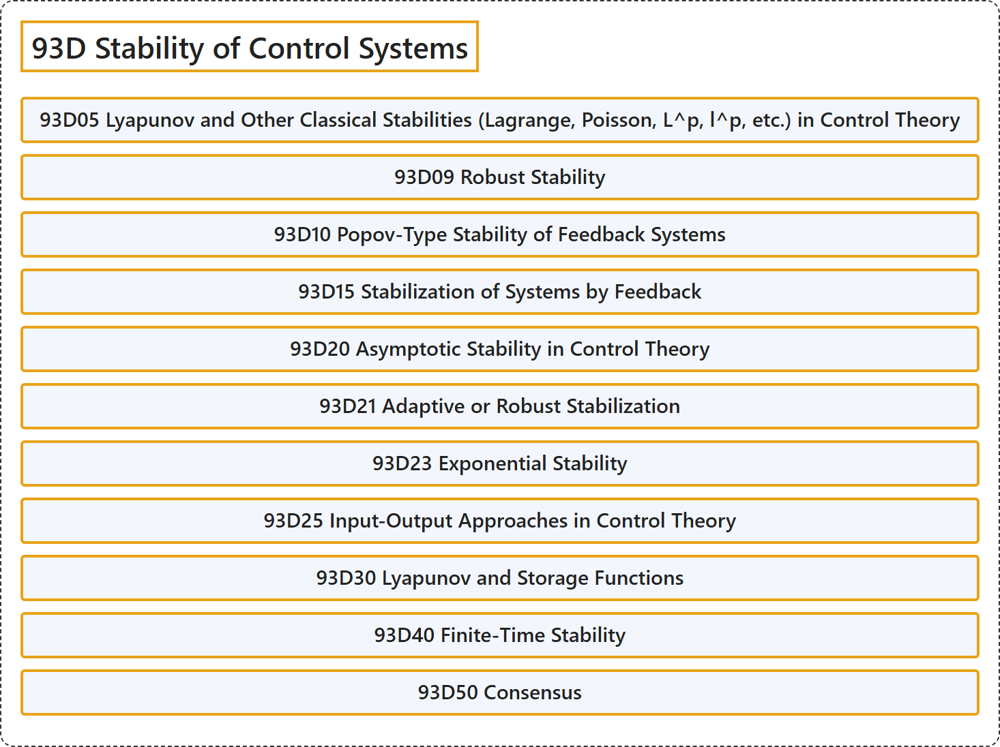

# 93D Stability of Control Systems

## Classification

## Glossary

| Term | Definition | 中文翻译 | Source |
|---|---|---|---|
| **93D Stability of Control Systems** 控制系统的稳定性 | (No definition) | （无定义） | [Associate Editors of Mathematical Reviews and zbMATH, 2020](https://msc2020.org/) |
| **93D05 Lyapunov and Other Classical Stabilities (Lagrange, Poisson, L^p, l^p, etc.) in Control Theory** 控制理论中的李雅普诺夫稳定性及其他经典稳定性（拉格朗日、泊松、L^p、l^p 等） | (No definition) | （无定义） | [Associate Editors of Mathematical Reviews and zbMATH, 2020](https://msc2020.org/) |
| **93D09 Robust Stability** 鲁棒稳定性 | (No definition) | （无定义） | [Associate Editors of Mathematical Reviews and zbMATH, 2020](https://msc2020.org/) |
| **93D10 Popov-Type Stability of Feedback Systems** 反馈系统的波波夫型稳定性 | (No definition) | （无定义） | [Associate Editors of Mathematical Reviews and zbMATH, 2020](https://msc2020.org/) |
| **93D15 Stabilization of Systems by Feedback** 系统的反馈镇定 | (No definition) | （无定义） | [Associate Editors of Mathematical Reviews and zbMATH, 2020](https://msc2020.org/) |
| **93D20 Asymptotic Stability in Control Theory** 控制理论中的渐近稳定性 | (No definition) | （无定义） | [Associate Editors of Mathematical Reviews and zbMATH, 2020](https://msc2020.org/) |
| **93D21 Adaptive or Robust Stabilization** 自适应镇定或鲁棒镇定 | (No definition) | （无定义） | [Associate Editors of Mathematical Reviews and zbMATH, 2020](https://msc2020.org/) |
| **93D23 Exponential Stability** 指数稳定性 | (No definition) | （无定义） | [Associate Editors of Mathematical Reviews and zbMATH, 2020](https://msc2020.org/) |
| **93D25 Input-Output Approaches in Control Theory** 控制理论中的输入输出方法 | (No definition) | （无定义） | [Associate Editors of Mathematical Reviews and zbMATH, 2020](https://msc2020.org/) |
| **93D30 Lyapunov and Storage Functions** 李雅普诺夫函数与存储函数 | (No definition) | （无定义） | [Associate Editors of Mathematical Reviews and zbMATH, 2020](https://msc2020.org/) |
| **93D40 Finite-Time Stability** 有限时间稳定性 | (No definition) | （无定义） | [Associate Editors of Mathematical Reviews and zbMATH, 2020](https://msc2020.org/) |
| **93D50 Consensus** 一致性 | (No definition) | （无定义） | [Associate Editors of Mathematical Reviews and zbMATH, 2020](https://msc2020.org/) |

## References

Associate Editors of Mathematical Reviews and zbMATH. (2020). *MSC2020: Mathematics Subject Classification system*. Retrieved October 27, 2026, from <https://msc2020.org/>
