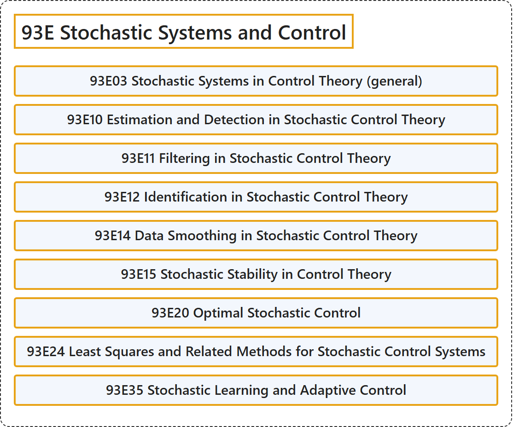

# 93E Stochastic Systems and Control

## Classification

## Glossary

| Term | Definition | 中文翻译 | Source |
|---|---|---|---|
| **93E Stochastic Systems and Control** 随机系统与控制 | (No definition) | （无定义） | [Associate Editors of Mathematical Reviews and zbMATH, 2020](https://msc2020.org/) |
| **93E03 Stochastic Systems in Control Theory (general)** 控制理论中的随机系统（一般） | (No definition) | （无定义） | [Associate Editors of Mathematical Reviews and zbMATH, 2020](https://msc2020.org/) |
| **93E10 Estimation and Detection in Stochastic Control Theory** 随机控制理论中的估计与检测 | (No definition) | （无定义） | [Associate Editors of Mathematical Reviews and zbMATH, 2020](https://msc2020.org/) |
| **93E11 Filtering in Stochastic Control Theory** 随机控制理论中的滤波 | (No definition) | （无定义） | [Associate Editors of Mathematical Reviews and zbMATH, 2020](https://msc2020.org/) |
| **93E12 Identification in Stochastic Control Theory** 随机控制理论中的辨识 | (No definition) | （无定义） | [Associate Editors of Mathematical Reviews and zbMATH, 2020](https://msc2020.org/) |
| **93E14 Data Smoothing in Stochastic Control Theory** 随机控制理论中的数据平滑 | (No definition) | （无定义） | [Associate Editors of Mathematical Reviews and zbMATH, 2020](https://msc2020.org/) |
| **93E15 Stochastic Stability in Control Theory** 控制理论中的随机稳定性 | (No definition) | （无定义） | [Associate Editors of Mathematical Reviews and zbMATH, 2020](https://msc2020.org/) |
| **93E20 Optimal Stochastic Control** 最优随机控制 | (No definition) | （无定义） | [Associate Editors of Mathematical Reviews and zbMATH, 2020](https://msc2020.org/) |
| **93E24 Least Squares and Related Methods for Stochastic Control Systems** 随机控制系统的最小二乘及相关方法 | (No definition) | （无定义） | [Associate Editors of Mathematical Reviews and zbMATH, 2020](https://msc2020.org/) |
| **93E35 Stochastic Learning and Adaptive Control** 随机学习与自适应控制 | (No definition) | （无定义） | [Associate Editors of Mathematical Reviews and zbMATH, 2020](https://msc2020.org/) |

## References

Associate Editors of Mathematical Reviews and zbMATH. (2020). *MSC2020: Mathematics Subject Classification system*. Retrieved October 27, 2026, from <https://msc2020.org/>
