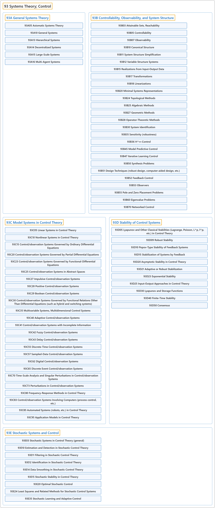

# 93 Systems Theory; Control

## Classification

## Glossary

| Term | Definition | 中文翻译 | Source |
|---|---|---|---|
| **93 Systems Theory; Control** 系统论；控制 | "The mathematical study of **how to manipulate the parameters affecting the behavior of a system** to produce the desired or optimal outcome." | 对**如何调节影响系统行为的参数**、以得到期望或最优结果所作的数学研究。 | [Weisstein, n.d., "Control theory" entry, para. 1](https://mathworld.wolfram.com/ControlTheory.html#:~:text=The%20mathematical%20study%20of%20how%20to%20manipulate%20the%20parameters) |
| **[93A General Systems Theory](93a-general-systems-theory.md)** 一般系统论 | (No definition) | （无定义） | [Associate Editors of Mathematical Reviews and zbMATH, 2020](https://msc2020.org/) |
| **[93B Controllability, Observability, and System Structure](93b-controllability-observability-and-system-structure.md)** 可控性、可观测性与系统结构 | (No definition) | （无定义） | [Associate Editors of Mathematical Reviews and zbMATH, 2020](https://msc2020.org/) |
| **[93C Model Systems in Control Theory](93c-model-systems-in-control-theory.md)** 控制理论中的模型系统 | (No definition) | （无定义） | [Associate Editors of Mathematical Reviews and zbMATH, 2020](https://msc2020.org/) |
| **[93D Stability of Control Systems](93d-stability-of-control-systems.md)** 控制系统的稳定性 | (No definition) | （无定义） | [Associate Editors of Mathematical Reviews and zbMATH, 2020](https://msc2020.org/) |
| **[93E Stochastic Systems and Control](93e-stochastic-systems-and-control.md)** 随机系统与控制 | (No definition) | （无定义） | [Associate Editors of Mathematical Reviews and zbMATH, 2020](https://msc2020.org/) |

## References

Associate Editors of Mathematical Reviews and zbMATH. (2020). *MSC2020: Mathematics Subject Classification system*. Retrieved October 27, 2026, from <https://msc2020.org/>

Weisstein, E. W. (n.d.). *Control theory*. MathWorld: A Wolfram Resource. Retrieved October 27, 2026, from <https://mathworld.wolfram.com/ControlTheory.html>
