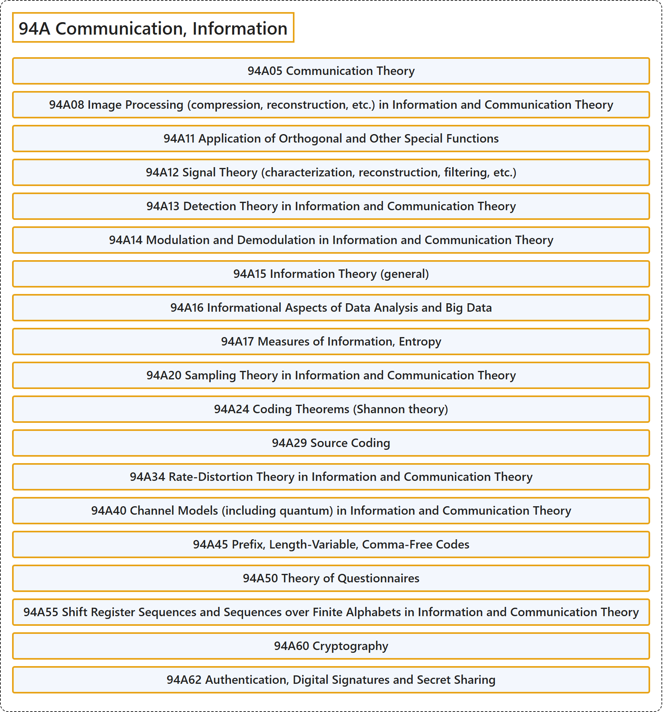

# 94A Communication, Information

## Classification

## Glossary

| Term | Definition | 中文翻译 | Source |
|---|---|---|---|
| **94A Communication, Information** 通信、信息 | (No definition) | （无定义） | [Associate Editors of Mathematical Reviews and zbMATH, 2020](https://msc2020.org/) |
| **94A05 Communication Theory** 通信理论 | (No definition) | （无定义） | [Associate Editors of Mathematical Reviews and zbMATH, 2020](https://msc2020.org/) |
| **94A08 Image Processing (compression, reconstruction, etc.) in Information and Communication Theory** 信息与通信理论中的图像处理（压缩、重建等） | (No definition) | （无定义） | [Associate Editors of Mathematical Reviews and zbMATH, 2020](https://msc2020.org/) |
| **94A11 Application of Orthogonal and Other Special Functions** 正交函数及其他特殊函数的应用 | (No definition) | （无定义） | [Associate Editors of Mathematical Reviews and zbMATH, 2020](https://msc2020.org/) |
| **94A12 Signal Theory (characterization, reconstruction, filtering, etc.)** 信号理论（刻画、重建、滤波等） | (No definition) | （无定义） | [Associate Editors of Mathematical Reviews and zbMATH, 2020](https://msc2020.org/) |
| **94A13 Detection Theory in Information and Communication Theory** 信息与通信理论中的检测理论 | (No definition) | （无定义） | [Associate Editors of Mathematical Reviews and zbMATH, 2020](https://msc2020.org/) |
| **94A14 Modulation and Demodulation in Information and Communication Theory** 信息与通信理论中的调制与解调 | (No definition) | （无定义） | [Associate Editors of Mathematical Reviews and zbMATH, 2020](https://msc2020.org/) |
| **94A15 Information Theory (general)** 信息论（一般） | (No definition) | （无定义） | [Associate Editors of Mathematical Reviews and zbMATH, 2020](https://msc2020.org/) |
| **94A16 Informational Aspects of Data Analysis and Big Data** 数据分析与大数据的信息方面 | (No definition) | （无定义） | [Associate Editors of Mathematical Reviews and zbMATH, 2020](https://msc2020.org/) |
| **94A17 Measures of Information, Entropy** 信息度量、熵 | (No definition) | （无定义） | [Associate Editors of Mathematical Reviews and zbMATH, 2020](https://msc2020.org/) |
| **94A20 Sampling Theory in Information and Communication Theory** 信息与通信理论中的采样理论 | (No definition) | （无定义） | [Associate Editors of Mathematical Reviews and zbMATH, 2020](https://msc2020.org/) |
| **94A24 Coding Theorems (Shannon theory)** 编码定理（香农理论） | (No definition) | （无定义） | [Associate Editors of Mathematical Reviews and zbMATH, 2020](https://msc2020.org/) |
| **94A29 Source Coding** 信源编码 | (No definition) | （无定义） | [Associate Editors of Mathematical Reviews and zbMATH, 2020](https://msc2020.org/) |
| **94A34 Rate-Distortion Theory in Information and Communication Theory** 信息与通信理论中的率失真理论 | (No definition) | （无定义） | [Associate Editors of Mathematical Reviews and zbMATH, 2020](https://msc2020.org/) |
| **94A40 Channel Models (including quantum) in Information and Communication Theory** 信息与通信理论中的信道模型（包括量子信道） | (No definition) | （无定义） | [Associate Editors of Mathematical Reviews and zbMATH, 2020](https://msc2020.org/) |
| **94A45 Prefix, Length-Variable, Comma-Free Codes** 前缀码、变长码、无逗号码 | (No definition) | （无定义） | [Associate Editors of Mathematical Reviews and zbMATH, 2020](https://msc2020.org/) |
| **94A50 Theory of Questionnaires** 问卷理论 | (No definition) | （无定义） | [Associate Editors of Mathematical Reviews and zbMATH, 2020](https://msc2020.org/) |
| **94A55 Shift Register Sequences and Sequences over Finite Alphabets in Information and Communication Theory** 信息与通信理论中的移位寄存器序列与有限字母表上的序列 | (No definition) | （无定义） | [Associate Editors of Mathematical Reviews and zbMATH, 2020](https://msc2020.org/) |
| **94A60 Cryptography** 密码学 | (No definition) | （无定义） | [Associate Editors of Mathematical Reviews and zbMATH, 2020](https://msc2020.org/) |
| **94A62 Authentication, Digital Signatures and Secret Sharing** 认证、数字签名与秘密共享 | (No definition) | （无定义） | [Associate Editors of Mathematical Reviews and zbMATH, 2020](https://msc2020.org/) |

## References

Associate Editors of Mathematical Reviews and zbMATH. (2020). *MSC2020: Mathematics Subject Classification system*. Retrieved October 27, 2026, from <https://msc2020.org/>
