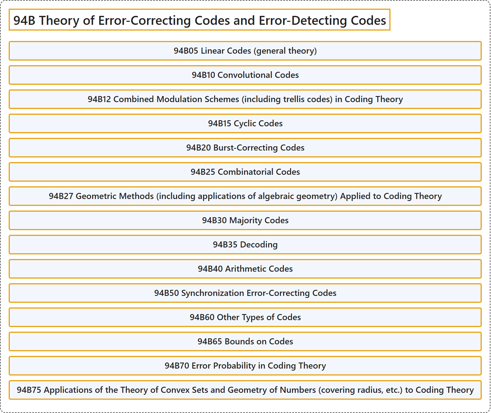

# 94B Theory of Error-Correcting Codes and Error-Detecting Codes

## Classification

## Glossary

| Term | Definition | 中文翻译 | Source |
|---|---|---|---|
| **94B Theory of Error-Correcting Codes and Error-Detecting Codes** 纠错码与检错码理论 | (No definition) | （无定义） | [Associate Editors of Mathematical Reviews and zbMATH, 2020](https://msc2020.org/) |
| **94B05 Linear Codes (general theory)** 线性码（一般理论） | (No definition) | （无定义） | [Associate Editors of Mathematical Reviews and zbMATH, 2020](https://msc2020.org/) |
| **94B10 Convolutional Codes** 卷积码 | (No definition) | （无定义） | [Associate Editors of Mathematical Reviews and zbMATH, 2020](https://msc2020.org/) |
| **94B12 Combined Modulation Schemes (including trellis codes) in Coding Theory** 编码理论中的组合调制方案（包括格码） | (No definition) | （无定义） | [Associate Editors of Mathematical Reviews and zbMATH, 2020](https://msc2020.org/) |
| **94B15 Cyclic Codes** 循环码 | (No definition) | （无定义） | [Associate Editors of Mathematical Reviews and zbMATH, 2020](https://msc2020.org/) |
| **94B20 Burst-Correcting Codes** 突发纠错码 | (No definition) | （无定义） | [Associate Editors of Mathematical Reviews and zbMATH, 2020](https://msc2020.org/) |
| **94B25 Combinatorial Codes** 组合码 | (No definition) | （无定义） | [Associate Editors of Mathematical Reviews and zbMATH, 2020](https://msc2020.org/) |
| **94B27 Geometric Methods (including applications of algebraic geometry) Applied to Coding Theory** 应用于编码理论的几何方法（包括代数几何的应用） | (No definition) | （无定义） | [Associate Editors of Mathematical Reviews and zbMATH, 2020](https://msc2020.org/) |
| **94B30 Majority Codes** 多数码 | (No definition) | （无定义） | [Associate Editors of Mathematical Reviews and zbMATH, 2020](https://msc2020.org/) |
| **94B35 Decoding** 译码 | (No definition) | （无定义） | [Associate Editors of Mathematical Reviews and zbMATH, 2020](https://msc2020.org/) |
| **94B40 Arithmetic Codes** 算术码 | (No definition) | （无定义） | [Associate Editors of Mathematical Reviews and zbMATH, 2020](https://msc2020.org/) |
| **94B50 Synchronization Error-Correcting Codes** 同步纠错码 | (No definition) | （无定义） | [Associate Editors of Mathematical Reviews and zbMATH, 2020](https://msc2020.org/) |
| **94B60 Other Types of Codes** 其他类型的码 | (No definition) | （无定义） | [Associate Editors of Mathematical Reviews and zbMATH, 2020](https://msc2020.org/) |
| **94B65 Bounds on Codes** 码的界 | (No definition) | （无定义） | [Associate Editors of Mathematical Reviews and zbMATH, 2020](https://msc2020.org/) |
| **94B70 Error Probability in Coding Theory** 编码理论中的错误概率 | (No definition) | （无定义） | [Associate Editors of Mathematical Reviews and zbMATH, 2020](https://msc2020.org/) |
| **94B75 Applications of the Theory of Convex Sets and Geometry of Numbers (covering radius, etc.) to Coding Theory** 凸集理论与数的几何（覆盖半径等）在编码理论中的应用 | (No definition) | （无定义） | [Associate Editors of Mathematical Reviews and zbMATH, 2020](https://msc2020.org/) |

## References

Associate Editors of Mathematical Reviews and zbMATH. (2020). *MSC2020: Mathematics Subject Classification system*. Retrieved October 27, 2026, from <https://msc2020.org/>
