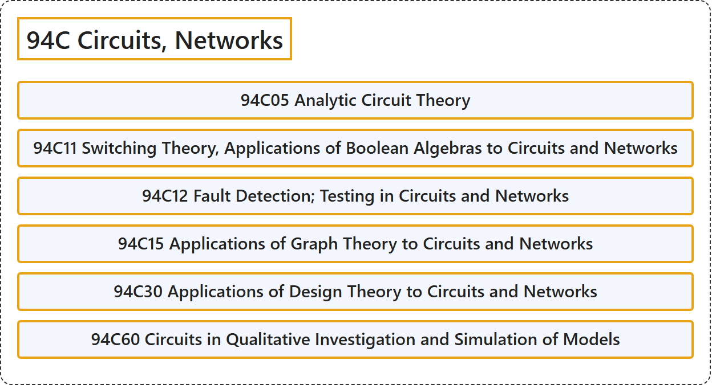

# 94C Circuits, Networks

## Classification

## Glossary

| Term | Definition | 中文翻译 | Source |
|---|---|---|---|
| **94C Circuits, Networks** 电路、网络 | (No definition) | （无定义） | [Associate Editors of Mathematical Reviews and zbMATH, 2020](https://msc2020.org/) |
| **94C05 Analytic Circuit Theory** 解析电路理论 | (No definition) | （无定义） | [Associate Editors of Mathematical Reviews and zbMATH, 2020](https://msc2020.org/) |
| **94C11 Switching Theory, Applications of Boolean Algebras to Circuits and Networks** 开关理论、布尔代数在电路与网络中的应用 | (No definition) | （无定义） | [Associate Editors of Mathematical Reviews and zbMATH, 2020](https://msc2020.org/) |
| **94C12 Fault Detection; Testing in Circuits and Networks** 电路与网络中的故障检测；测试 | (No definition) | （无定义） | [Associate Editors of Mathematical Reviews and zbMATH, 2020](https://msc2020.org/) |
| **94C15 Applications of Graph Theory to Circuits and Networks** 图论在电路与网络中的应用 | (No definition) | （无定义） | [Associate Editors of Mathematical Reviews and zbMATH, 2020](https://msc2020.org/) |
| **94C30 Applications of Design Theory to Circuits and Networks** 设计理论在电路与网络中的应用 | (No definition) | （无定义） | [Associate Editors of Mathematical Reviews and zbMATH, 2020](https://msc2020.org/) |
| **94C60 Circuits in Qualitative Investigation and Simulation of Models** 模型定性研究与仿真中的电路 | (No definition) | （无定义） | [Associate Editors of Mathematical Reviews and zbMATH, 2020](https://msc2020.org/) |

## References

Associate Editors of Mathematical Reviews and zbMATH. (2020). *MSC2020: Mathematics Subject Classification system*. Retrieved October 27, 2026, from <https://msc2020.org/>
