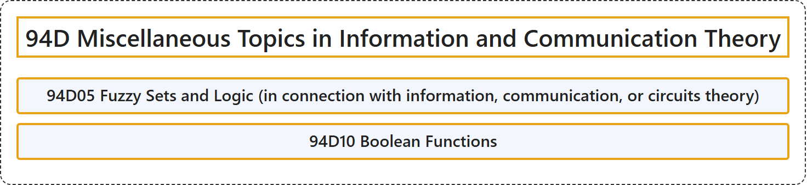

# 94D Miscellaneous Topics in Information and Communication Theory

## Classification

## Glossary

| Term | Definition | 中文翻译 | Source |
|---|---|---|---|
| **94D Miscellaneous Topics in Information and Communication Theory** 信息与通信理论的杂项专题 | (No definition) | （无定义） | [Associate Editors of Mathematical Reviews and zbMATH, 2020](https://msc2020.org/) |
| **94D05 Fuzzy Sets and Logic (in connection with information, communication, or circuits theory)** 模糊集与模糊逻辑（与信息、通信或电路理论相关） | (No definition) | （无定义） | [Associate Editors of Mathematical Reviews and zbMATH, 2020](https://msc2020.org/) |
| **94D10 Boolean Functions** 布尔函数 | (No definition) | （无定义） | [Associate Editors of Mathematical Reviews and zbMATH, 2020](https://msc2020.org/) |

## References

Associate Editors of Mathematical Reviews and zbMATH. (2020). *MSC2020: Mathematics Subject Classification system*. Retrieved October 27, 2026, from <https://msc2020.org/>
