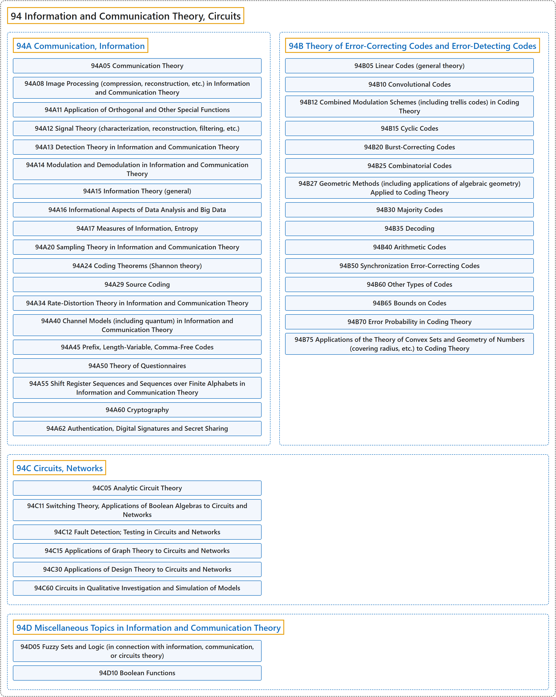

# 94 Information and Communication Theory, Circuits

## Classification

## Glossary

| Term | Definition | 中文翻译 | Source |
|---|---|---|---|
| **94 Information and Communication Theory, Circuits** 信息与通信理论、电路 | "Information theory is the branch of mathematics dealing with **the efficient and accurate storage, transmission, and representation of information**." | 信息论是一个数学分支，处理**信息的高效、准确存储、传输和表示**。 | [Weisstein, n.d., "Information theory" entry, para. 1](https://mathworld.wolfram.com/InformationTheory.html#:~:text=Information%20theory%20is%20the%20branch%20of%20mathematics%20dealing%20with) |
| **[94A Communication, Information](94a-communication-information.md)** 通信、信息 | (No definition) | （无定义） | [Associate Editors of Mathematical Reviews and zbMATH, 2020](https://msc2020.org/) |
| **[94B Theory of Error-Correcting Codes and Error-Detecting Codes](94b-theory-of-error-correcting-codes-and-error-detecting-codes.md)** 纠错码与检错码理论 | (No definition) | （无定义） | [Associate Editors of Mathematical Reviews and zbMATH, 2020](https://msc2020.org/) |
| **[94C Circuits, Networks](94c-circuits-networks.md)** 电路、网络 | (No definition) | （无定义） | [Associate Editors of Mathematical Reviews and zbMATH, 2020](https://msc2020.org/) |
| **[94D Miscellaneous Topics in Information and Communication Theory](94d-miscellaneous-topics-in-information-and-communication-theory.md)** 信息与通信理论的杂项专题 | (No definition) | （无定义） | [Associate Editors of Mathematical Reviews and zbMATH, 2020](https://msc2020.org/) |

## References

Associate Editors of Mathematical Reviews and zbMATH. (2020). *MSC2020: Mathematics Subject Classification system*. Retrieved October 27, 2026, from <https://msc2020.org/>

Weisstein, E. W. (n.d.). *Information theory*. MathWorld: A Wolfram Resource. Retrieved October 27, 2026, from <https://mathworld.wolfram.com/InformationTheory.html>
