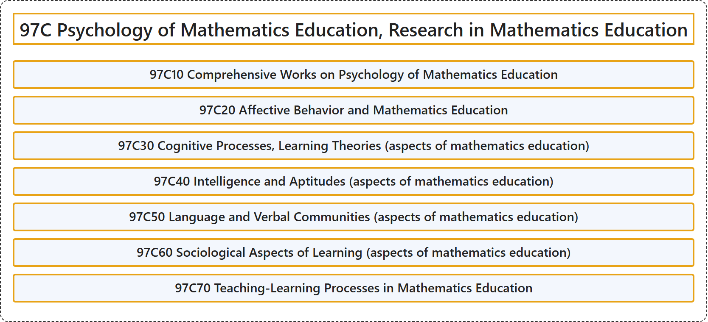

# 97C Psychology of Mathematics Education, Research in Mathematics Education

## Classification

## Glossary

| Term | Definition | 中文翻译 | Source |
|---|---|---|---|
| **97C Psychology of Mathematics Education, Research in Mathematics Education** 数学教育心理学、数学教育研究 | (No definition) | （无定义） | [Associate Editors of Mathematical Reviews and zbMATH, 2020](https://msc2020.org/) |
| **97C10 Comprehensive Works on Psychology of Mathematics Education** 数学教育心理学综合著作 | (No definition) | （无定义） | [Associate Editors of Mathematical Reviews and zbMATH, 2020](https://msc2020.org/) |
| **97C20 Affective Behavior and Mathematics Education** 情感行为与数学教育 | (No definition) | （无定义） | [Associate Editors of Mathematical Reviews and zbMATH, 2020](https://msc2020.org/) |
| **97C30 Cognitive Processes, Learning Theories (aspects of mathematics education)** 认知过程、学习理论（数学教育方面） | (No definition) | （无定义） | [Associate Editors of Mathematical Reviews and zbMATH, 2020](https://msc2020.org/) |
| **97C40 Intelligence and Aptitudes (aspects of mathematics education)** 智力与能力倾向（数学教育方面） | (No definition) | （无定义） | [Associate Editors of Mathematical Reviews and zbMATH, 2020](https://msc2020.org/) |
| **97C50 Language and Verbal Communities (aspects of mathematics education)** 语言与言语共同体（数学教育方面） | (No definition) | （无定义） | [Associate Editors of Mathematical Reviews and zbMATH, 2020](https://msc2020.org/) |
| **97C60 Sociological Aspects of Learning (aspects of mathematics education)** 学习的社会学方面（数学教育方面） | (No definition) | （无定义） | [Associate Editors of Mathematical Reviews and zbMATH, 2020](https://msc2020.org/) |
| **97C70 Teaching-Learning Processes in Mathematics Education** 数学教育中的教学过程 | (No definition) | （无定义） | [Associate Editors of Mathematical Reviews and zbMATH, 2020](https://msc2020.org/) |

## References

Associate Editors of Mathematical Reviews and zbMATH. (2020). *MSC2020: Mathematics Subject Classification system*. Retrieved October 27, 2026, from <https://msc2020.org/>
